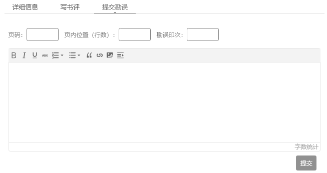

# 资源与支持

本书由异步社区出品，社区（https://www.epubit.com/）为你提供相关资源和后续服务。

配套资源

本书为教师提供如下教学辅助资源：

z 教学PPT 和听课笔记；

z 考试题和参考答案；

z 讨论题和作业；

z 项目说明和指导。

如果您是教师，希望获得教学配套资源，请发邮件到contact@epubit.com.cn 申请，或者在社区本书页面中直接联系本书的责任编辑。

提交勘误

作者和编辑尽最大努力来确保书中内容的准确性，但难免会存在疏漏。欢迎您将发现的问题反馈给我们，帮助我们提升图书的质量。

当您发现错误时，请登录异步社区，按书名搜索，进入本书页面，单击“提交勘误”，输入勘误信息，单击“提交”按钮即可。本书的作者和编辑会对您提交的勘误进行审核，确认并接受后，您将获赠异步社区的100 积分。积分可用于在异步社区兑换优惠券、样书或奖品。

扫码关注本书

扫描下方二维码，您将会在异步社区微信服务号中看到本书信息及相关的服务提示。

与我们联系

我们的联系邮箱是contact@epubit.com.cn。

如果您对本书有任何疑问或建议，请您发邮件给我们，并请在邮件标题中注明本书书名，以便我们更高效地做出反馈。

如果您有兴趣出版图书、录制教学视频，或者参与图书翻译、技术审校等工作，可以发邮件给我们；有意出版图书的作者也可以到异步社区在线提交投稿（直接访问www.epubit.com/selfpublish/submission 即可）。

如果您是学校、培训机构或企业，想批量购买本书或异步社区出版的其他图书，也可以发邮件给我们。

如果您在网上发现有针对异步社区出品图书的各种形式的盗版行为，包括对图书全部或部分内容的非授权传播，请您将怀疑有侵权行为的链接发邮件给我们。您的这一举动是对作者权益的保护，也是我们持续为您提供有价值的内容的动力之源。

关于异步社区和异步图书

“异步社区”是人民邮电出版社旗下IT 专业图书社区，致力于出版精品IT 技术图书和相关学习产品，为作译者提供优质出版服务。异步社区创办于2015 年8 月，提供大量精品IT 技术图书和电子书，以及高品质技术文章和视频课程。更多详情请访问异步社区官网https://www.epubit.com。“异步图书”是由异步社区编辑团队策划出版的精品IT 专业图书的品牌，依托于人民邮电出版社近30 年的计算机图书出版积累和专业编辑团队，相关图书在封面上印有异步图书的LOGO。异步图书的出版领域包括软件开发、大数据、AI、测试、前端、网络技术等。

异步社区微信服务号
