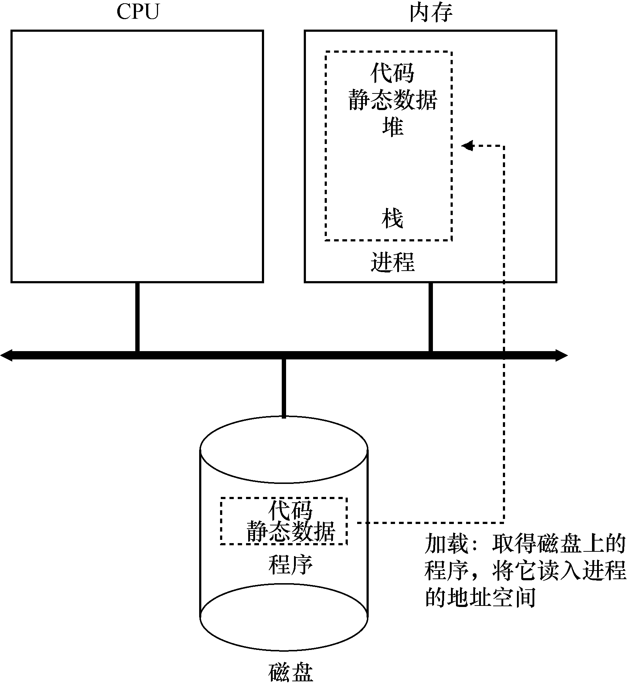

# 4.3 进程创建：更多细节

我们应该揭开一个谜，就是程序如何转化为进程。具体来说，操作系统如何启动并运行一个程序？进程创建实际如何进行？

操作系统运行程序必须做的第一件事是将代码和所有静态数据（例如初始化变量）加载（load）到内存中，加载到进程的地址空间中。程序最初以某种可执行格式驻留在磁盘上（disk，或者在某些现代系统中，在基于闪存的SSD 上）。因此，将程序和静态数据加载到内存中的过程，需要操作系统从磁盘读取这些字节，并将它们放在内存中的某处（见图4.1）。

在早期的（或简单的）操作系统中，加载过程尽早（eagerly）完成，即在运行程序之前全部完成。现代操作系统惰性（lazily）执行该过程，即仅在程序执行期间需要加载的代码或数据片段，才会加载。要真正理解代码和数据的惰性加载是如何工作的，必须更多地了解分页和交换的机制，这是我们将来讨论内存虚拟化时要涉及的主题。现在，只要记住在运行任何程序之前，操作系统显然必须做一些工作，才能将重要的程序字节从磁盘读入内存。

将代码和静态数据加载到内存后，操作系统在运行此进程之前还需要执行其他一些操作。必须为程序的运行时栈（run-time stack 或stack）分配一些内存。你可能已经知道，C程序使用栈存放局部变量、函数参数和返回地址。操作系统分配这些内存，并提供给进程。操作系统也可能会用参数初始化栈。具体来说，它会将参数填入main()函数，即argc 和argv数组。

操作系统也可能为程序的堆（heap）分配一些内存。在C 程序中，堆用于显式请求的动态分配数据。程序通过调用malloc()来请求这样的空间，并通过调用free()来明确地释放它。数据结构（如链表、散列表、树和其他有趣的数据结构）需要堆。起初堆会很小。随着程序运行，通过malloc()库API 请求更多内存，操作系统可能会参与分配更多内存给进程，以满足这些调用。

操作系统还将执行一些其他初始化任务，特别是与输入/输出（I/O）相关的任务。例如，在UNIX 系统中，默认情况下每个进程都有3 个打开的文件描述符（file descriptor），用于标准输入、输出和错误。这些描述符让程序轻松读取来自终端的输入以及打印输出到屏幕。在本书的第3 部分关于持久性（persistence）的知识中，我们将详细了解I/O、文件描述符等。

通过将代码和静态数据加载到内存中，通过创建和初始化栈以及执行与I/O 设置相关的其他工作，OS 现在（终于）为程序执行搭好了舞台。然后它有最后一项任务：启动程序，在入口处运行，即main()。通过跳转到main()例程（第5 章讨论的专门机制），OS 将CPU的控制权转移到新创建的进程中，从而程序开始执行。
