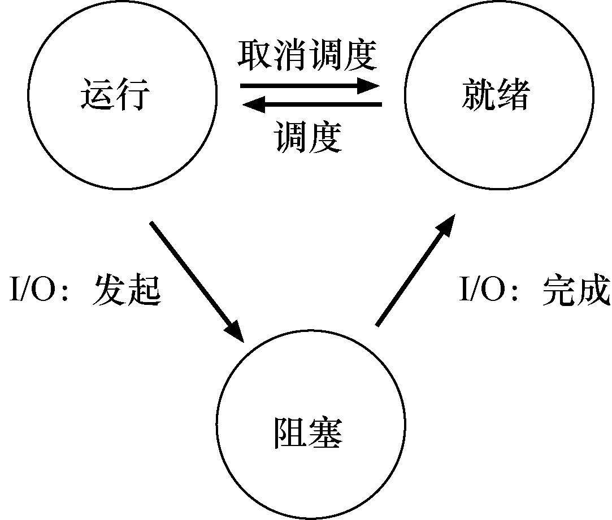
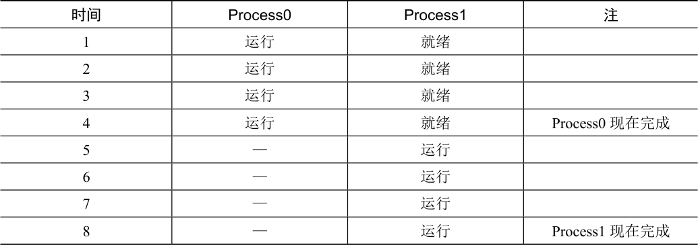
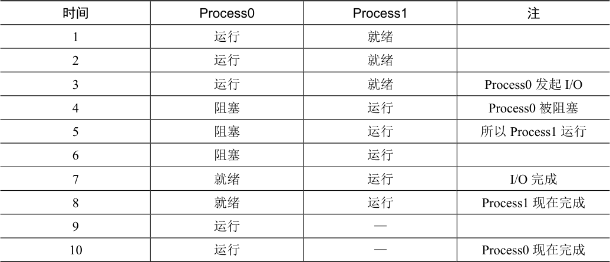

# 4.4 进程状态

既然已经了解了进程是什么（但我们会继续改进这个概念），以及（大致）它是如何创建的，让我们来谈谈进程在给定时间可能处于的不同状态（state）。在早期的计算机系统[DV66，V+65]中，出现了一个进程可能处于这些状态之一的概念。简而言之，进程可以处于以下3 种状态之一。

运行（running）：在运行状态下，进程正在处理器上运行。这意味着它正在执行

指令。

就绪（ready）：在就绪状态下，进程已准备好运行，但由于某种原因，操作系统

选择不在此时运行。

阻塞（blocked）：在阻塞状态下，一个进程执行了某种操作，直到发生其他事件

时才会准备运行。一个常见的例子是，当进程向磁盘发起I/O 请求时，它会被阻塞，

因此其他进程可以使用处理器。

如果将这些状态映射到一个图上，会得到图4.2。如图4.2 所示，可以根据操作系统的载量，让进程在就绪状态和运行状态之间转换。从就绪到运行意味着该进程已经被调度（scheduled）。从运行转移到就绪意味着该进程已经取消调度（descheduled）。一旦进程被阻塞（例如，通过发起I/O 操作），OS 将保持进程的这种状态，直到发生某种事件（例如，I/O 完成）。此时，进程再次转入就绪状态（也可能立即再次运行，如果操作系统这样决定）。

我们来看一个例子，看两个进程如何通过这些状态转换。首先，想象两个正在运行的进程，每个进程只使用CPU（它们没有I/O）。在这种情况下，每个进程的状态可能如表4.1所示。

表格文字

| 时间 | Process0 | Process1 | 注 |
| --- | --- | --- | --- |
| 1 | 运行 | 就绪 |  |
| 2 | 运行 | 就绪 |  |
| 3 | 运行 | 就绪 |  |
| 4 | 运行 | 就绪 | Process0 现在完成 |
| 5 | — | 运行 |  |
| 6 | — | 运行 |  |
| 7 | — | 运行 |  |
| 8 | — | 运行 | Process1 现在完成 |

在下一个例子中，第一个进程在运行一段时间后发起I/O 请求。此时，该进程被阻塞，让另一个进程有机会运行。表4.2 展示了这种场景。

表格文字

| 时间 | Process0 | Process1 | 注 |
| --- | --- | --- | --- |
| 1 | 运行 | 就绪 |  |
| 2 | 运行 | 就绪 |  |
| 3 | 运行 | 就绪 | Process0 发起I/O |
| 4 | 阻塞 | 运行 | Process0 被阻塞 |
| 5 | 阻塞 | 运行 | 所以Process1 运行 |
| 6 | 阻塞 | 运行 |  |
| 7 | 就绪 | 运行 | I/O 完成 |
| 8 | 就绪 | 运行 | Process1 现在完成 |
| 9 | 运行 | — |  |
| 10 | 运行 | — | Process0 现在完成 |

更具体地说，Process0 发起I/O 并被阻塞，等待I/O 完成。例如，当从磁盘读取数据或等待网络数据包时，进程会被阻塞。OS 发现Process0 不使用CPU 并开始运行Process1。当Process1 运行时，I/O 完成，将Process0 移回就绪状态。最后，Process1 结束，Process0 运行，然后完成。

请注意，即使在这个简单的例子中，操作系统也必须做出许多决定。首先，系统必须决定在Process0 发出I/O 时运行Process1。这样做可以通过保持CPU 繁忙来提高资源利用率。其次，当I/O 完成时，系统决定不切换回Process0。目前还不清楚这是不是一个很好的决定。你怎么看？这些类型的决策由操作系统调度程序完成，这是我们在未来几章讨论的主题。
