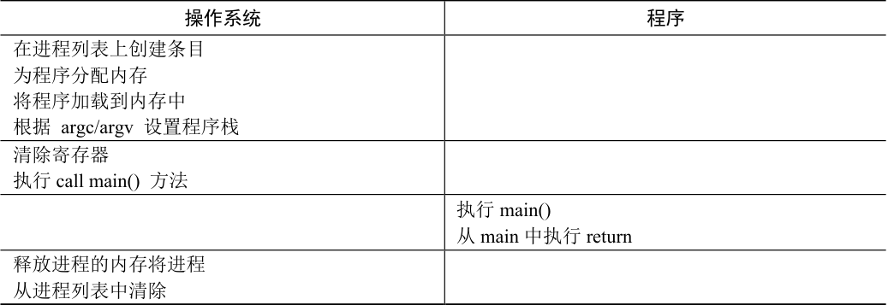

# 6.1 基本技巧：受限直接执行

为了使程序尽可能快地运行，操作系统开发人员想出了一种技术——我们称之为受限的直接执行（limited direct execution）。这个概念的“直接执行”部分很简单：只需直接在CPU上运行程序即可。因此，当OS 希望启动程序运行时，它会在进程列表中为其创建一个进程条目，为其分配一些内存，将程序代码（从磁盘）加载到内存中，找到入口点（main()函数或类似的），跳转到那里，并开始运行用户的代码。表6.1 展示了这种基本的直接执行协议（没有任何限制），使用正常的调用并返回跳转到程序的main()，并在稍后回到内核。

表格文字

| 操作系统 | 程序 |
| --- | --- |
| 在进程列表上创建条目 为程序分配内存 将程序加载到内存中 根据 argc/argv 设置程序栈 |  |
| 清除寄存器 执行call main() 方法 |  |
|  | 执行main() 从main 中执行return |
| 释放进程的内存将进程 从进程列表中清除 |  |

听起来很简单，不是吗？但是，这种方法在我们的虚拟化CPU 时产生了一些问题。第一个问题很简单：如果我们只运行一个程序，操作系统怎么能确保程序不做任何我们不希望它做的事，同时仍然高效地运行它？第二个问题：当我们运行一个进程时，操作系统如何让它停下来并切换到另一个进程，从而实现虚拟化CPU 所需的时分共享？

下面在回答这些问题时，我们将更好地了解虚拟化CPU 需要什么。在开发这些技术时，我们还会看到标题中的“受限”部分来自哪里。如果对运行程序没有限制，操作系统将无法控制任何事情，因此会成为“仅仅是一个库”——对于有抱负的操作系统而言，这真是非常令人悲伤的事！
