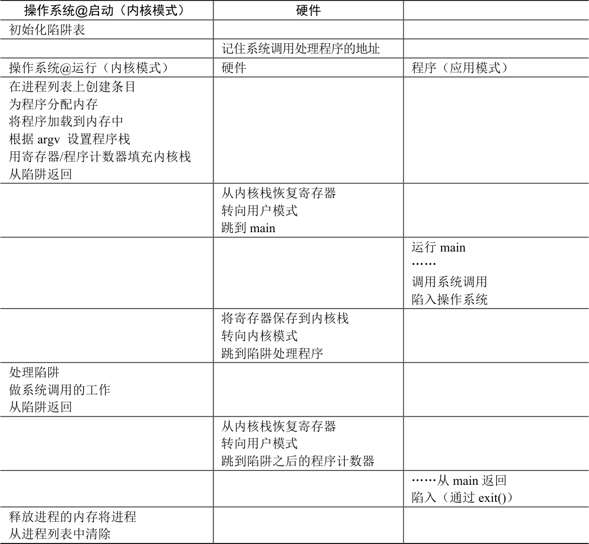

# 6.2 问题1：受限制的操作

直接执行的明显优势是快速。该程序直接在硬件CPU 上运行，因此执行速度与预期的一样快。但是，在CPU 上运行会带来一个问题——如果进程希望执行某种受限操作（如向磁盘发出I/O 请求或获得更多系统资源（如CPU 或内存）），该怎么办？

> **关键问题：如何执行受限制的操作**

> 一个进程必须能够执行I/O 和其他一些受限制的操作，但又不能让进程完全控制系统。操作系统和硬件如何协作实现这一点？

> **提示：采用受保护的控制权转移**

> 硬件通过提供不同的执行模式来协助操作系统。在用户模式（user mode）下，应用程序不能完全访问硬件资源。在内核模式（kernel mode）下，操作系统可以访问机器的全部资源。还提供了陷入（trap）内核和从陷阱返回（return-from-trap）到用户模式程序的特别说明，以及一些指令，让操作系统告诉硬件陷阱表（trap table）在内存中的位置。

对于I/O 和其他相关操作，一种方法就是让所有进程做所有它想做的事情。但是，这样做导致无法构建许多我们想要的系统。例如，如果我们希望构建一个在授予文件访问权限前检查权限的文件系统，就不能简单地让任何用户进程向磁盘发出I/O。如果这样做，一个进程就可以读取或写入整个磁盘，这样所有的保护都会失效。

因此，我们采用的方法是引入一种新的处理器模式，称为用户模式（user mode）。在用户模式下运行的代码会受到限制。例如，在用户模式下运行时，进程不能发出I/O 请求。这样做会导致处理器引发异常，操作系统可能会终止进程。

与用户模式不同的内核模式（kernel mode），操作系统（或内核）就以这种模式运行。在此模式下，运行的代码可以做它喜欢的事，包括特权操作，如发出I/O 请求和执行所有类型的受限指令。

但是，我们仍然面临着一个挑战——如果用户希望执行某种特权操作（如从磁盘读取），应该怎么做？为了实现这一点，几乎所有的现代硬件都提供了用户程序执行系统调用的能力。系统调用是在Atlas [K+61，L78]等古老机器上开创的，它允许内核小心地向用户程序暴露某些关键功能，例如访问文件系统、创建和销毁进程、与其他进程通信，以及分配更多内存。大多数操作系统提供几百个调用（详见POSIX 标准[P10]）。早期的UNIX 系统公开了更简洁的子集，大约20 个调用。

要执行系统调用，程序必须执行特殊的陷阱（trap）指令。该指令同时跳入内核并将特权级别提升到内核模式。一旦进入内核，系统就可以执行任何需要的特权操作（如果允许），从而为调用进程执行所需的工作。完成后，操作系统调用一个特殊的从陷阱返回（return-from-trap）指令，如你期望的那样，该指令返回到发起调用的用户程序中，同时将特权级别降低，回到用户模式。

执行陷阱时，硬件需要小心，因为它必须确保存储足够的调用者寄存器，以便在操作系统发出从陷阱返回指令时能够正确返回。例如，在x86 上，处理器会将程序计数器、标志和其他一些寄存器推送到每个进程的内核栈（kernel stack）上。从返回陷阱将从栈弹出这些值，并恢复执行用户模式程序（有关详细信息，请参阅英特尔系统手册[I11]）。其他硬件系统使用不同的约定，但基本概念在各个平台上是相似的。

> **补充：为什么系统调用看起来像过程调用**

> 你可能想知道，为什么对系统调用的调用（如open()或read()）看起来完全就像C 中的典型过程调用。也就是说，如果它看起来像一个过程调用，系统如何知道这是一个系统调用，并做所有正确的事情？原因很简单：它是一个过程调用，但隐藏在过程调用内部的是著名的陷阱指令。更具体地说，当你调用open()（举个例子）时，你正在执行对C 库的过程调用。其中，无论是对于open()还是提供的其他系统调用，库都使用与内核一致的调用约定来将参数放在众所周知的位置（例如，在栈中或特定的寄存器中），将系统调用号也放入一个众所周知的位置（同样，放在栈或寄存器中），然后执行上述的陷阱指令。库中陷阱之后的代码准备好返回值，并将控制权返回给发出系统调用的程序。因此，C 库中进行系统调用的部分是用汇编手工编码的，因为它们需要仔细遵循约定，以便正确处理参数和返回值，以及执行硬件特定的陷阱指令。现在你知道为什么你自己不必写汇编代码来陷入操作系统了，因为有人已经为你写了这些汇编。

还有一个重要的细节没讨论：陷阱如何知道在OS 内运行哪些代码？显然，发起调用的过程不能指定要跳转到的地址（就像你在进行过程调用时一样），这样做让程序可以跳转到内核中的任意位置，这显然是一个糟糕的主意（想象一下跳到访问文件的代码，但在权限检查之后。实际上，这种能力很可能让一个狡猾的程序员令内核运行任意代码序列[S07]）。因此内核必须谨慎地控制在陷阱上执行的代码。

内核通过在启动时设置陷阱表（trap table）来实现。当机器启动时，它在特权（内核）模式下执行，因此可以根据需要自由配置机器硬件。操作系统做的第一件事，就是告诉硬件在发生某些异常事件时要运行哪些代码。例如，当发生硬盘中断，发生键盘中断或程序进行系统调用时，应该运行哪些代码？操作系统通常通过某种特殊的指令，通知硬件这些陷阱处理程序的位置。一旦硬件被通知，它就会记住这些处理程序的位置，直到下一次重新启动机器，并且硬件知道在发生系统调用和其他异常事件时要做什么（即跳转到哪段代码）。

最后再插一句：能够执行指令来告诉硬件陷阱表的位置是一个非常强大的功能。因此，你可能已经猜到，这也是一项特权（privileged）操作。如果你试图在用户模式下执行这个指令，硬件不会允许，你可能会猜到会发生什么（提示：再见，违规程序）。思考问题：如果可以设置自己的陷阱表，你可以对系统做些什么？你能接管机器吗？

时间线（随着时间的推移向下，在表6.2 中）总结了该协议。我们假设每个进程都有一个内核栈，在进入内核和离开内核时，寄存器（包括通用寄存器和程序计数器）分别被保存和恢复。

表格文字

| 操作系统@启动（内核模式） | 硬件 |  |
| --- | --- | --- |
| 初始化陷阱表 |  |  |
|  | 记住系统调用处理程序的地址 |  |
| 操作系统@运行（内核模式） | 硬件 | 程序（应用模式） |
| 在进程列表上创建条目 为程序分配内存 将程序加载到内存中 根据argv 设置程序栈 用寄存器/程序计数器填充内核栈 从陷阱返回 |  |  |
|  | 从内核栈恢复寄存器 转向用户模式 跳到main |  |
|  |  | 运行main …… 调用系统调用 陷入操作系统 |
|  | 将寄存器保存到内核栈 转向内核模式 跳到陷阱处理程序 |  |
| 处理陷阱 做系统调用的工作 从陷阱返回 |  |  |
|  | 从内核栈恢复寄存器 转向用户模式 跳到陷阱之后的程序计数器 |  |
|  |  | ……从main 返回 陷入（通过exit()） |
| 释放进程的内存将进程 从进程列表中清除 |  |  |

LDE 协议有两个阶段。第一个阶段（在系统引导时），内核初始化陷阱表，并且CPU 记住它的位置以供随后使用。内核通过特权指令来执行此操作（所有特权指令均以粗体突出显示）。第二个阶段（运行进程时），在使用从陷阱返回指令开始执行进程之前，内核设置了一些内容（例如，在进程列表中分配一个节点，分配内存）。这会将CPU 切换到用户模式并开始运行该进程。当进程希望发出系统调用时，它会重新陷入操作系统，然后再次通过从陷阱返回，将控制权还给进程。该进程然后完成它的工作，并从main()返回。这通常会返回到一些存根代码，它将正确退出该程序（例如，通过调用exit()系统调用，这将陷入OS 中）。此时，OS 清理干净，任务完成了。
