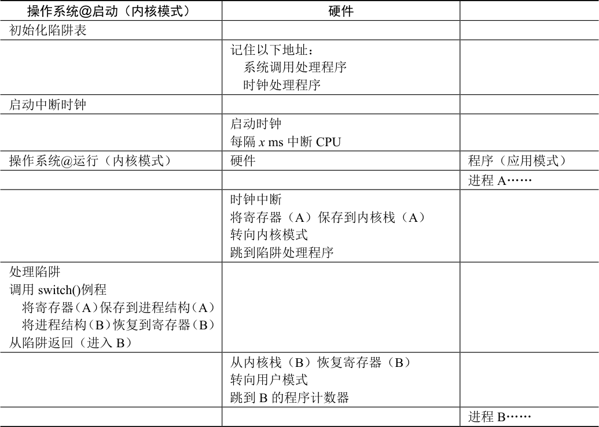

# 6.3 问题2：在进程之间切换

直接执行的下一个问题是实现进程之间的切换。在进程之间切换应该很简单，对吧？操作系统应该决定停止一个进程并开始另一个进程。有什么大不了的？但实际上这有点棘手，特别是，如果一个进程在CPU 上运行，这就意味着操作系统没有运行。如果操作系统没有运行，它怎么能做事情？（提示：它不能）虽然这听起来几乎是哲学，但这是真正的问题——如果操作系统没有在CPU 上运行，那么操作系统显然没有办法采取行动。因此，我们遇到了关键问题。

> **关键问题：如何重获CPU 的控制权**

> 操作系统如何重新获得CPU 的控制权（regain control），以便它可以在进程之间切换？

## 协作方式：等待系统调用

过去某些系统采用的一种方式（例如，早期版本的Macintosh 操作系统[M11]或旧的Xerox Alto 系统[A79]）称为协作（cooperative）方式。在这种风格下，操作系统相信系统的进程会合理运行。运行时间过长的进程被假定会定期放弃CPU，以便操作系统可以决定运行其他任务。

因此，你可能会问，在这个虚拟的世界中，一个友好的进程如何放弃CPU？事实证明，大多数进程通过进行系统调用，将CPU 的控制权转移给操作系统，例如打开文件并随后读取文件，或者向另一台机器发送消息或创建新进程。像这样的系统通常包括一个显式的yield 系统调用，它什么都不干，只是将控制权交给操作系统，以便系统可以运行其他进程。

> **提示：处理应用程序的不当行为**

> 操作系统通常必须处理不当行为，这些程序通过设计（恶意）或不小心（错误），尝试做某些不应该做的事情。在现代系统中，操作系统试图处理这种不当行为的方式是简单地终止犯罪者。一击出局！也许有点残酷，但如果你尝试非法访问内存或执行非法指令，操作系统还应该做些什么？

如果应用程序执行了某些非法操作，也会将控制转移给操作系统。例如，如果应用程序以0 为除数，或者尝试访问应该无法访问的内存，就会陷入（trap）操作系统。操作系统将再次控制CPU（并可能终止违规进程）。

因此，在协作调度系统中，OS 通过等待系统调用，或某种非法操作发生，从而重新获得CPU 的控制权。你也许会想：这种被动方式不是不太理想吗？例如，如果某个进程（无论是恶意的还是充满缺陷的）进入无限循环，并且从不进行系统调用，会发生什么情况？那时操作系统能做什么？

## 非协作方式：操作系统进行控制

事实证明，没有硬件的额外帮助，如果进程拒绝进行系统调用（也不出错），从而将控制权交还给操作系统，那么操作系统无法做任何事情。事实上，在协作方式中，当进程陷入无限循环时，唯一的办法就是使用古老的解决方案来解决计算机系统中的所有问题——重新启动计算机。因此，我们又遇到了请求获得CPU 控制权的一个子问题。

> **关键问题：如何在没有协作的情况下获得控制权**

> 即使进程不协作，操作系统如何获得CPU 的控制权？操作系统可以做什么来确保流氓进程不会占用机器？

答案很简单，许多年前构建计算机系统的许多人都发现了：时钟中断（timer interrupt）[M+63]。时钟设备可以编程为每隔几毫秒产生一次中断。产生中断时，当前正在运行的进程停止，操作系统中预先配置的中断处理程序（interrupt handler）会运行。此时，操作系统重新获得CPU 的控制权，因此可以做它想做的事：停止当前进程，并启动另一个进程。

> **提示：利用时钟中断重新获得控制权**

> 即使进程以非协作的方式运行，添加时钟中断（timer interrupt）也让操作系统能够在CPU 上重新运行。因此，该硬件功能对于帮助操作系统维持机器的控制权至关重要。

首先，正如我们之前讨论过的系统调用一样，操作系统必须通知硬件哪些代码在发生时钟中断时运行。因此，在启动时，操作系统就是这样做的。其次，在启动过程中，操作系统也必须启动时钟，这当然是一项特权操作。一旦时钟开始运行，操作系统就感到安全了，因为控制权最终会归还给它，因此操作系统可以自由运行用户程序。时钟也可以关闭（也是特权操作），稍后更详细地理解并发时，我们会讨论。

请注意，硬件在发生中断时有一定的责任，尤其是在中断发生时，要为正在运行的程序保存足够的状态，以便随后从陷阱返回指令能够正确恢复正在运行的程序。这一组操作与硬件在显式系统调用陷入内核时的行为非常相似，其中各种寄存器因此被保存（进入内核栈），因此从陷阱返回指令可以容易地恢复。

## 保存和恢复上下文

既然操作系统已经重新获得了控制权，无论是通过系统调用协作，还是通过时钟中断更强制执行，都必须决定：是继续运行当前正在运行的进程，还是切换到另一个进程。这个决定是由调度程序（scheduler）做出的，它是操作系统的一部分。我们将在接下来的几章中详细讨论调度策略。

如果决定进行切换，OS 就会执行一些底层代码，即所谓的上下文切换（context switch）。上下文切换在概念上很简单：操作系统要做的就是为当前正在执行的进程保存一些寄存器的值（例如，到它的内核栈），并为即将执行的进程恢复一些寄存器的值（从它的内核栈）。这样一来，操作系统就可以确保最后执行从陷阱返回指令时，不是返回到之前运行的进程，而是继续执行另一个进程。

为了保存当前正在运行的进程的上下文，操作系统会执行一些底层汇编代码，来保存通用寄存器、程序计数器，以及当前正在运行的进程的内核栈指针，然后恢复寄存器、程序计数器，并切换内核栈，供即将运行的进程使用。通过切换栈，内核在进入切换代码调用时，是一个进程（被中断的进程）的上下文，在返回时，是另一进程（即将执行的进程）的上下文。当操作系统最终执行从陷阱返回指令时，即将执行的进程变成了当前运行的进程。至此上下文切换完成。

表6.3 展示了整个过程的时间线。在这个例子中，进程A 正在运行，然后被中断时钟中断。硬件保存它的寄存器（在内核栈中），并进入内核（切换到内核模式）。在时钟中断处理程序中，操作系统决定从正在运行的进程A 切换到进程B。此时，它调用switch()例程，该例程仔细保存当前寄存器的值（保存到A 的进程结构），恢复寄存器进程B（从它的进程结构），然后切换上下文（switch context），具体来说是通过改变栈指针来使用B 的内核栈（而不是A 的）。最后，操作系统从陷阱返回，恢复B 的寄存器并开始运行它。



<details markdown="1">
<summary>表格文字</summary>

| 操作系统@启动（内核模式） | 硬件 |  |
| --- | --- | --- |
| 初始化陷阱表 |  |  |
|  | 记住以下地址： 系统调用处理程序 时钟处理程序 |  |
| 启动中断时钟 |  |  |
|  | 启动时钟 每隔x ms 中断CPU |  |
| 操作系统@运行（内核模式） | 硬件 | 程序（应用模式） |
|  |  | 进程A…… |
|  | 时钟中断 将寄存器（A）保存到内核栈（A） 转向内核模式 跳到陷阱处理程序 |  |
| 处理陷阱 调用switch()例程 将寄存器（A）保存到进程结构（A） 将进程结构（B）恢复到寄存器（B） 从陷阱返回（进入B） |  |  |
|  | 从内核栈（B）恢复寄存器（B） 转向用户模式 跳到B 的程序计数器 |  |
|  |  | 进程B…… |

</details>

请注意，在此协议中，有两种类型的寄存器保存/恢复。第一种是发生时钟中断的时候。在这种情况下，运行进程的用户寄存器由硬件隐式保存，使用该进程的内核栈。第二种是当操作系统决定从A 切换到B。在这种情况下，内核寄存器被软件（即OS）明确地保存，但这次被存储在该进程的进程结构的内存中。后一个操作让系统从好像刚刚由A 陷入内核，变成好像刚刚由B 陷入内核。

为了让你更好地了解如何实现这种切换，图6.1 给出了xv6 的上下文切换代码。看看你是否能理解它（你必须知道一点x86 和一点xv6）。context 结构old 和new 分别在老的和新的进程的进程结构中。

```c
# void swtch(struct context **old, struct context *new);
#
# Save current register context in old
# and then load register context from new.
.globl swtch
swtch:
  # Save old registers
  movl 4(%esp), %eax # put old ptr into eax
  popl 0(%eax)        # save the old IP
  movl %esp, 4(%eax) # and stack
  movl %ebx, 8(%eax) # and other registers
  movl %ecx, 12(%eax)
  movl %edx, 16(%eax)
  movl %esi, 20(%eax)
  movl %edi, 24(%eax)
  movl %ebp, 28(%eax)

  # Load new registers
  movl 4(%esp), %eax # put new ptr into eax
  movl 28(%eax), %ebp # restore other registers
  movl 24(%eax), %edi
  movl 20(%eax), %esi
  movl 16(%eax), %edx
  movl 12(%eax), %ecx
  movl 8(%eax), %ebx
  movl 4(%eax), %esp  # stack is switched here
  pushl 0(%eax)       # return addr put in place
  ret                 # finally return into new ctxt
```

*图6.1 xv6 的上下文切换代码*
