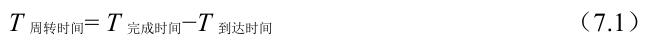

# 7.2 调度指标

除了做出工作负载假设之外，还需要一个东西能让我们比较不同的调度策略：调度指标。指标是我们用来衡量某些东西的东西，在进程调度中，有一些不同的指标是有意义的。

现在，让我们简化一下生活，只用一个指标：周转时间（turnaround time）。任务的周转时间定义为任务完成时间减去任务到达系统的时间。更正式的周转时间定义T 周转时间是：

因为我们假设所有的任务在同一时间到达，那么T 到达时间= 0，因此T 周转时间= T 完成时间。随着我们放宽上述假设，这个情况将改变。

你应该注意到，周转时间是一个性能（performance）指标，这将是本章的首要关注点。另一个有趣的指标是公平（fairness），比如Jian's Fairness Index[J91]。性能和公平在调度系统中往往是矛盾的。例如，调度程序可以优化性能，但代价是以阻止一些任务运行，这就降低了公平。这个难题也告诉我们，生活并不总是完美的。
