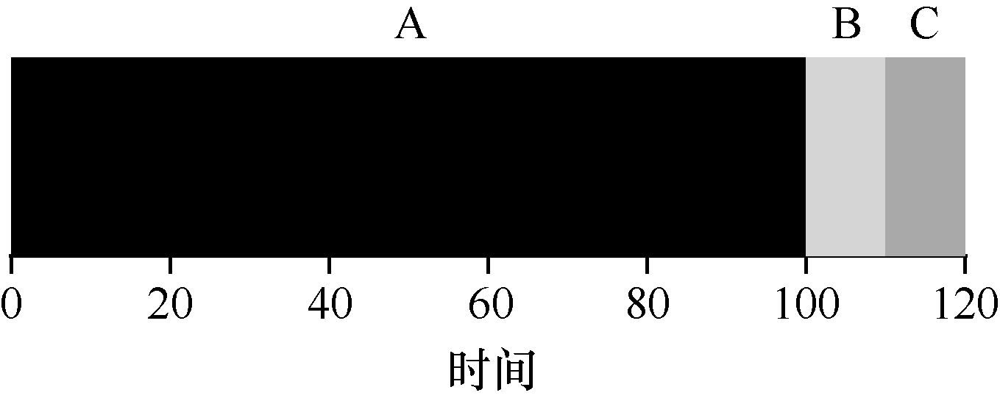
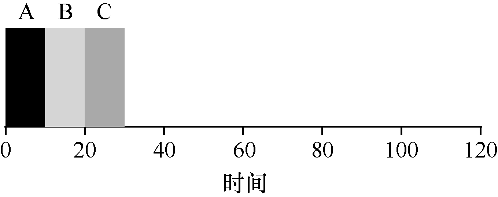

# 7.3 先进先出（FIFO）

我们可以实现的最基本的算法，被称为先进先出（First In First Out 或FIFO）调度，有时候也称为先到先服务（First Come First Served 或FCFS）。

FIFO 有一些积极的特性：它很简单，而且易于实现。而且，对于我们的假设，它的效果很好。

我们一起看一个简单的例子。想象一下，3 个工作A、B 和C 在大致相同的时间（T 到达时间 = 0）到达系统。因为FIFO 必须将某个工作放在前面，所以我们假设当它们都同时到达时，A 比B 早一点点，然后B 比C 早到达一点点。假设每个工作运行10s。这些工作的平均周转时间（average turnaround time）是多少？

从图7.1 可以看出，A 在10s 时完成，B 在20s 时完成，C 在30s 时完成。因此，这3个任务的平均周转时间就是（10 + 20 + 30）/ 3 = 20。计算周转时间就这么简单。

现在让我们放宽假设。具体来说，让我们放宽假设1，因此不再认为每个任务的运行时间相同。FIFO 表现如何？你可以构建什么样的工作负载来让FIFO 表现不好？（在继续往下读之前，请认真想一下……接着想……想到了么？！）

你现在应该已经弄清楚了，但是以防万一，让我们举个例子来说明不同长度的任务如何导致FIFO 调度的问题。具体来说，我们再次假设3 个任务（A、B 和C），但这次A 运行100s，而B 和C 运行10s。

如图7.2 所示，A 先运行100s，B 或C 才有机会运行。因此，系统的平均周转时间是比较高的：令人不快的110s（（100 + 110 + 120）/ 3 = 110）。

这个问题通常被称为护航效应（convoy effect）[B+79]，一些耗时较少的潜在资源消费者被排在重量级的资源消费者之后。这个调度方案可能让你想起在杂货店只有一个排队队伍的时候，如果看到前面的人装满 3 辆购物车食品并且掏出了支票本，你感觉如何？这会等很长时间[^p68-1]。

> **提示：SJF 原则**

> 最短任务优先代表一个总体调度原则，可以应用于所有系统，只要其中平均客户（或在我们案例中的任务）周转时间很重要。想想你等待的任何队伍：如果有关的机构关心客户满意度，他们可能会考虑到SJF。例如，大超市通常都有一个“零散购物”的通道，以确保仅购买几件东西的购物者，不会堵在为即将到来的冬天而大量购物以做准备的家庭后面。

那么我们该怎么办？如何开发一种更好的算法来处理任务实际运行时间不一样的场景？先考虑一下，然后继续阅读。

[^p68-1]: 在这种情况下建议采取的措施：要么快速切换到另一个队伍，要么深要吸并放松。没错，要气，吸气。这样会变好的，不要担心。
