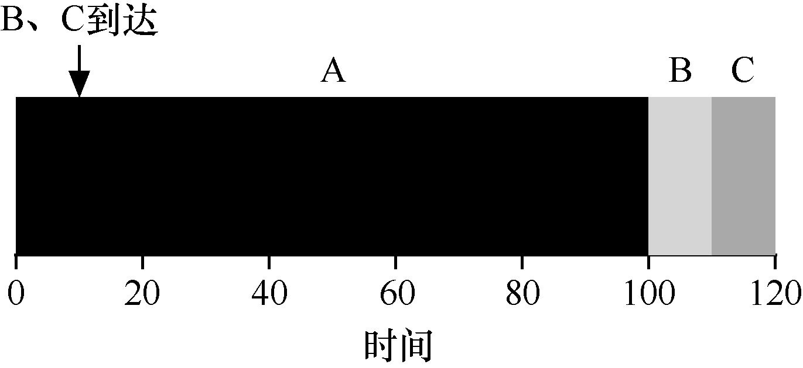
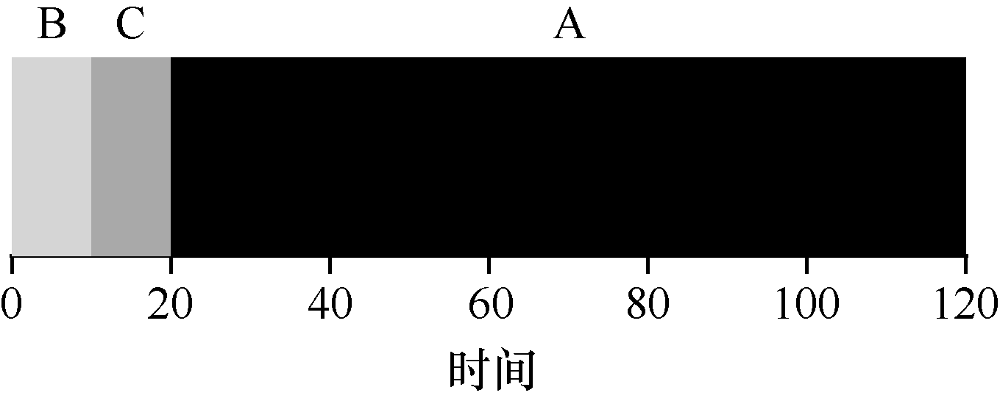

# 7.4 最短任务优先（SJF）

事实证明，一个非常简单的方法解决了这个问题。实际上这是从运筹学中借鉴的一个想法[C54，PV56]，然后应用到计算机系统的任务调度中。这个新的调度准则被称为最短任务优先（Shortest Job First，SJF），该名称应该很容易记住，因为它完全描述了这个策略：先运行最短的任务，然后是次短的任务，如此下去。

我们用上面的例子，但以SJF 作为调度策略。图7.3 展示的是运行A、B 和C 的结果。它清楚地说明了为什么在考虑平均周转时间的情况下，SJF 调度策略更好。仅通过在A 之前运行B 和C，SJF 将平均周转时间从110s 降低到50s（（10 + 20 + 120）/3 = 50）。

事实上，考虑到所有工作同时到达的假设，我们可以证明SJF 确实是一个最优（optimal）调度算法。但是，你是在上操作系统课，而不是研究理论，所以，这里允许没有证明。

> **补充：抢占式调度程序**

> 在过去的批处理计算中，开发了一些非抢占式（non-preemptive）调度程序。这样的系统会将每项工作做完，再考虑是否运行新工作。几乎所有现代化的调度程序都是抢占式的（preemptive），非常愿意停止一个进程以运行另一个进程。这意味着调度程序采用了我们之前学习的机制。特别是调度程序可以进行上下文切换，临时停止一个运行进程，并恢复（或启动）另一个进程。

因此，我们找到了一个用SJF 进行调度的好方法，但是我们的假设仍然是不切实际的。让我们放宽另一个假设。具体来说，我们可以针对假设2，现在假设工作可以随时到达，而不是同时到达。这导致了什么问题？（再次停下来想想……你在想吗？加油，你可以做到）

在这里我们可以再次用一个例子来说明问题。现在，假设A 在t = 0 时到达，且需要运行100s。而B 和C 在t = 10 到达，且各需要运行10s。用纯SJF，我们可以得到如图7.4 所示的调度。

从图中可以看出，即使B 和C 在A 之后不久到达，它们仍然被迫等到A 完成，从而遭遇同样的护航问题。这3 项工作的平均周转时间为103.33s，即（100+（110−10）+（120−10））/3。
