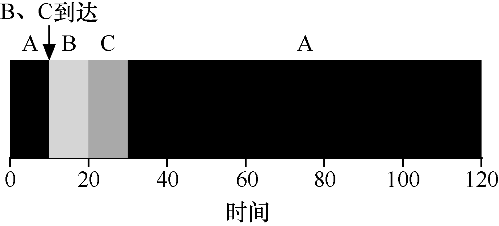

# 7.5 最短完成时间优先（STCF）

为了解决这个问题，需要放宽假设条件（工作必须保持运行直到完成）。我们还需要调度程序本身的一些机制。你可能已经猜到，鉴于我们先前关于时钟中断和上下文切换的讨论，当B 和C 到达时，调度程序当然可以做其他事情：它可以抢占（preempt）工作A，并决定运行另一个工作，或许稍后继续工作A。根据我们的定义，SJF 是一种非抢占式（non-preemptive）调度程序，因此存在上述问题。

幸运的是，有一个调度程序完全就是这样做的：向SJF 添加抢占，称为最短完成时间优先（Shortest Time-to-Completion First，STCF）或抢占式最短作业优先（Preemptive Shortest Job First ，PSJF）调度程序[CK68]。每当新工作进入系统时，它就会确定剩余工作和新工作中，谁的剩余时间最少，然后调度该工作。因此，在我

们的例子中，STCF 将抢占A 并运行B 和C 以完成。只有在它们完成后，才能调度A 的剩余时间。图7.5 展示了一个例子。

结果是平均周转时间大大提高：50s（……）。和以前一样，考虑到我们的新假设，STCF 可证明是最优的。考虑到如果所有工作同时到达，SJF 是最优的，那么你应该能够看到STCF 的最优性是符合直觉的。
