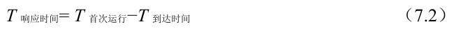

# 7.6 新度量指标：响应时间

因此，如果我们知道任务长度，而且任务只使用CPU，而我们唯一的衡量是周转时间，STCF 将是一个很好的策略。事实上，对于许多早期批处理系统，这些类型的调度算法有一定的意义。然而，引入分时系统改变了这一切。现在，用户将会坐在终端前面，同时也要求系统的交互性好。因此，一个新的度量标准诞生了：响应时间（response time）。

响应时间定义为从任务到达系统到首次运行的时间。更正式的定义是：

例如，如果我们有上面的调度（A 在时间0 到达，B 和C 在时间10 达到），每个作业的响应时间如下：作业A 为0，B 为0，C 为10（平均：3.33）。

你可能会想，STCF 和相关方法在响应时间上并不是很好。例如，如果3 个工作同时到达，第三个工作必须等待前两个工作全部运行后才能运行。这种方法虽然有很好的周转时间，但对于响应时间和交互性是相当糟糕的。假设你在终端前输入，不得不等待10s 才能看到系统的回应，只是因为其他一些工作已经在你之前被调度：你肯定不太开心。

因此，我们还有另一个问题：如何构建对响应时间敏感的调度程序？
