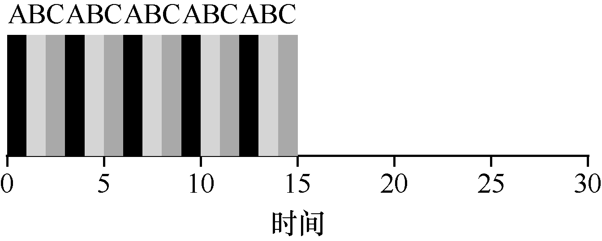
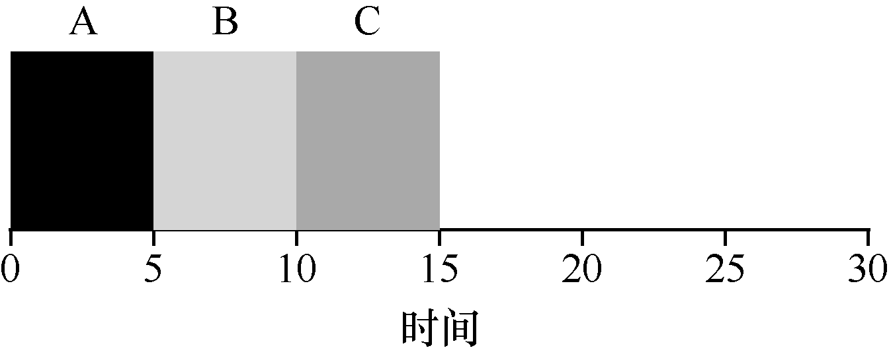

# 7.7 轮转

为了解决这个问题，我们将介绍一种新的调度算法，通常被称为轮转（Round-Robin，RR）调度[K64]。基本思想很简单：RR 在一个时间片（time slice，有时称为调度量子，scheduling quantum）内运行一个工作，然后切换到运行队列中的下一个任务，而不是运行一个任务直到结束。它反复执行，直到所有任务完成。因此，RR 有时被称为时间切片（time-slicing）。请注意，时间片长度必须是时钟中断周期的倍数。因此，如果时钟中断是每10ms 中断一次，则时间片可以是10ms、20ms 或10ms 的任何其他倍数。

为了更详细地理解RR，我们来看一个例子。假设3 个任务A、B 和C 在系统中同时到达，并且它们都希望运行5s。SJF 调度程序必须运行完当前任务才可运行下一个任务（见图7.6）。相比之下，1s 时间片的RR 可以快速地循环工作（见图7.7）。

RR 的平均响应时间是：（0 + 1 + 2）/3 = 1; SJF 算法平均响应时间是：（0 + 5 + 10）/ 3 = 5。

如你所见，时间片长度对于RR 是至关重要的。越短，RR 在响应时间上表现越好。然而，时间片太短是有问题的：突然上下文切换的成本将影响整体性能。因此，系统设计者需要权衡时间片的长度，使其足够长，以便摊销（amortize）上下文切换成本，而又不会使系统不及时响应。

> **提示：摊销可以减少成本**

> 当系统某些操作有固定成本时，通常会使用摊销技术（amortization）。通过减少成本的频度（即执行较少次的操作），系统的总成本就会降低。例如，如果时间片设置为10ms，并且上下文切换时间为1ms，那么浪费大约10%的时间用于上下文切换。如果要摊销这个成本，可以把时间片增加到100ms。在这种情况下，不到1%的时间用于上下文切换，因此时间片带来的成本就被摊销了。

请注意，上下文切换的成本不仅仅来自保存和恢复少量寄存器的操作系统操作。程序运行时，它们在CPU 高速缓存、TLB、分支预测器和其他片上硬件中建立了大量的状态。切换到另一个工作会导致此状态被刷新，且与当前运行的作业相关的新状态被引入，这可能导致显著的性能成本[MB91]。

如果响应时间是我们的唯一指标，那么带有合理时间片的RR，就会是非常好的调度程序。但是我们老朋友的周转时间呢？再来看看我们的例子。A、B 和C，每个运行时间为5s，同时到达，RR 是具有（长）1s 时间片的调度程序。从图7.7 可以看出，A 在13 完成，B 在14，C 在15，平均14。相当可怕！

这并不奇怪，如果周转时间是我们的指标，那么RR 确实是最糟糕的策略之一。直观地说，这应该是有意义的：RR 所做的正是延伸每个工作，只运行每个工作一小段时间，就转向下一个工作。因为周转时间只关心作业何时完成，RR 几乎是最差的，在很多情况下甚至比简单的FIFO 更差。

更一般地说，任何公平（fair）的政策（如RR），即在小规模的时间内将CPU 均匀分配到活动进程之间，在周转时间这类指标上表现不佳。事实上，这是固有的权衡：如果你愿意不公平，你可以运行较短的工作直到完成，但是要以响应时间为代价。如果你重视公平性，则响应时间会较短，但会以周转时间为代价。这种权衡在系统中很常见。你不能既拥有你的蛋糕，又吃它[^p71-1]。

我们开发了两种调度程序。第一种类型（SJF、STCF）优化周转时间，但对响应时间不利。第二种类型（RR）优化响应时间，但对周转时间不利。我们还有两个假设需要放宽：假设4（作业没有I/O）和假设5（每个作业的运行时间是已知的）。接下来我们来解决这些假设。

> **提示：重叠可以提高利用率**

> 如有可能，重叠（overlap）操作可以最大限度地提高系统的利用率。重叠在许多不同的领域很有用，包括执行磁盘I/O 或将消息发送到远程机器时。在任何一种情况下，开始操作然后切换到其他工作都是一个好主意，这也提高了系统的整体利用率和效率。

[^p71-1]: 这是一个迷惑人的说法，因为它应该是“你不能保留你的蛋糕，又吃它”（这很明显，不是吗？）。令人惊讶的是，这个说法有一个维基百科页面。请自行查阅。
