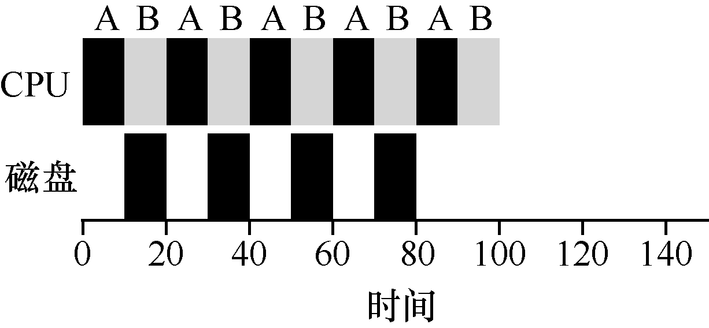
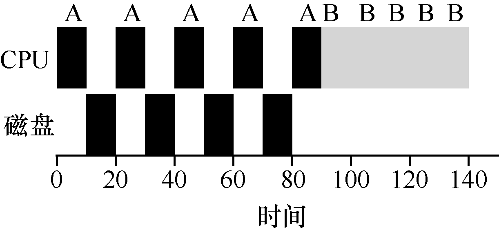

# 7.8 结合I/O

首先，我们将放宽假设4：当然所有程序都执行I/O。想象一下没有任何输入的程序：每次都会产生相同的输出。设想一个没有输出的程序：它就像谚语所说的森林里倒下的树，没有人看到它。它的运行并不重要。

调度程序显然要在工作发起I/O 请求时做出决定，因为当前正在运行的作业在I/O 期间不会使用CPU，它被阻塞等待I/O 完成。如果将I/O 发送到硬盘驱动器，则进程可能会被阻塞几毫秒或更长时间，具体取决于驱动器当前的I/O 负载。因此，这时调度程序应该在CPU上安排另一项工作。

调度程序还必须在I/O 完成时做出决定。发生这种情况时，会产生中断，操作系统运行并将发出I/O 的进程从阻塞状态移回就绪状态。当然，它甚至可以决定在那个时候运行该项工作。操作系统应该如何处理每项工作？

为了更好地理解这个问题，让我们假设有两项工作A 和B，每项工作需要50ms 的CPU时间。但是，有一个明显的区别：A 运行10ms，然后发出I/O 请求（假设I/O 每个都需要10ms），而B 只是使用CPU 50ms，不执行I/O。调度程序先运行A，然后运行B（见图7.8）。

假设我们正在尝试构建STCF 调度程序。这样的调度程序应该如何考虑到这样的事实，即A 分解成5 个10ms 子工作，而B 仅仅是单个50ms CPU 需求？显然，仅仅运行一个工作，然后运行另一个工作，而不考虑如何考虑I/O 是没有意义的。

一种常见的方法是将A 的每个10ms 的子工作视为一项独立的工作。因此，当系统启动时，它的选择是调度10ms 的A，还是50ms 的B。对于STCF，选择是明确的：选择较短的一个，在这种情况下是A。然后，A 的工作已完成，只剩下B，并开始运行。然后提交A的一个新子工作，它抢占B 并运行10ms。这样做可以实现重叠（overlap），一个进程在等待另一个进程的I/O 完成时使用CPU，系统因此得到更好的利用（见图7.9）。

这样我们就看到了调度程序可能如何结合I/O。通过将每个CPU 突发作为一项工作，调度程序确保“交互”的进程经常运行。当这些交互式作业正在执行I/O 时，其他CPU 密集型作业将运行，从而更好地利用处理器。
