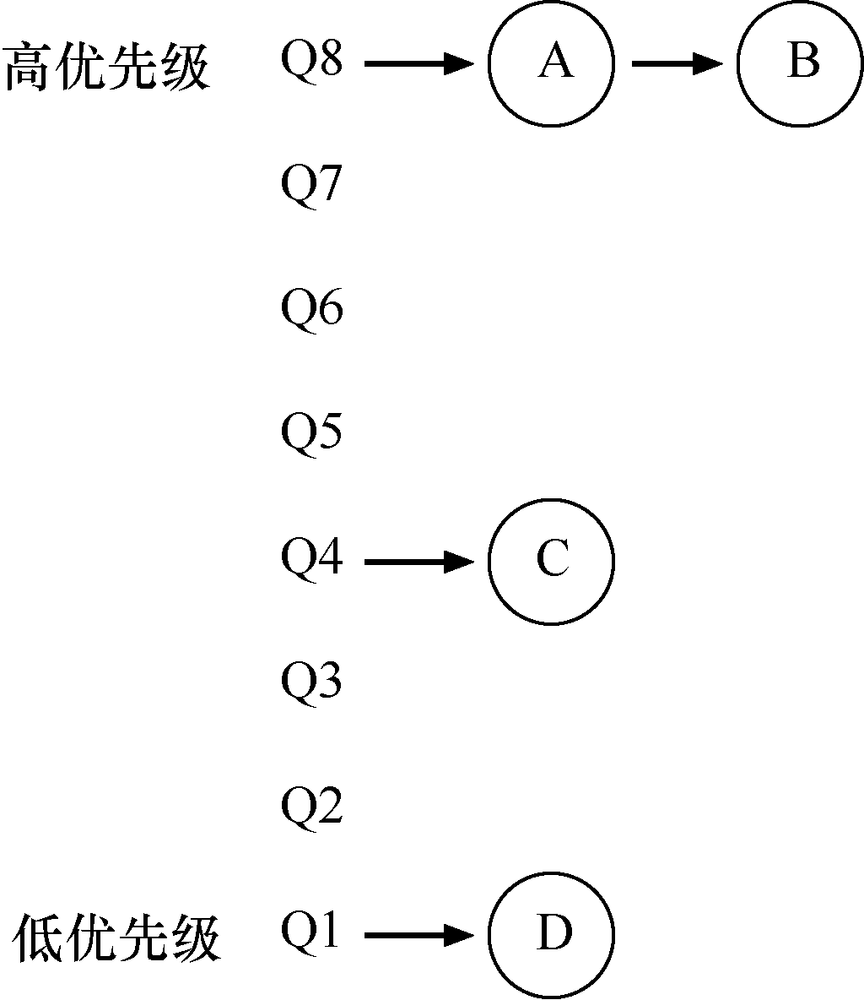

# 8.1 MLFQ：基本规则

为了构建这样的调度程序，本章将介绍多级消息队列背后的基本算法。虽然它有许多不同的实现[E95]，但大多数方法是类似的。

MLFQ 中有许多独立的队列（queue），每个队列有不同的优先级（priority level）。任何时刻，一个工作只能存在于一个队列中。MLFQ 总是优先执行较高优先级的工作（即在较高级队列中的工作）。

当然，每个队列中可能会有多个工作，因此具有同样的优先级。在这种情况下，我们就对这些工作采用轮转调度。

因此，MLFQ 调度策略的关键在于如何设置优先级。MLFQ 没有为每个工作指定不变的优先情绪而已，而是根据观察到的行为调整它的优先级。例如，如果一个工作不断放弃CPU 去等待键盘输入，这是交互型进程的可能行为，MLFQ 因此会让它保持高优先级。相反，如果一个工作长时间地占用CPU，MLFQ 会降低其优先级。通过这种方式，MLFQ 在进程运行过程中学习其行为，从而利用工作的历史来预测它未来的行为。

至此，我们得到了MLFQ 的两条基本规则。

规则1：如果A 的优先级 &gt; B 的优先级，运行A（不运行B）。

规则2：如果A 的优先级 = B 的优先级，轮转运行

A 和B。

如果要在某个特定时刻展示队列，可能会看到如下内容（见图8.1）。图8.1 中，最高优先级有两个工作（A 和B），工作C 位于中等优先级，而D 的优先级最低。按刚才介绍的基本规则，由于A 和B 有最高优先级，调度程序将交替的调度他们，可怜的C 和D 永远都没有机会运行，太气人了！

当然，这只是展示了一些队列的静态快照，并不能让你真正明白MLFQ 的工作原理。我们需要理解工作的优先级如何随时间变化。初次拿起本书阅读一章的人可能会吃惊，这正是我们接下来要做的事。
