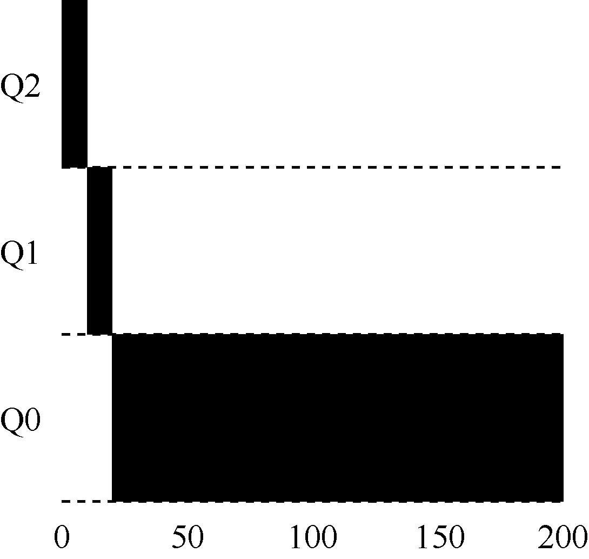
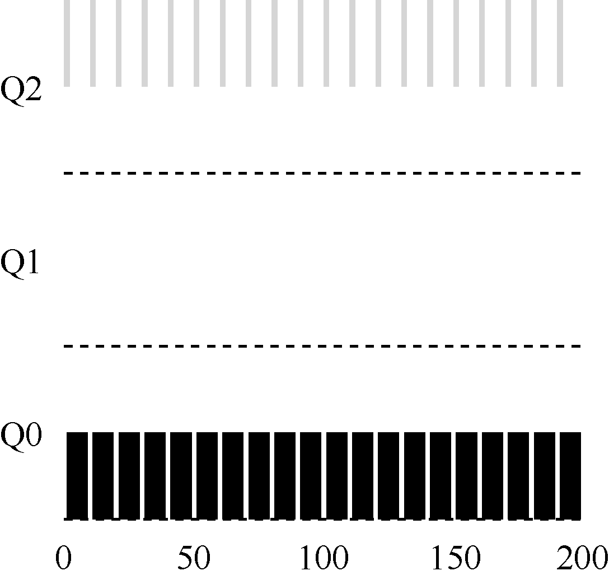
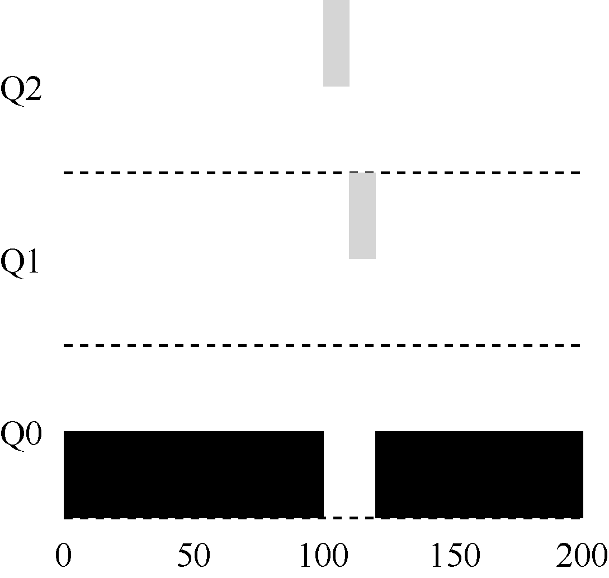

# 8.2 尝试1：如何改变优先级

我们必须决定，在一个工作的生命周期中，MLFQ 如何改变其优先级（在哪个队列中）。要做到这一点，我们必须记得工作负载：既有运行时间很短、频繁放弃CPU 的交互型工作，也有需要很多CPU 时间、响应时间却不重要的长时间计算密集型工作。下面是我们第一次尝试优先级调整算法。

规则3：工作进入系统时，放在最高优先级（最上层队列）。

规则4a：工作用完整个时间片后，降低其优先级（移入下一个队列）。

规则4b：如果工作在其时间片以内主动释放CPU，

则优先级不变。

## 实例1：单个长工作

我们来看一些例子。首先，如果系统中有一个需要长时间运行的工作，看看会发生什么。图8.2 展示了在一个有3 个队列的调度程序中，随着时间的推移，这个工作的运行情况。

从这个例子可以看出，该工作首先进入最高优先级（Q2）。执行一个10ms 的时间片后，调度程序将工作的优先级减1，因此进入Q1。在Q1 执行一个时间片后，最终降低优先级进入系统的最低优先级（Q0），一直留在那里。相当简单，不是吗？

## 实例2：来了一个短工作

再看一个较复杂的例子，看看MLFQ 如何近似SJF。在这个例子中，有两个工作：A是一个长时间运行的CPU 密集型工作，B 是一个运行时间很短的交互型工作。假设A 执行一段时间后B 到达。会发生什么呢？对B 来说，MLFQ 会近似于SJF 吗？

图8.3 展示了这种场景的结果。A（用黑色表示）在最低优先级队列执行（长时间运行的CPU 密集型工作都这样）。B（用灰色表示）在时间T=100 时到达，并被加入最高优先级队列。由于它的运行时间很短（只有20ms），经过两个时间片，在被移入最低优先级队列之前，B 执行完毕。然后A 继续运行（在低优先级）。

通过这个例子，你大概可以体会到这个算法的一个主要目标：如果不知道工作是短工作还是长工作，那么就在开始的时候假设其是短工作，并赋予最高优先级。如果确实是短工作，则很快会执行完毕，否则将被慢慢移入低优先级队列，而这时该工作也被认为是长工作了。通过这种方式，MLFQ 近似于SJF。

## 实例3：如果有I/O 呢

看一个有I/O 的例子。根据上述规则4b，如果进程在时间片用完之前主动放弃CPU，则保持它的优先级不变。这条规则的意图很简单：假设交互型工作中有大量的I/O 操作（比如等待用户的键盘或鼠标输入），它会在时间片用完之前放弃CPU。在这种情况下，我们不想处罚它，只是保持它的优先级不变。

图8.4 展示了这个运行过程，交互型工作B（用灰色表示）每执行1ms 便需要进行I/O操作，它与长时间运行的工作A（用黑色表示）竞争CPU。MLFQ 算法保持B 在最高优先级，因为B 总是让出CPU。如果B 是交互型工作，MLFQ 就进一步实现了它的目标，让交互型工作快速运行。

## 当前MLFQ 的一些问题

至此，我们有了基本的MLFQ。它看起来似乎相当不错，长工作之间可以公平地分享CPU，又能给短工作或交互型工作很好的响应时间。然而，这种算法有一些非常严重的缺点。你能想到吗？（暂停一下，尽量让脑筋转转弯）

首先，会有饥饿（starvation）问题。如果系统有“太多”交互型工作，就会不断占用CPU，导致长工作永远无法得到CPU（它们饿死了）。即使在这种情况下，我们希望这些长工作也能有所进展。

其次，聪明的用户会重写程序，愚弄调度程序（game the scheduler）。愚弄调度程序指的是用一些卑鄙的手段欺骗调度程序，让它给你远超公平的资源。上述算法对如下的攻击束手无策：进程在时间片用完之前，调用一个I/O 操作（比如访问一个无关的文件），从而主动释放CPU。如此便可以保持在高优先级，占用更多的CPU 时间。做得好时（比如，每运行99%的时间片时间就主动放弃一次CPU），工作可以几乎独占CPU。

最后，一个程序可能在不同时间表现不同。一个计算密集的进程可能在某段时间表现为一个交互型的进程。用我们目前的方法，它不会享受系统中其他交互型工作的待遇。
