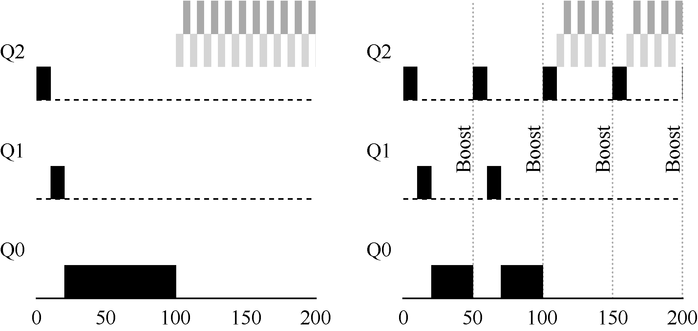

# 8.3 尝试2：提升优先级

让我们试着改变之前的规则，看能否避免饥饿问题。要让CPU 密集型工作也能取得一些进展（即使不多），我们能做些什么？

一个简单的思路是周期性地提升（boost）所有工作的优先级。可以有很多方法做到，但我们就用最简单的：将所有工作扔到最高优先级队列。于是有了如下的新规则。

规则5：经过一段时间S，就将系统中所有工作重新加入最高优先级队列。

新规则一下解决了两个问题。首先，进程不会饿死——在最高优先级队列中，它会以轮转的方式，与其他高优先级工作分享CPU，从而最终获得执行。其次，如果一个CPU 密集型工作变成了交互型，当它优先级提升时，调度程序会正确对待它。

我们来看一个例子。在这种场景下，我们展示长工作与两个交互型短工作竞争CPU 时的行为。图8.5 包含两张图。左边没有优先级提升，长工作在两个短工作到达后被饿死。右边每50ms 就有一次优先级提升（这里只是举例，这个值可能过小），因此至少保证长工作会有一些进展，每过50ms 就被提升到最高优先级，从而定期获得执行。

当然，添加时间段S 导致了明显的问题：S 的值应该如何设置？德高望重的系统研究员John Ousterhout[O11]曾将这种值称为“巫毒常量（voo-doo constant）”，因为似乎需要一些黑魔法才能正确设置。如果S 设置得太高，长工作会饥饿；如果设置得太低，交互型工作又得不到合适的CPU 时间比例。
