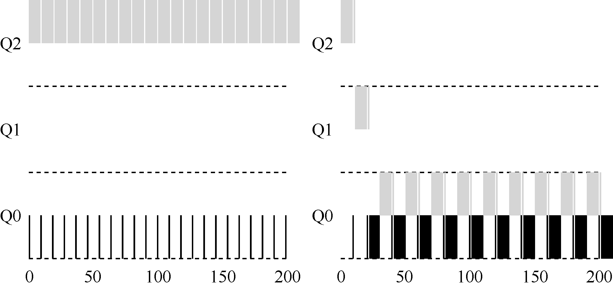

# 8.4 尝试3：更好的计时方式

现在还有一个问题要解决：如何阻止调度程序被愚弄？可以看出，这里的元凶是规则4a 和4b，导致工作在时间片以内释放CPU，就保留它的优先级。那么应该怎么做？

这里的解决方案，是为MLFQ 的每层队列提供更完善的CPU 计时方式（accounting）。调度程序应该记录一个进程在某一层中消耗的总时间，而不是在调度时重新计时。只要进程用完了自己的配额，就将它降到低一优先级的队列中去。不论它是一次用完的，还是拆成很多次用完。因此，我们重写规则4a 和4b。

规则4：一旦工作用完了其在某一层中的时间配额（无论中间主动放弃了多少次

CPU），就降低其优先级（移入低一级队列）。

来看一个例子。图8.6 对比了在规则4a、4b 的策略下（左图），以及在新的规则4（右图）的策略下，同样试图愚弄调度程序的进程的表现。没有规则4 的保护时，进程可以在每个时间片结束前发起一次I/O 操作，从而垄断CPU 时间。有了这样的保护后，不论进程的I/O 行为如何，都会慢慢地降低优先级，因而无法获得超过公平的CPU 时间比例。

