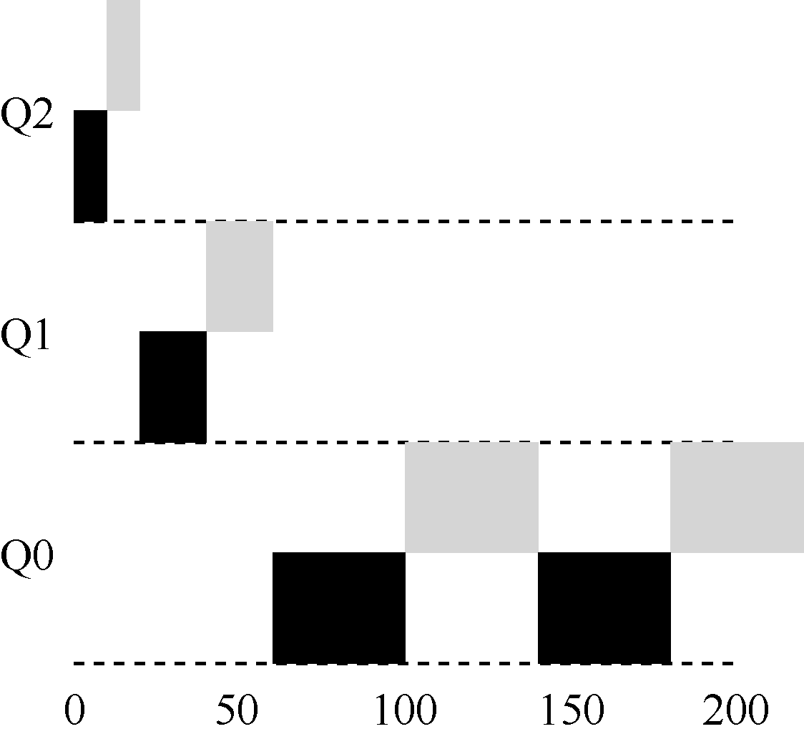

# 8.5 MLFQ 调优及其他问题

关于MLFQ 调度算法还有一些问题。其中一个大问题是如何配置一个调度程序，例如，配置多少队列？每一层队列的时间片配置多大？为了避免饥饿问题以及进程行为改变，应该多久提升一次进程的优先级？这些问题都没有显而易见的答案，因此只有利用对工作负载的经验，以及后续对调度程序的调优，才会导致令人满意的平衡。

例如，大多数的MLFQ 变体都支持不同队列可变的时间片长度。高优先级队列通常只有较短的时间片（比如10ms 或者更少），因而这一层的交互工作可以更快地切换。相反，低优先级队列中更多的是CPU 密集型工作，配置更长的时间片会取得更好的效果。图8.7展示了一个例子，两个长工作在高优先级队列执行10ms，中间队列执行20ms，最后在最低优先级队列执行40ms。

> **提示：避免巫毒常量（Ousterhout 定律）**

> 尽可能避免巫毒常量是个好主意。然而，从上面的例子可以看出，这通常很难。当然，我们也可以让系统自己去学习一个很优化的值，但这同样也不容易。因此，通常我们会有一个写满各种参数值默认值的配置文件，使得系统管理员可以方便地进行修改调整。然而，大多数使用者并不会去修改这些默认值，这时就寄希望于默认值合适了。这个提示是由资深的OS 教授John Ousterhout 提出的，因此称为Ousterhout 定律（Ousterhout’s Law）。

Solaris 的MLFQ 实现（时分调度类TS）很容易配置。它提供了一组表来决定进程在其

生命周期中如何调整优先级，每层的时间片多大，以及多久提升一个工作的优先级[AD00]。管理员可以通过这些表，让调度程序的行为方式不同。该表默认有60 层队列，时间片长度从20ms（最高优先级），到几百ms（最低优先级），每一秒左右提升一次进程的优先级。

其他一些MLFQ 调度程序没用表，甚至没用本章中讲到的规则，有些采用数学公式来调整优先级。例如，FreeBSD 调度程序（4.3 版本），会基于当前进程使用了多少CPU，通过公式计算某个工作的当前优先级[LM+89]。另外，使用量会随时间衰减，这提供了期望的优先级提升，但与这里描述方式不同。阅读Epema 的论文，他漂亮地概括了这种使用量衰减（decay-usage）算法及其特征[E95]。

最后，许多调度程序有一些我们没有提到的特征。例如，有些调度程序将最高优先级队列留给操作系统使用，因此通常的用户工作是无法得到系统的最高优先级的。有些系统允许用户给出优先级设置的建议（advice），比如通过命令行工具nice，可以增加或降低工作的优先级（稍微），从而增加或降低它在某个时刻运行的机会。更多信息请查看man 手册。
