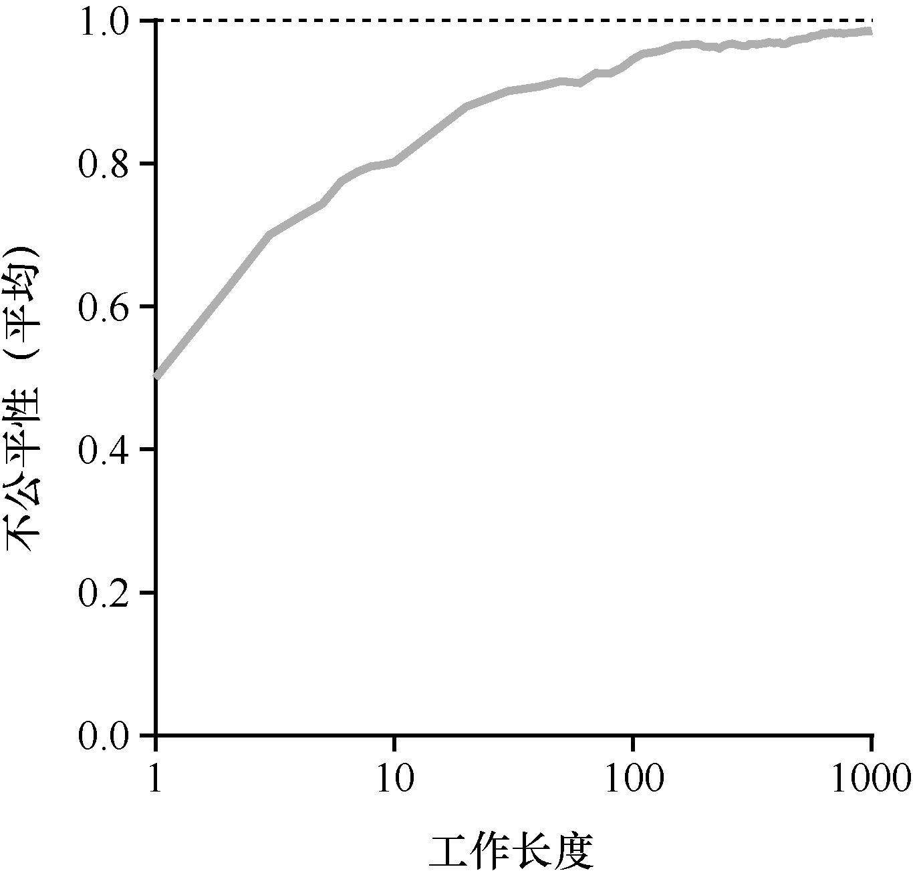

# 9.4 一个例子

为了更好地理解彩票调度的运行过程，我们现在简单研究一下两个互相竞争工作的完成时间，每个工作都有相同数目的100 张彩票，以及相同的运行时间R（稍后会改变）。

这种情况下，我们希望两个工作在大约同时完

成，但由于彩票调度算法的随机性，有时一个工作会先于另一个完成。为了量化这种区别，我们定义了一个简单的不公平指标U（unfairness metric），将两个工作完成时刻相除得到U 的值。比如，运行时间R 为10，第一个工作在时刻10 完成，另一个在20，U=10/20=0.5。如果两个工作几乎同时完成，U的值将很接近于1。在这种情况下，我们的目标是：完美的公平调度程序可以做到U=1。

图9.2 展示了当两个工作的运行时间从1 到1000 变化时，30 次试验的平均U 值（利用本章末尾的模拟器产生的结果）。可以看出，当工作执行时间很短时，平均不公平度非常糟糕。只有当工作执行非常多的时间片时，彩票调度算法才能得到期望的结果。
