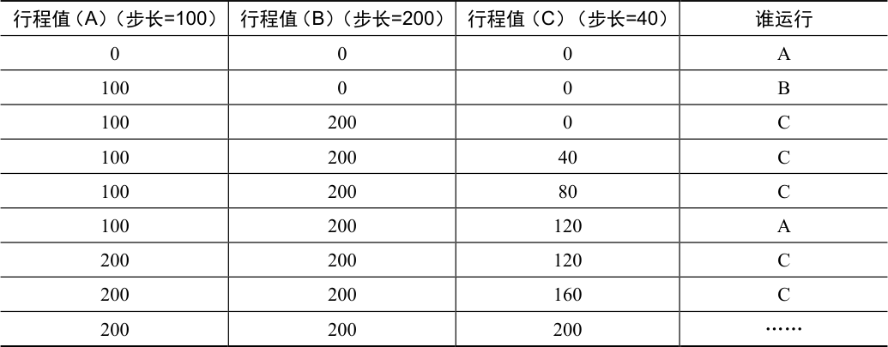

# 9.6 为什么不是确定的

你可能还想知道，究竟为什么要利用随机性？从上面的内容可以看出，虽然随机方式可以使得调度程序的实现简单（且大致正确），但偶尔并不能产生正确的比例，尤其在工作运行时间很短的情况下。由于这个原因，Waldspurger 提出了步长调度（stride scheduling），一个确定性的公平分配算法[W95]。

步长调度也很简单。系统中的每个工作都有自己的步长，这个值与票数值成反比。在上面的例子中，A、B、C 这3 个工作的票数分别是100、50 和250，我们通过用一个大数分别除以他们的票数来获得每个进程的步长。比如用10000 除以这些票数值，得到了3 个进程的步长分别为100、200 和40。我们称这个值为每个进程的步长（stride）。每次进程运行后，我们会让它的计数器 [称为行程（pass）值] 增加它的步长，记录它的总体进展。

之后，调度程序使用进程的步长及行程值来确定调度哪个进程。基本思路很简单：当需要进行调度时，选择目前拥有最小行程值的进程，并且在运行之后将该进程的行程值增加一个步长。下面是Waldspurger[W95]给出的伪代码：

```text
current = remove_min(queue);       // pick client with minimum pass
schedule(current);                 // use resource for quantum
current->pass += current->stride;  // compute next pass using stride
insert(queue, current);            // put back into the queue
```

在我们的例子中，3 个进程（A、B、C）的步长值分别为100、200 和40，初始行程值都为0。因此，最初，所有进程都可能被选择执行。假设选择A（任意的，所有具有同样低的行程值的进程，都可能被选中）。A 执行一个时间片后，更新它的行程值为100。然后运行B，并更新其行程值为200。最后执行C，C 的行程值变为40。这时，算法选择最小的行程值，是C，执行并增加为80（C 的步长是40）。然后C 再次运行（依然行程值最小），行程值增加到120。现在运行A，更新它的行程值为200（现在与B 相同）。然后C 再次连续运行两次，行程值也变为200。此时，所有行程值再次相等，这个过程会无限地重复下去。表9.1 展示了一段时间内调度程序的行为。



<details markdown="1">
<summary>表格文字</summary>

| 行程值（A）（步长=100 | ）行程值（B）（步长=200 | ）行程值（C）（步长=40） | 谁运行 |
| --- | --- | --- | --- |
| 0 | 0 | 0 | A |
| 100 | 0 | 0 | B |
| 100 | 200 | 0 | C |
| 100 | 200 | 40 | C |
| 100 | 200 | 80 | C |
| 100 | 200 | 120 | A |
| 200 | 200 | 120 | C |
| 200 | 200 | 160 | C |
| 200 | 200 | 200 | …… |

</details>

可以看出，C 运行了5 次、A 运行了2 次，B 一次，正好是票数的比例——200、100 和 50。彩票调度算法只能一段时间后，在概率上实现比例，而步长调度算法可以在每个调度周期后做到完全正确。

你可能想知道，既然有了可以精确控制的步长调度算法，为什么还要彩票调度算法呢？好吧，彩票调度有一个步长调度没有的优势——不需要全局状态。假如一个新的进程在上面的步长调度执行过程中加入系统，应该怎么设置它的行程值呢？设置成0 吗？这样的话，它就独占CPU 了。而彩票调度算法不需要对每个进程记录全局状态，只需要用新进程的票数更新全局的总票数就可以了。因此彩票调度算法能够更合理地处理新加入的进程。
