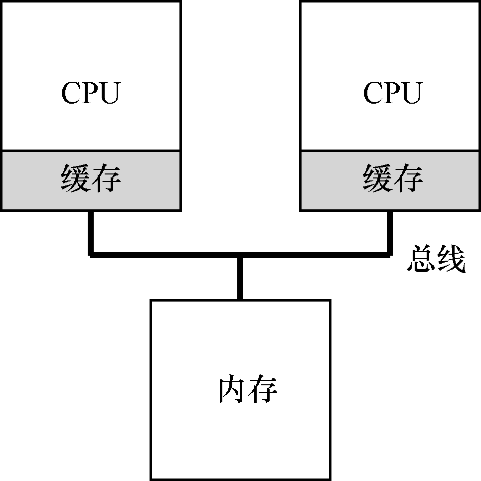

# 10.1 背景：多处理器架构

为了理解多处理器调度带来的新问题，必须先知道它与单CPU 之间的基本区别。区别的核心在于对硬件缓存（cache）的使用（见图10.1），以及多处理器之间共享数据的方式。本章将在较高层面讨论这些问题。更多信息可以其他地方找到[CSG99]，尤其是在高年级或研究生计算机架构课程中。

在单CPU 系统中，存在多级的硬件缓存（hardware cache），一般来说会让处理器更快地执行程序。缓存是很小但很快的存储设备，通常拥有内存中最热的数据的备份。相比之下，内存很大且拥有所有的数据，但访问速度较慢。通过将频繁访问的数据放在缓存中，系统似乎拥有又大又快的内存。

举个例子，假设一个程序需要从内存中加载指令并读取一个值，系统只有一个CPU，拥有较小的缓存（如64KB）和较大的内存。

程序第一次读取数据时，数据在内存中，因此需要花费较长的时间（可能数十或数百纳秒）。处理器判断该数据很可能会被再次使用，因此将其放入CPU 缓存中。如果之后程序再次需要使用同样的数据，CPU 会先查找缓存。因为在缓存中找到了数据，所以取数据快得多（比如几纳秒），程序也就运行更快。

缓存是基于局部性（locality）的概念，局部性有两种，即时间局部性和空间局部性。时间局部性是指当一个数据被访问后，它很有可能会在不久的将来被再次访问，比如循环代码中的数据或指令本身。而空间局部性指的是，当程序访问地址为x 的数据时，很有可能会紧接着访问x 周围的数据，比如遍历数组或指令的顺序执行。由于这两种局部性存在于大多数的程序中，硬件系统可以很好地预测哪些数据可以放入缓存，从而运行得很好。

有趣的部分来了：如果系统有多个处理器，并共享同一个内存，如图10.2 所示，会怎样呢？

事实证明，多CPU 的情况下缓存要复杂得多。例如，假设一个运行在CPU 1 上的程序从内存地址A 读取数据。由于不在CPU 1 的缓存中，所以系统直接访问内存，得到值D。程序然后修改了地址A 处的值，只是将它的缓存更新为新值D'。将数据写回内存比较慢，因此系统（通常）会稍后再做。假设这时操作系统中断了该程序的运行，并将其交给CPU 2，重新读取地址A 的数据，由于CPU 2 的缓存中并没有该数据，所以会直接从内存中读取，得到了旧值D，而不是正确的值D'。哎呀！

这一普遍的问题称为缓存一致性（cache coherence）问题，有大量的研究文献描述了解决这个问题时的微妙之处[SHW11]。这里我们会略过所有的细节，只提几个要点。选一门计算机体系结构课（或3 门），你可以了解更多。

硬件提供了这个问题的基本解决方案：通过监控内存访问，硬件可以保证获得正确的数据，并保证共享内存的唯一性。在基于总线的系统中，一种方式是使用总线窥探（bus snooping）[G83]。每个缓存都通过监听链接所有缓存和内存的总线，来发现内存访问。如果CPU 发现对它放在缓存中的数据的更新，会作废（invalidate）本地副本（从缓存中移除），或更新（update）它（修改为新值）。回写缓存，如上面提到的，让事情更复杂（由于对内存的写入稍后才会看到），你可以想想基本方案如何工作。
