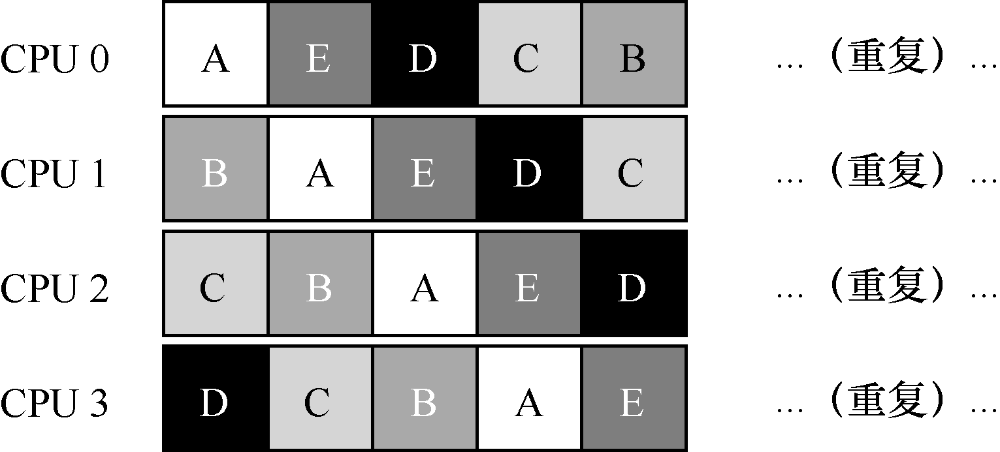
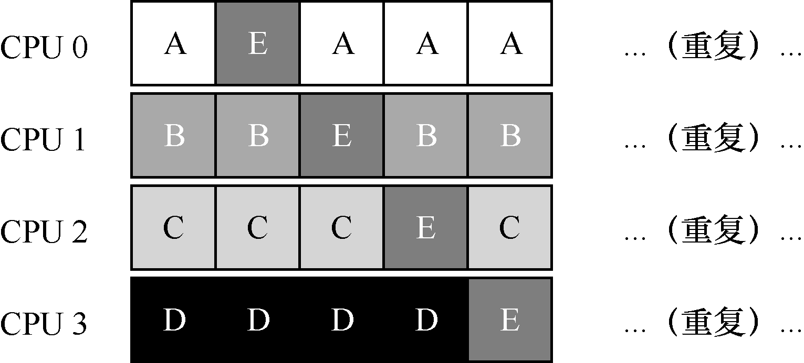

# 10.4 单队列调度

上面介绍了一些背景，现在来讨论如何设计一个多处理器系统的调度程序。最基本的方式是简单地复用单处理器调度的基本架构，将所有需要调度的工作放入一个单独的队列中，我们称之为单队列多处理器调度（Single Queue Multiprocessor Scheduling，SQMS）。这个方法最大的优点是简单。它不需要太多修改，就可以将原有的策略用于多个CPU，选择最适合的工作来运行（例如，如果有两个CPU，它可能选择两个最合适的工作）。

然而，SQMS 有几个明显的短板。第一个是缺乏可扩展性（scalability）。为了保证在多CPU 上正常运行，调度程序的开发者需要在代码中通过加锁（locking）来保证原子性，如上所述。在SQMS 访问单个队列时（如寻找下一个运行的工作），锁确保得到正确的结果。

然而，锁可能带来巨大的性能损失，尤其是随着系统中的CPU 数增加时[A91]。随着这种单个锁的争用增加，系统花费了越来越多的时间在锁的开销上，较少的时间用于系统应该完成的工作（哪天在这里加上真正的测量数据就好了）。

SQMS 的第二个主要问题是缓存亲和性。比如，假设我们有5 个工作（A、B、C、D、E）和4 个处理器。调度队列如下：

一段时间后，假设每个工作依次执行一个时间片，然后选择另一个工作，下面是每个CPU 可能的调度序列：

由于每个CPU 都简单地从全局共享的队列中选取下一个工作执行，因此每个工作都不断在不同CPU 之间转移，这与缓存亲和的目标背道而驰。

为了解决这个问题，大多数SQMS 调度程序都引入了一些亲和度机制，尽可能让进程在同一个CPU 上运行。保持一些工作的亲和度的同时，可能需要牺牲其他工作的亲和度来实现负载均衡。例如，针对同样的5 个工作的调度如下：

这种调度中，A、B、C、D 这4 个工作都保持在同一个CPU 上，只有工作E 不断地来回迁移（migrating），从而尽可能多地获得缓存亲和度。为了公平起见，之后我们可以选择不同的工作来迁移。但实现这种策略可能很复杂。

我们看到，SQMS 调度方式有优势也有不足。优势是能够从单CPU 调度程序很简单地发展而来，根据定义，它只有一个队列。然而，它的扩展性不好（由于同步开销有限），并且不能很好地保证缓存亲和度。
