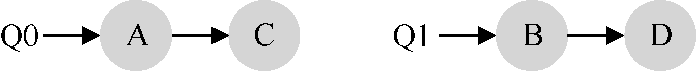
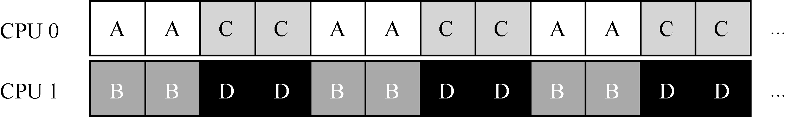
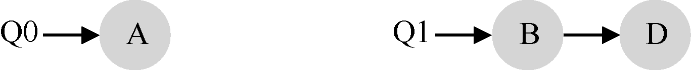
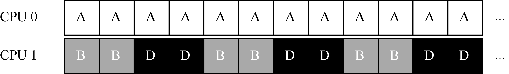
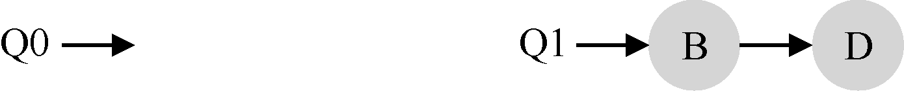
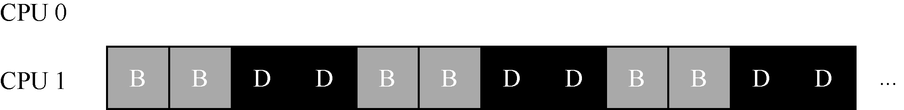
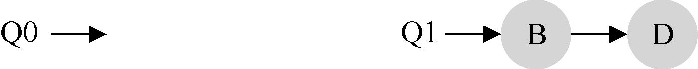
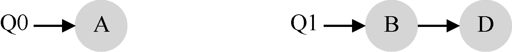
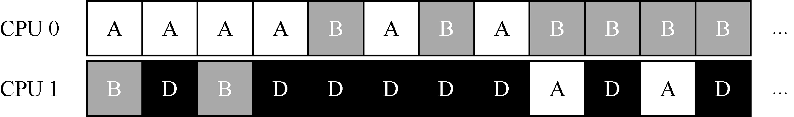

# 10.5 多队列调度

正是由于单队列调度程序的这些问题，有些系统使用了多队列的方案，比如每个CPU一个队列。我们称之为多队列多处理器调度（Multi-Queue Multiprocessor Scheduling，MQMS）

在MQMS 中，基本调度框架包含多个调度队列，每个队列可以使用不同的调度规则，比如轮转或其他任何可能的算法。当一个工作进入系统后，系统会依照一些启发性规则（如随机或选择较空的队列）将其放入某个调度队列。这样一来，每个CPU 调度之间相互独立，就避免了单队列的方式中由于数据共享及同步带来的问题。

例如，假设系统中有两个CPU（CPU 0 和CPU 1）。这时一些工作进入系统：A、B、C和D。由于每个CPU 都有自己的调度队列，操作系统需要决定每个工作放入哪个队列。可能像下面这样做：

根据不同队列的调度策略，每个CPU 从两个工作中选择，决定谁将运行。例如，利用轮转，调度结果可能如下所示：

MQMS 比SQMS 有明显的优势，它天生更具有可扩展性。队列的数量会随着CPU 的增加而增加，因此锁和缓存争用的开销不是大问题。此外，MQMS 天生具有良好的缓存亲和度。所有工作都保持在固定的CPU 上，因而可以很好地利用缓存数据。

但是，如果稍加注意，你可能会发现有一个新问题（这在多队列的方法中是根本的），即负载不均（load imbalance）。假定和上面设定一样（4 个工作，2 个CPU），但假设一个工作（如C）这时执行完毕。现在调度队列如下：

如果对系统中每个队列都执行轮转调度策略，会获得如下调度结果：

从图中可以看出，A 获得了B 和D 两倍的CPU 时间，这不是期望的结果。更糟的是，假设A 和C 都执行完毕，系统中只有B 和D。调度队列看起来如下：

因此CPU 使用时间线看起来令人难过：

所以可怜的多队列多处理器调度程序应该怎么办呢？怎样才能克服潜伏的负载不均问题，打败邪恶的……霸天虎军团[^p96-1]？如何才能不要问这些与这本好书几乎无关的问题？

> **关键问题：如何应对负载不均**

> 多队列多处理器调度程序应该如何处理负载不均问题，从而更好地实现预期的调度目标？

最明显的答案是让工作移动，这种技术我们称为迁移（migration）。通过工作的跨CPU迁移，可以真正实现负载均衡。

来看两个例子就更清楚了。同样，有一个CPU 空闲，另一个CPU 有一些工作。

在这种情况下，期望的迁移很容易理解：操作系统应该将B 或D 迁移到CPU0。这次工作迁移导致负载均衡，皆大欢喜。

更棘手的情况是较早一些的例子，A 独自留在CPU 0 上，B 和D 在CPU 1 上交替运行。

在这种情况下，单次迁移并不能解决问题。应该怎么做呢？答案是不断地迁移一个或多个工作。一种可能的解决方案是不断切换工作，如下面的时间线所示。可以看到，开始的时候A 独享CPU 0，B 和D 在CPU 1。一些时间片后，B 迁移到CPU 0 与A 竞争，D 则独享CPU 1 一段时间。这样就实现了负载均衡。

当然，还有其他不同的迁移模式。但现在是最棘手的部分：系统如何决定发起这样的迁移？

一个基本的方法是采用一种技术，名为工作窃取（work stealing）[FLR98]。通过这种方法，工作量较少的（源）队列不定期地“偷看”其他（目标）队列是不是比自己的工作多。如果目标队列比源队列（显著地）更满，就从目标队列“窃取”一个或多个工作，实现负载均衡。

当然，这种方法也有让人抓狂的地方——如果太频繁地检查其他队列，就会带来较高的开销，可扩展性不好，而这是多队列调度最初的全部目标！相反，如果检查间隔太长，又可能会带来严重的负载不均。找到合适的阈值仍然是黑魔法，这在系统策略设计中很常见。

[^p96-1]: 一个一为人知的事实是，变形金刚的家变塞伯坦星球被糟糕的CPU 调度决策所摧毁。
