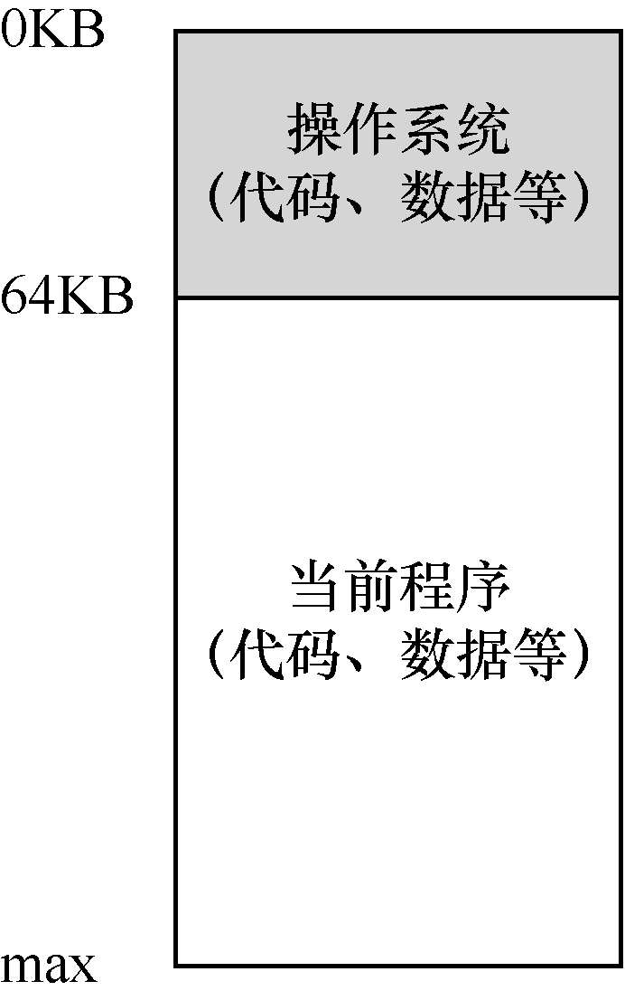

# 13.1 早期系统

从内存来看，早期的机器并没有提供多少抽象给用户。基本上，机器的物理内存看起来如图13.1 所示。

操作系统曾经是一组函数（实际上是一个库），在内存中（在本例中，从物理地址0 开始），然后有一个正在运行的程序（进程），目前在物理内存中（在本例中，从物理地址64KB 开始），并使用剩余的内存。这里几乎没有抽象，用户对操作系统的要求也不多。那时候，操作系统开发人员的生活确实很容易，不是吗？
