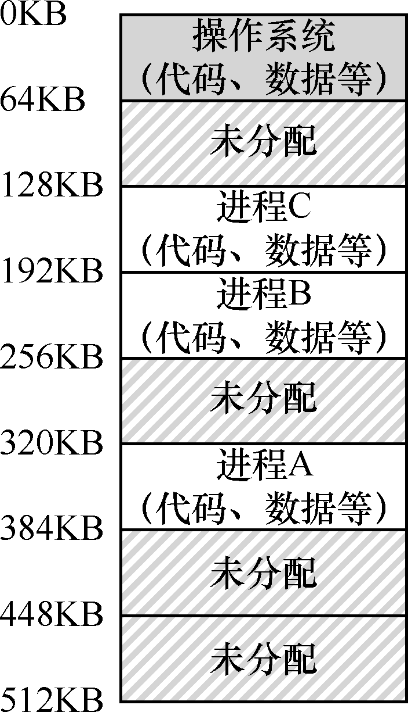

# 13.2 多道程序和时分共享

过了一段时间，由于机器昂贵，人们开始更有效地共享机器。因此，多道程序（multiprogramming）系统时代开启[DV66]，其中多个进程在给定时间准备运行，比如当有一个进程在等待I/O 操作的时候，操作系统会切换这些进程，这样增加了CPU 的有效利用率（utilization）。那时候，效率（efficiency）的提高尤其重要，因为每台机器的成本是数十万美元甚至数百万美元（现在你觉得你的Mac 很贵！）

但很快，人们开始对机器要求更多，分时系统的时代诞生了[S59，L60，M62，M83]。具体来说，许多人意识到批量计算的局限性，尤其是程序员本身[CV65]，他们厌倦了长时间的（因此也是低效率的）编程—调试循环。交互性（interactivity）变得很重要，因为许多用户可能同时在使用机器，每个人都在等待（或希望）他们执行的任务及时响应。

一种实现时分共享的方法，是让一个进程单独占用全部内存运行一小段时间（见图13.1），然后停止它，并将它所有的状态信息保存在磁盘上（包含所有的物理内存），加载其他进程的状态信息，再运行一段时间，这就实现了某种比较粗糙的机器共享[M+63]。

遗憾的是，这种方法有一个问题：太慢了，特别是当内存增长的时候。虽然保存和恢复寄存器级的状态信息（程序计数器、通用寄存器等）相对较

快，但将全部的内存信息保存到磁盘就太慢了。因此，在进程切换的时候，我们仍然将进程信息放在内存中，这样操作系统可以更有效率地实现时分共享（见图13.2）。

在图13.2 中，有3 个进程（A、B、C），每个进程拥有从512KB 物理内存中切出来给它们的一小部分内存。假定只有一个CPU，操作系统选择运行其中一个进程（比如A），同时其他进程（B 和C）则在队列中等待运行。

随着时分共享变得更流行，人们对操作系统又有了新的要求。特别是多个程序同时驻留在内存中，使保护（protection）成为重要问题。人们不希望一个进程可以读取其他进程的内存，更别说修改了。
