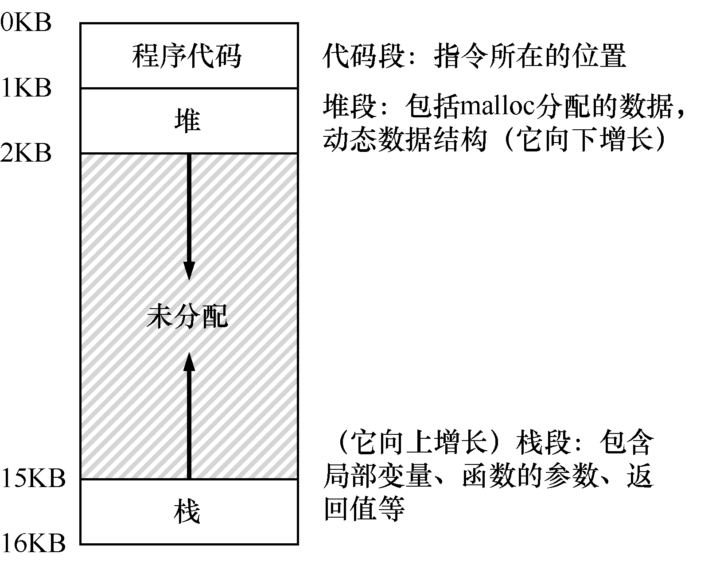

# 13.3 地址空间

然而，我们必须将这些烦人的用户的需求放在心上。因此操作系统需要提供一个易用（easy to use）的物理内存抽象。这个抽象叫作地址空间（address space），是运行的程序看到的系统中的内存。理解这个基本的操作系统内存抽象，是了解内存虚拟化的关键。

一个进程的地址空间包含运行的程序的所有内存状态。比如：程序的代码（code，指令）必须在内存中，因此它们在地址空间里。当程序在运行的时候，利用栈（stack）来保存当前的函数调用信息，分配空间给局部变量，传递参数和函数返回值。最后，堆（heap）用于管理动态分配的、用户管理的内存，就像你从C 语言中调用malloc()或面向对象语言（如C ++或Java）中调用new 获得内存。当然，还有其

他的东西（例如，静态初始化的变量），但现在假设只有这3 个部分：代码、栈和堆。

在图13.3 的例子中，我们有一个很小的地址空间[^p104-1]（只有16KB）。程序代码位于地址空间的顶部（在本例中从0 开始，并且装入到地址空间的前1KB）。代码是静态的（因此很容易放在内存中），所以可以将它放在地址空间的顶部，我们知道程序运行时不再需要新的空间。

接下来，在程序运行时，地址空间有两个区域可能增长（或者收缩）。它们就是堆（在顶部）和栈（在底部）。把它们放在那里，是因为它们都希望能够增长。通过将它们放在地址空间的两端，我们可以允许这样的增长：它们只需要在相反的方向增长。因此堆在代码（1KB）之下开始并向下增长（当用户通过malloc()请求更多内存时），栈从16KB 开始并向上增长（当用户进行程序调用时）。然而，堆栈和堆的这种放置方法只是一种约定，如果你愿意，可以用不同的方式安排地址空间 [稍后我们会看到，当多个线程（threads）在地址空间中共存时，就没有像这样分配空间的好办法了]。

当然，当我们描述地址空间时，所描述的是操作系统提供给运行程序的抽象（abstract）。程序不在物理地址0～16KB 的内存中，而是加载在任意的物理地址。回顾图13.2 中的进程A、B 和C，你可以看到每个进程如何加载到内存中的不同地址。因此问题来了：

> **关键问题：如何虚拟化内存**

> 操作系统如何在单一的物理内存上为多个运行的进程（所有进程共享内存）构建一个私有的、可能很大的地址空间的抽象？

当操作系统这样做时，我们说操作系统在虚拟化内存（virtualizing memory），因为运行的程序认为它被加载到特定地址（例如0）的内存中，并且具有非常大的地址空间（例如32 位或64 位）。现实很不一样。

例如，当图13.2 中的进程A 尝试在地址0（我们将称其为虚拟地址，virtual address）执行加载操作时，然而操作系统在硬件的支持下，出于某种原因，必须确保不是加载到物理地址0，而是物理地址320KB（这是A 载入内存的地址）。这是内存虚拟化的关键，这是世界上每一个现代计算机系统的基础。

> **提示：隔离原则**

> 隔离是建立可靠系统的关键原则。如果两个实体相互隔离，这意味着一个实体的失败不会影响另一个实体。操作系统力求让进程彼此隔离，从而防止相互造成伤害。通过内存隔离，操作系统进一步确保运行程序不会影响底层操作系统的操作。一些现代操作系统通过将某些部分与操作系统的其他部分分离，实现进一步的隔离。这样的微内核（microkernel）[BH70，R+89，S+03] 可以比整体内核提供更大的可靠性。

[^p104-1]: 我们通常会使用这样的小例子，原因有二：①表示32 位地址空间是一种痛苦；②数学计算更难。我们喜欢简单的数学。
