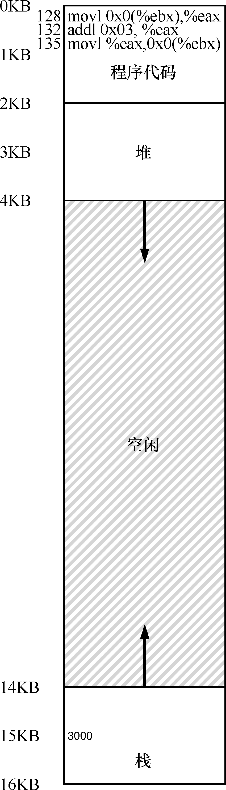
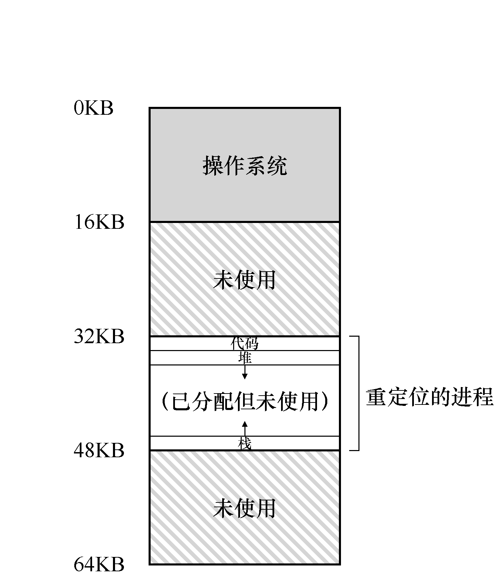

# 15.2 一个例子

为了更好地理解实现地址转换需要什么，以及为什么需要，我们先来看一个简单的例子。设想一个进程的地址空间如图15.1 所示。这里我们要检查一小段代码，它从内存中加载一个值，对它加3，然后将它存回内存。你可以设想，这段代码的C 语言形式可能像这样：

```c
void func() {
    int x;
    x = x + 3; // this is the line of code we are interested in
```

编译器将这行代码转化为汇编语句，可能像下面这样（x86 汇编）。我们可以用Linux的objdump 或者Mac 的otool 将它反汇编：

```text
128: movl 0x0(%ebx), %eax   ;load 0+ebx into eax
132: addl $0x03, %eax       ;add 3 to eax register
135: movl %eax, 0x0(%ebx)   ;store eax back to mem
```

这段代码相对简单，它假定x 的地址已经存入寄存器ebx，之后通过movl 指令将这个地址的值加载到通用寄存器eax（长字移动）。下一条指令对eax 的内容加3。最后一条指令将eax 中的值写回到内存的同一位置。

> **提示：介入（Interposition）很强大**

> 介入是一种很常见又很有用的技术，计算机系统中使用介入常常能带来很好的效果。在虚拟内存中，硬件可以介入到每次内存访问中，将进程提供的虚拟地址转换为数据实际存储的物理地址。但是，一般化的介入技术有更广阔的应用空间，实际上几乎所有良好定义的接口都应该提供功能介入机制，以便增加功能或者在其他方面提升系统。这种方式最基本的优点是透明（transparency），介入完成时通常不需要改动接口的客户端，因此客户端不需要任何改动。

在图15.1 中，可以看到代码和数据都位于进程的地址空间，3 条指令序列位于地址128（靠近头部的代码段），变量x 的值位于地址15KB（在靠近底部的栈中）。如图15.1 所示，x的初始值是3000。

如果这3 条指令执行，从进程的角度来看，发生了以下几次内存访问：

从地址128 获取指令；

执行指令（从地址15KB 加载数据）；

从地址132 获取命令；

执行命令（没有内存访问）；

从地址135 获取指令；

执行指令（新值存入地址15KB）。

从程序的角度来看，它的地址空间（address space）从0 开始到16KB 结束。它包含的所有内存引用都应该在这个范围内。然而，对虚拟内存来说，操作系统希望将这个进程地址空间放在物理内存的其他位置，并不一定从地址0 开始。因此我们遇到了如下问题：怎样在内存中重定位这个进程，同时对该进程透明（transparent）？怎么样提供一种虚拟地址空间从0 开始的假象，而实际上地址空间位于另外某个物理地址？

图15.2 展示了一个例子，说明这个进程的地址空间被放入物理内存后可能的样子。从图15.2 中可以看到，操作系统将第一块物理内存留给了自己，并将上述例子中的进程地址空间重定位到从32KB 开始的物理内存地址。剩下的两块内存空闲（16～32KB 和48～64KB）。




