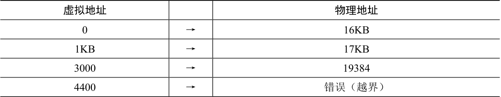

# 15.3 动态（基于硬件）重定位

为了更好地理解基于硬件的地址转换，我们先来讨论它的第一次应用。在20 世纪50年代后期，它在首次出现的时分机器中引入，那时只是一个简单的思想，称为基址加界限机制（base and bound），有时又称为动态重定位（dynamic relocation），我们将互换使用这两个术语[SS74]。

具体来说，每个CPU 需要两个硬件寄存器：基址（base）寄存器和界限（bound）寄存器，有时称为限制（limit）寄存器。这组基址和界限寄存器，让我们能够将地址空间放在物理内存的任何位置，同时又能确保进程只能访问自己的地址空间。

采用这种方式，在编写和编译程序时假设地址空间从零开始。但是，当程序真正执行时，操作系统会决定其在物理内存中的实际加载地址，并将起始地址记录在基址寄存器中。在上面的例子中，操作系统决定加载在物理地址32KB 的进程，因此将基址寄存器设置为这个值。

当进程运行时，有趣的事情发生了。现在，该进程产生的所有内存引用，都会被处理器通过以下方式转换为物理地址：

```text
physical address = virtual address + base
```

> **补充：基于软件的重定位**

> 在早期，在硬件支持重定位之前，一些系统曾经采用纯软件的重定位方式。基本技术被称为静态重定位（static relocation），其中一个名为加载程序（loader）的软件接手将要运行的可执行程序，将它的地址重写到物理内存中期望的偏移位置。

> 例如，程序中有一条指令是从地址1000 加载到寄存器（即movl 1000，%eax），当整个程序的地址空间被加载到从3000（不是程序认为的0）开始的物理地址中，加载程序会重写指令中的地址（即movl 4000, %eax），从而完成简单的静态重定位。

> 然而，静态重定位有许多问题，首先也是最重要的是不提供访问保护，进程中的错误地址可能导致对其他进程或操作系统内存的非法访问，一般来说，需要硬件支持来实现真正的访问保护[WL+93]。静态重定位的另一个缺点是一旦完成，稍后很难将内存空间重定位到其他位置 [M65]。

进程中使用的内存引用都是虚拟地址（virtual address），硬件接下来将虚拟地址加上基址寄存器中的内容，得到物理地址（physical address），再发给内存系统。

为了更好地理解，让我们追踪一条指令执行的情况。具体来看前面序列中的一条指令：

```text
128: movl 0x0(%ebx), %eax
```

程序计数器（PC）首先被设置为128。当硬件需要获取这条指令时，它先将这个值加上基址寄存器中的32KB(32768)，得到实际的物理地址32896，然后硬件从这个物理地址获取指令。接下来，处理器开始执行该指令。这时，进程发起从虚拟地址15KB 的加载，处理器同样将虚拟地址加上基址寄存器内容（32KB），得到最终的物理地址47KB，从而获得需要的数据。

将虚拟地址转换为物理地址，这正是所谓的地址转换（address translation）技术。也就是说，硬件取得进程认为它要访问的地址，将它转换成数据实际位于的物理地址。由于这种重定位是在运行时发生的，而且我们甚至可以在进程开始运行后改变其地址空间，这种技术一般被称为动态重定位（dynamic relocation）[M65]。

> **提示：基于硬件的动态重定位**

> 在动态重定位的过程中，只有很少的硬件参与，但获得了很好的效果。一个基址寄存器将虚拟地址转换为物理地址，一个界限寄存器确保这个地址在进程地址空间的范围内。它们一起提供了既简单又高效的虚拟内存机制。

现在你可能会问，界限（限制）寄存器去哪了？不是基址加界限机制吗？正如你猜测的那样，界限寄存器提供了访问保护。在上面的例子中，界限寄存器被置为16KB。如果进程需要访问超过这个界限或者为负数的虚拟地址，CPU 将触发异常，进程最终可能被终止。界限寄存器的用处在于，它确保了进程产生的所有地址都在进程的地址“界限”中。

这种基址寄存器配合界限寄存器的硬件结构是芯片中的（每个CPU 一对）。有时我们将CPU 的这个负责地址转换的部分统称为内存管理单元（Memory Management Unit，MMU）。随着我们开发更复杂的内存管理技术，MMU 也将有更复杂的电路和功能。

关于界限寄存器再补充一点，它通常有两种使用方式。在一种方式中（像上面那样），它记录地址空间的大小，硬件在将虚拟地址与基址寄存器内容求和前，就检查这个界限。另一种方式是界限寄存器中记录地址空间结束的物理地址，硬件在转化虚拟地址到物理地址之后才去检查这个界限。这两种方式在逻辑上是等价的。简单起见，我们这里假设采用第一种方式。

## 转换示例

为了更好地理解基址加界限的地址转换的详细过程，我们来看一个例子。设想一个进程拥有4KB 大小地址空间（是的，小得不切实际），它被加载到从16KB 开始的物理内存中。一些地址转换结果见表15.1。



<details markdown="1">
<summary>表格文字</summary>

| 虚拟地址 |  | 物理地址 |
| --- | --- | --- |
| 0 | → | 16KB |
| 1KB | → | 17KB |
| 3000 | → | 19384 |
| 4400 | → | 错误（越界） |

</details>

从例子中可以看到，通过基址加虚拟地址（可以看作是地址空间的偏移量）的方式，很容易得到物理地址。虚拟地址“过大”或者为负数时，会导致异常。

> **补充：数据结构——空闲列表**

> 操作系统必须记录哪些空闲内存没有使用，以便能够为进程分配内存。很多不同的数据结构可以用于这项任务，其中最简单的（也是我们假定在这里采用的）是空闲列表（free list）。它就是一个列表，记录当前没有使用的物理内存的范围。
