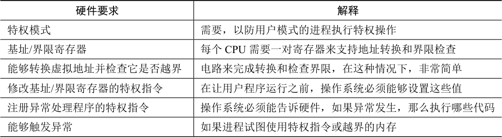

# 15.4 硬件支持：总结

我们来总结一下需要的硬件支持（见表15.2）。首先，正如在CPU 虚拟化的章节中提到的，我们需要两种CPU 模式。操作系统在特权模式（privileged mode，或内核模式，kernel mode），可以访问整个机器资源。应用程序在用户模式（user mode）运行，只能做有限的操作。只要一个位，也许保存在处理器状态字（processor status word）中，就能说明当前的CPU 运行模式。在一些特殊的时刻（如系统调用、异常或中断），CPU 会切换状态。

表格文字

| 硬件要求 | 解释 |
| --- | --- |
| 特权模式 | 需要，以防用户模式的进程执行特权操作 |
| 基址/界限寄存器 | 每个CPU 需要一对寄存器来支持地址转换和界限检查 |
| 能够转换虚拟地址并检查它是否越界 | 电路来完成转换和检查界限，在这种情况下，非常简单 |
| 修改基址/界限寄存器的特权指令 | 在让用户程序运行之前，操作系统必须能够设置这些值 |
| 注册异常处理程序的特权指令 | 操作系统必须能告诉硬件，如果异常发生，那么执行哪些代码 |
| 能够触发异常 | 如果进程试图使用特权指令或越界的内存 |

硬件还必须提供基址和界限寄存器（base and bounds register），因此每个CPU 的内存管理单元（Memory Management Unit，MMU）都需要这两个额外的寄存器。用户程序运行时，硬件会转换每个地址，即将用户程序产生的虚拟地址加上基址寄存器的内容。硬件也必须能检查地址是否有用，通过界限寄存器和CPU 内的一些电路来实现。

硬件应该提供一些特殊的指令，用于修改基址寄存器和界限寄存器，允许操作系统在切换进程时改变它们。这些指令是特权（privileged）指令，只有在内核模式下，才能修改这些寄存器。想象一下，如果用户进程在运行时可以随意更改基址寄存器，那么用户进程可能会造成严重破坏[^p123-1]。想象一下吧！然后迅速将这些阴暗的想法从你的头脑中赶走，因为它们很可怕，会导致噩梦。

最后，在用户程序尝试非法访问内存（越界访问）时，CPU必须能够产生异常（exception）。在这种情况下，CPU 应该阻止用户程序的执行，并安排操作系统的“越界”异常处理程序（exception handler）去处理。操作系统的处理程序会做出正确的响应，比如在这种情况下终止进程。类似地，如果用户程序尝试修改基址或者界限寄存器时，CPU 也应该产生异常，并调用“用户模式尝试执行特权指令”的异常处理程序。CPU 还必须提供一种方法，来通知它这些处理程序的位置，因此又需要另一些特权指令。

[^p123-1]: 除了“严重破坏（havoc）”还有什么可以“造成（wreaked）”的吗？
