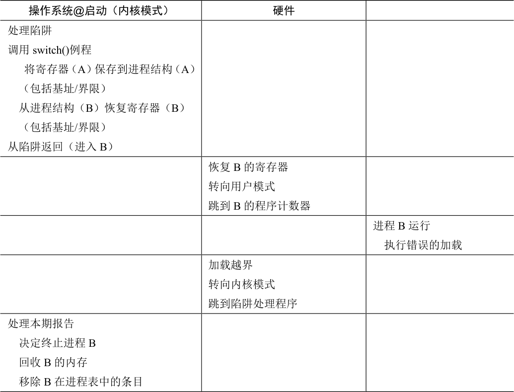

# 15.5 操作系统的问题

为了支持动态重定位，硬件添加了新的功能，使得操作系统有了一些必须处理的新问题。硬件支持和操作系统管理结合在一起，实现了一个简单的虚拟内存。具体来说，在一些关键的时刻操作系统需要介入，以实现基址和界限方式的虚拟内存，见表15.3。

第一，在进程创建时，操作系统必须采取行动，为进程的地址空间找到内存空间。由于我们假设每个进程的地址空间小于物理内存的大小，并且大小相同，这对操作系统来说很容易。它可以把整个物理内存看作一组槽块，标记了空闲或已用。当新进程创建时，操作系统检索这个数据结构（常被称为空闲列表，free list），为新地址空间找到位置，并将其标记为已用。如果地址空间可变，那么生活就会更复杂，我们将在后续章节中讨论。

我们来看一个例子。在图15.2 中，操作系统将物理内存的第一个槽块分配给自己，然后将例子中的进程重定位到物理内存地址32KB。另两个槽块（16～32KB，48～64KB）空闲，因此空闲列表（free list）就包含这两个槽块。

第二，在进程终止时（正常退出，或因行为不端被强制终止），操作系统也必须做一些工作，回收它的所有内存，给其他进程或者操作系统使用。在进程终止时，操作系统会将这些内存放回到空闲列表，并根据需要清除相关的数据结构。

第三，在上下文切换时，操作系统也必须执行一些额外的操作。每个CPU 毕竟只有一个基址寄存器和一个界限寄存器，但对于每个运行的程序，它们的值都不同，因为每个程序被加载到内存中不同的物理地址。因此，在切换进程时，操作系统必须保存和恢复基础和界限寄存器。具体来说，当操作系统决定中止当前的运行进程时，它必须将当前基址和界限寄存器中的内容保存在内存中，放在某种每个进程都有的结构中，如进程结构（process structure）或进程控制块（Process Control Block，PCB）中。类似地，当操作系统恢复执行某个进程时（或第一次执行），也必须给基址和界限寄存器设置正确的值。

表格文字

| 操作系统的要求 | 解释 |
| --- | --- |
| 内存管理 | 需要为新进程分配内存 从终止的进程回收内存 一般通过空闲列表（free list）来管理内存 |
| 基址/界限管理 | 必须在上下文切换时正确设置基址/界限寄存器 |
| 异常处理 | 当异常发生时执行的代码，可能的动作是终止犯错的进程 |

需要注意，当进程停止时（即没有运行），操作系统可以改变其地址空间的物理位置，这很容易。要移动进程的地址空间，操作系统首先让进程停止运行，然后将地址空间拷贝到新位置，最后更新保存的基址寄存器（在进程结构中），指向新位置。当该进程恢复执行时，它的（新）基址寄存器会被恢复，它再次开始运行，显然它的指令和数据都在新的内存位置了。

第四，操作系统必须提供异常处理程序（exception handler），或要一些调用的函数，像上面提到的那样。操作系统在启动时加载这些处理程序（通过特权命令）。例如，当一个进程试图越界访问内存时，CPU 会触发异常。在这种异常产生时，操作系统必须准备采取行动。通常操作系统会做出充满敌意的反应：终止错误进程。操作系统应该尽力保护它运行的机器，因此它不会对那些企图访问非法地址或执行非法指令的进程客气。再见了，行为不端的进程，很高兴认识你。

表15.4 为按时间线展示了大多数硬件与操作系统的交互。可以看出，操作系统在启动时做了什么，为我们准备好机器，然后在进程（进程A）开始运行时发生了什么。请注意，地址转换过程完全由硬件处理，没有操作系统的介入。在这个时候，发生时钟中断，操作系统切换到进程B 运行，它执行了“错误的加载”（对一个非法内存地址），这时操作系统必须介入，终止该进程，清理并释放进程B 占用的内存，将它从进程表中移除。从表中可以看出，我们仍然遵循受限直接访问（limited direct execution）的基本方法，大多数情况下，操作系统正确设置硬件后，就任凭进程直接运行在CPU 上，只有进程行为不端时才介入。

表格文字

| 操作系统@启动（内核模式） | 硬件 |  |
| --- | --- | --- |
| 初始化陷阱表 |  |  |
|  | 记住以下地址： 系统调用处理程序 时钟处理程序 非法内存处理程序 非常指令处理程序 |  |
| 开始中断时钟 |  |  |
|  | 开始时钟，在x ms 后中断 |  |
| 初始化进程表 初始化空闲列表 |  |  |
| 操作系统@运行（核心模式） | 硬件 | 程序（用户模式） |
| 为了启动进程A： 在进程表中分配条目 为进程分配内存 设置基址/界限寄存器 从陷阱返回（进入A） |  |  |
|  | 恢复A 的寄存器 转向用户模式 跳到A（最初）的程序计数器 |  |
|  |  | 进程A 运行 获取指令 |
|  | 转换虚拟地址并执行获取 |  |
|  |  | 执行指令 |
|  | 如果显式加载/保存 确保地址不越界 转换虚拟地址并执行 加载/保存 |  |
|  |  | …… |
|  | 时钟中断 转向内核模式 跳到中断处理程序 |  |

续表

表格文字

| 操作系统@启动（内核模式） | 硬件 |  |
| --- | --- | --- |
| 处理陷阱 调用switch()例程 将寄存器（A）保存到进程结构（A） （包括基址/界限） 从进程结构（B）恢复寄存器（B） （包括基址/界限） 从陷阱返回（进入B） |  |  |
|  | 恢复B 的寄存器 转向用户模式 跳到B 的程序计数器 |  |
|  |  | 进程B 运行 执行错误的加载 |
|  | 加载越界 转向内核模式 跳到陷阱处理程序 |  |
| 处理本期报告 决定终止进程B 回收B 的内存 移除B 在进程表中的条目 |  |  |

