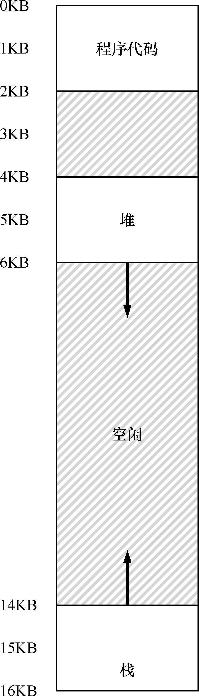
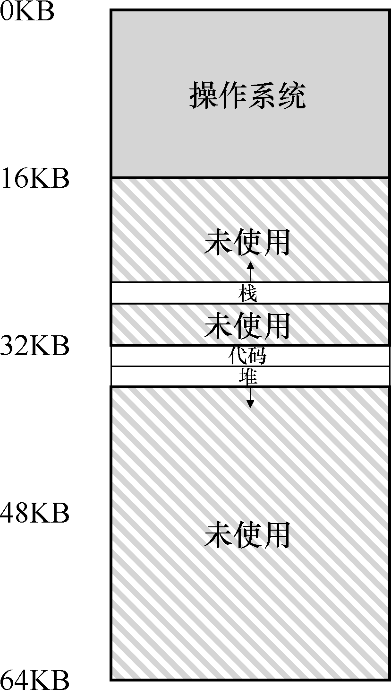
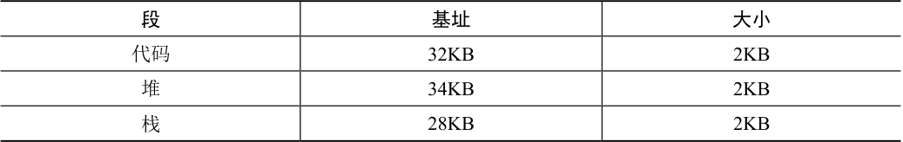

# 16.1 分段：泛化的基址/界限

为了解决这个问题，分段（segmentation）的概念应运而生。分段并不是一个新概念，它甚至可以追溯到20 世纪60 年代初期[H61, G62]。这个想法很简单，在MMU 中引入不止一个基址和界限寄存器对，而是给地址空间内的每个逻辑段（segment）一对。一个段只是地址空间里的一个连续定长的区域，在典型的地址空间里有 3 个逻辑不同的段：代码、栈和堆。分段的机制使得操作系统能够将不同的段放到不同的物理内存区域，从而避免了虚拟地址空间中的未使用部分占用物理内存。

我们来看一个例子。假设我们希望将图16.1 中的地址空间放入物理内存。通过给每个段一对基址和界限寄存器，可以将每个段独立地放入物理内存。如图16.2 所示，64KB 的物理内存中放置了3 个段（为操作系统保留16KB）。

从图中可以看到，只有已用的内存才在物理内存中分配空间，因此可以容纳巨大的地址空间，其中包含大量未使用的地址空间（有时又称为稀疏地址空间，sparse address spaces）。

你会想到，需要MMU 中的硬件结构来支持分断：在这种情况下，需要一组3 对基址和界限寄存器。表 16.1 展示了上面的例子中的寄存器值，每个界限寄存器记录了一个段的大小。

表格文字

| 段 | 基址 | 大小 |
| --- | --- | --- |
| 代码 | 32KB | 2KB |
| 堆 | 34KB | 2KB |
| 栈 | 28KB | 2KB |

如表16.1 所示，代码段放在物理地址32KB，大小是2KB。堆在34KB，大小也是2KB。

利用图16.1 中的地址空间，我们来看一个地址转换的例子。假设现在要引用虚拟地址100（在代码段中），MMU 将基址值加上偏移量（100）得到实际的物理地址：100 + 32KB =32868。然后它会检查该地址是否在界限内（100 小于2KB），发现是的，于是发起对物理地址32868 的引用。

> **补充：段错误**

> 段错误指的是在支持分段的机器上发生了非法的内存访问。有趣的是，即使在不支持分段的机器上这个术语依然保留。但如果你弄不清楚为什么代码老是出错，就没那么有趣了。

来看一个堆中的地址，虚拟地址4200（同样参考图16.1）。如果用虚拟地址4200 加上堆的基址（34KB），得到物理地址39016，这不是正确的地址。我们首先应该先减去堆的偏移量，即该地址指的是这个段中的哪个字节。因为堆从虚拟地址4K（4096）开始，4200 的偏移量实际上是4200 减去4096，即104，然后用这个偏移量（104）加上基址寄存器中的物理地址（34KB），得到真正的物理地址34920。

如果我们试图访问非法的地址，例如7KB，它超出了堆的边界呢？你可以想象发生的情况：硬件会发现该地址越界，因此陷入操作系统，很可能导致终止出错进程。这就是每个C 程序员都感到恐慌的术语的来源：段异常（segmentation violation）或段错误（segmentation fault）。
