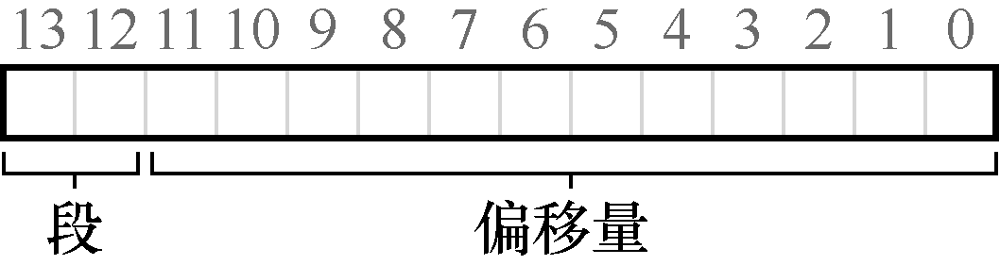
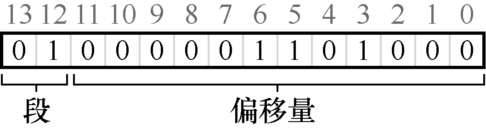

# 16.2 我们引用哪个段

硬件在地址转换时使用段寄存器。它如何知道段内的偏移量，以及地址引用了哪个段？

一种常见的方式，有时称为显式（explicit）方式，就是用虚拟地址的开头几位来标识不同的段，VAX/VMS 系统使用了这种技术[LL82]。在我们之前的例子中，有3 个段，因此需要两位来标识。如果我们用14 位虚拟地址的前两位来标识，那么虚拟地址如下所示：



那么在我们的例子中，如果前两位是00，硬件就知道这是属于代码段的地址，因此使用代码段的基址和界限来重定位到正确的物理地址。如果前两位是01，则是堆地址，对应地，使用堆的基址和界限。下面来看一个4200 之上的堆虚拟地址，进行进制转换，确保弄清楚这些内容。虚拟地址4200 的二进制形式如下：



从图中可以看到，前两位（01）告诉硬件我们引用哪个段。剩下的12 位是段内偏移：0000 0110 1000（即十六进制0x068 或十进制104）。因此，硬件就用前两位来决定使用哪个段寄存器，然后用后12 位作为段内偏移。偏移量与基址寄存器相加，硬件就得到了最终的物理地址。请注意，偏移量也简化了对段边界的判断。我们只要检查偏移量是否小于界限，大于界限的为非法地址。因此，如果基址和界限放在数组中（每个段一项），为了获得需要的物理地址，硬件会做下面这样的事：

```text
// get top 2 bits of 14-bit VA
Segment = (VirtualAddress & SEG_MASK) >> SEG_SHIFT
// now get offset
Offset = VirtualAddress & OFFSET_MASK
if (Offset >= Bounds[Segment])
    RaiseException(PROTECTION_FAULT)
else
    PhysAddr = Base[Segment] + Offset
    Register = AccessMemory(PhysAddr)
```

在我们的例子中，可以为上面的常量填上值。具体来说，SEG\_MASK 为0x3000，SEG\_SHIFT 为12，OFFSET\_MASK 为0xFFF。

你或许已经注意到，上面使用两位来区分段，但实际只有3 个段（代码、堆、栈），因此有一个段的地址空间被浪费。因此有些系统中会将堆和栈当作同一个段，因此只需要一位来做标识[LL82]。

硬件还有其他方法来决定特定地址在哪个段。在隐式（implicit）方式中，硬件通过地址产生的方式来确定段。例如，如果地址由程序计数器产生（即它是指令获取），那么地址在代码段。如果基于栈或基址指针，它一定在栈段。其他地址则在堆段。
