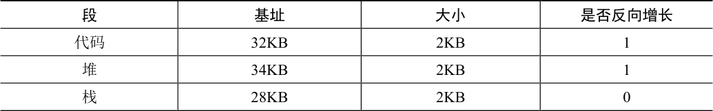

# 16.3 栈怎么办

到目前为止，我们一直没有讲地址空间中的一个重要部分：栈。在表16.1 中，栈被重定位到物理地址28KB。但有一点关键区别，它反向增长。在物理内存中，它始于28KB，增长回到26KB，相应虚拟地址从16KB 到14KB。地址转换必须有所不同。

首先，我们需要一点硬件支持。除了基址和界限外，硬件还需要知道段的增长方向（用一位区分，比如1 代表自小而大增长，0 反之）。在表16.2 中，我们更新了硬件记录的视图。

表格文字

| 段 | 基址 | 大小 | 是否反向增长 |
| --- | --- | --- | --- |
| 代码 | 32KB | 2KB | 1 |
| 堆 | 34KB | 2KB | 1 |
| 栈 | 28KB | 2KB | 0 |

硬件理解段可以反向增长后，这种虚拟地址的地址转换必须有点不同。下面来看一个栈虚拟地址的例子，将它进行转换，以理解这个过程：

在这个例子中，假设要访问虚拟地址15KB，它应该映射到物理地址27KB。该虚拟地址的二进制形式是：11 1100 0000 0000（十六进制0x3C00）。硬件利用前两位（11）来指定段，但然后我们要处理偏移量3KB。为了得到正确的反向偏移，我们必须从3KB 中减去最大的段地址：在这个例子中，段可以是4KB，因此正确的偏移量是3KB 减去4KB，即−1KB。只要用这个反向偏移量（−1KB）加上基址（28KB），就得到了正确的物理地址27KB。用户可以进行界限检查，确保反向偏移量的绝对值小于段的大小。
