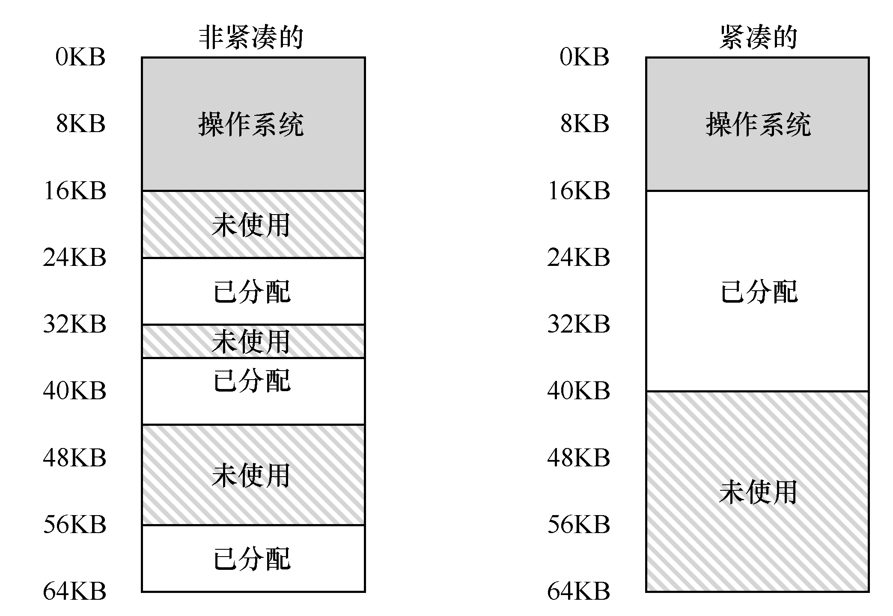

# 16.6 操作系统支持

现在你应该大致了解了分段的基本原理。系统运行时，地址空间中的不同段被重定位到物理内存中。与我们之前介绍的整个地址空间只有一个基址/界限寄存器对的方式相比，大量节省了物理内存。具体来说，栈和堆之间没有使用的区域就不需要再分配物理内存，让我们能将更多地址空间放进物理内存。

然而，分段也带来了一些新的问题。我们先介绍必须关注的操作系统新问题。第一个是老问题：操作系统在上下文切换时应该做什么？你可能已经猜到了：各个段寄存器中的内容必须保存和恢复。显然，每个进程都有自己独立的虚拟地址空间，操作系统必须在进程运行前，确保这些寄存器被正确地赋值。

第二个问题更重要，即管理物理内存的空闲空间。新的地址空间被创建时，操作系统需要在物理内存中为它的段找到空间。之前，我们假设所有的地址空间大小相同，物理内存可以被认为是一些槽块，进程可以放进去。现在，每个进程都有一些段，每个段的大小也可能不同。

一般会遇到的问题是，物理内存很快充满了许多空闲空间的小洞，因而很难分配给新的段，或扩大已有的段。这种问题被称为外部碎片（external fragmentation）[R69]，如图16.3（左边）所示。

在这个例子中，一个进程需要分配一个20KB 的段。当前有24KB 空闲，但并不连续（是3 个不相邻的块）。因此，操作系统无法满足这个20KB 的请求。

该问题的一种解决方案是紧凑（compact）物理内存，重新安排原有的段。例如，操作系统先终止运行的进程，将它们的数据复制到连续的内存区域中去，改变它们的段寄存器中的值，指向新的物理地址，从而得到了足够大的连续空闲空间。这样做，操作系统能让新的内存分配请求成功。但是，内存紧凑成本很高，因为拷贝段是内存密集型的，一般会占用大量的处理器时间。图16.3（右边）是紧凑后的物理内存。

一种更简单的做法是利用空闲列表管理算法，试图保留大的内存块用于分配。相关的算法可能有成百上千种，包括传统的最优匹配（best-fit，从空闲链表中找最接近需要分配空间的空闲块返回）、最坏匹配（worst-fit）、首次匹配（first-fit）以及像伙伴算法（buddy algorithm）[K68]这样更复杂的算法。Wilson 等人做过一个很好的调查[W+95]，如果你想对这些算法了解更多，可以从它开始，或者等到第17 章，我们将介绍一些基本知识。但遗憾的是，无论算法多么精妙，都无法完全消除外部碎片，因此，好的算法只是试图减小它。

> **提示：如果有一千个解决方案，就没有特别好的**

> 存在如此多不同的算法来尝试减少外部碎片，正说明了解决这个问题没有最好的办法。因此我们满足于找到一个合理的足够好的方案。唯一真正的解决办法就是（我们会在后续章节看到），完全避免这个问题，永远不要分配不同大小的内存块。
