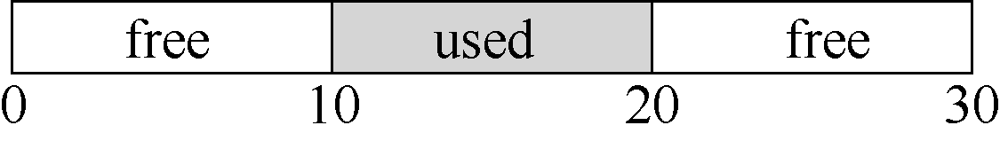
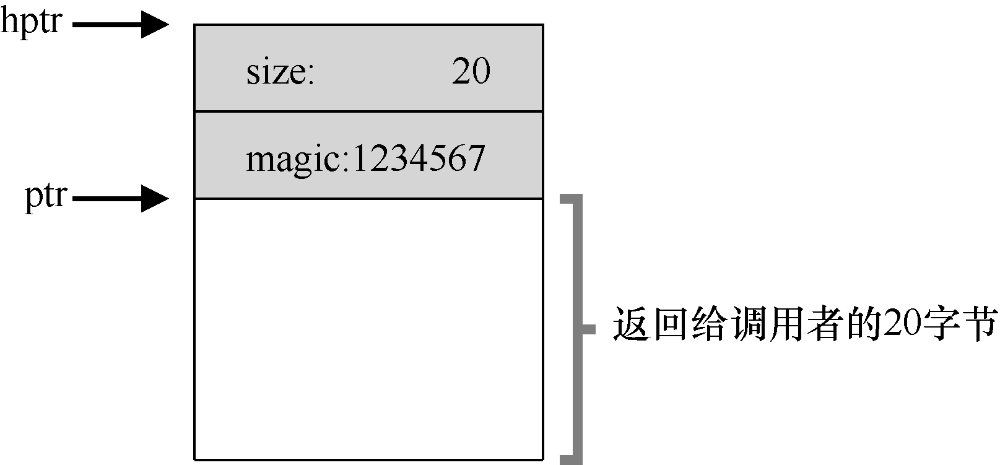
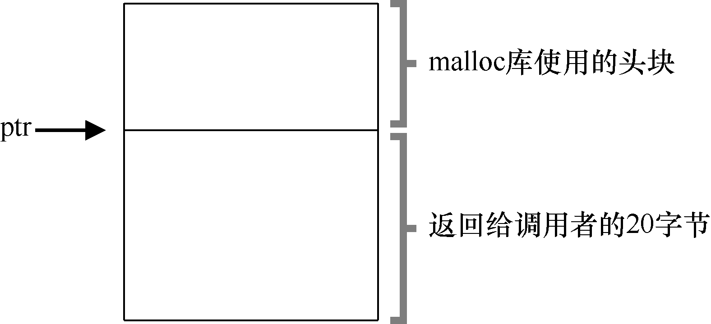
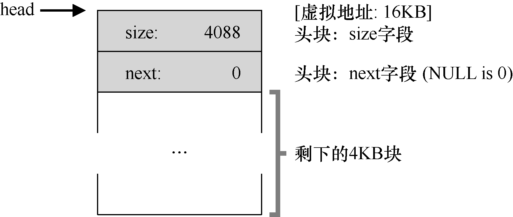
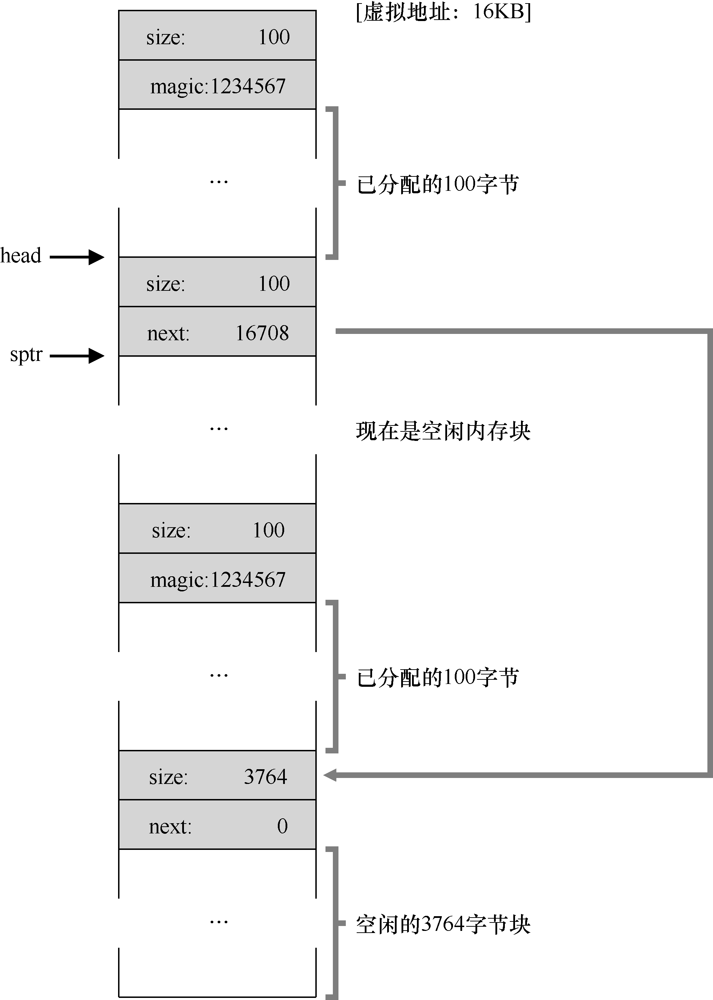
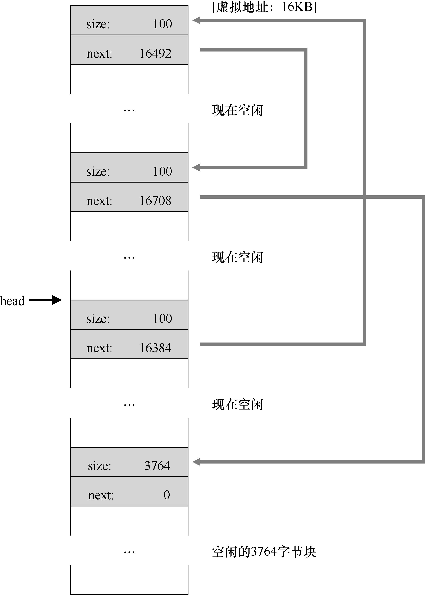

# 17.2 底层机制

在深入策略细节之前，我们先来介绍大多数分配程序采用的通用机制。首先，探讨空间分割与合并的基本知识。其次，看看如何快速并相对轻松地追踪已分配的空间。最后，讨论如何利用空闲区域的内部空间维护一个简单的列表，来追踪空闲和已分配的空间。

## 分割与合并

空闲列表包含一组元素，记录了堆中的哪些空间还没有分配。假设有下面的30 字节的堆：



这个堆对应的空闲列表会有两个元素，一个描述第一个10 字节的空闲区域（字节0～9），一个描述另一个空闲区域（字节20～29）：


通过上面的介绍可以看出，任何大于10 字节的分配请求都会失败（返回NULL），因为没有足够的连续可用空间。而恰好10 字节的需求可以由两个空闲块中的任何一个满足。但是，如果申请小于10 字节空间，会发生什么？

假设我们只申请一个字节的内存。这种情况下，分配程序会执行所谓的分割（splitting）动作：它找到一块可以满足请求的空闲空间，将其分割，第一块返回给用户，第二块留在空闲列表中。在我们的例子中，假设这时遇到申请一个字节的请求，分配程序选择使用第二块空闲空间，对malloc()的调用会返回20（1 字节分配区域的地址），空闲列表会变成这样：


从上面可以看出，空闲列表基本没有变化，只是第二个空闲区域的起始位置由20 变成21，长度由10 变为9 了[^p140-1]。因此，如果请求的空间大小小于某块空闲块，分配程序通常会进行分割。

许多分配程序中因此也有一种机制，名为合并（coalescing）。还是看前面的例子（10字节的空闲空间，10 字节的已分配空间，和另外10 字节的空闲空间）。

对于这个（小）堆，如果应用程序调用free(10)，归还堆中间的空间，会发生什么？如果只是简单地将这块空闲空间加入空闲列表，不多想想，可能得到如下的结果：


问题出现了：尽管整个堆现在完全空闲，但它似乎被分割成了3 个10 字节的区域。这时，如果用户请求20 字节的空间，简单遍历空闲列表会找不到这样的空闲块，因此返回失败。

为了避免这个问题，分配程序会在释放一块内存时合并可用空间。想法很简单：在归还一块空闲内存时，仔细查看要归还的内存块的地址以及邻近的空闲空间块。如果新归还的空间与一个原有空闲块相邻（或两个，就像这个例子），就将它们合并为一个较大的空闲块。通过合并，最后空闲列表应该像这样：


实际上，这是堆的空闲列表最初的样子，在所有分配之前。通过合并，分配程序可以更好地确保大块的空闲空间能提供给应用程序。

## 追踪已分配空间的大小

你可能注意到，free(void \*ptr)接口没有块大小的参数。因此它是假定，对于给定的指针，内存分配库可以很快确定要释放空间的大小，从而将它放回空闲列表。

要完成这个任务，大多数分配程序都会在头块（header）中保存一点额外的信息，它在内存中，通常就在返回的内存块之前。我们再看一个例子（见图17.1）。在这个例子中，我们检查一个20 字节的已分配块，由ptr 指着，设想用户调用了malloc()，并将结果保存在ptr 中：ptr = malloc(20)。

该头块中至少包含所分配空间的大小（这个例子中是20）。它也可能包含一些额外的指针来加速空间释放，包含一个幻数来提供完整性检查，以及其他信息。我们假定，一个简单的头块包含了分配空间的大小和一个幻数：

```c
typedef struct  header_t {
    int size;
    int magic;
} header_t;
```

上面的例子看起来会像图17.2 的样子。用户调用free(ptr)时，库会通过简单的指针运算得到头块的位置：

```c
void free(void *ptr) {
    header_t *hptr = (void *)ptr - sizeof(header_t);
}
```





获得头块的指针后，库可以很容易地确定幻数是否符合预期的值，作为正常性检查（assert（hptr-&gt;magic == 1234567）），并简单计算要释放的空间大小（即头块的大小加区域长度）。请注意前一句话中一个小但重要的细节：实际释放的是头块大小加上分配给用户的空间的大小。因此，如果用户请求N 字节的内存，库不是寻找大小为N 的空闲块，而是寻找N 加上头块大小的空闲块。

## 嵌入空闲列表

到目前为止，我们这个简单的空闲列表还只是一个概念上的存在，它就是一个列表，描述了堆中的空闲内存块。但如何在空闲内存自己内部建立这样一个列表呢？

在更典型的列表中，如果要分配新节点，你会调用malloc()来获取该节点所需的空间。遗憾的是，在内存分配库内，你无法这么做！你需要在空闲空间本身中建立空闲空间列表。虽然听起来有点奇怪，但别担心，这是可以做到的。

假设我们需要管理一个4096 字节的内存块（即堆是4KB）。为了将它作为一个空闲空间列表来管理，首先要初始化这个列表。开始，列表中只有一个条目，记录了大小为4096的空间（减去头块的大小）。下面是该列表中一个节点描述：

```c
typedef struct  node_t {
    int    size;
    struct  node_t *next;
} node_t;
```

现在来看一些代码，它们初始化堆，并将空闲列表的第一个元素放在该空间中。假设堆构建在某块空闲空间上，这块空间通过系统调用 mmap()获得。这不是构建这种堆的唯一选择，但在这个例子中很合适。下面是代码：

```text
// mmap() returns a pointer to a chunk of free space
node_t *head = mmap(NULL, 4096, PROT_READ|PROT_WRITE,
MAP_ANON|MAP_PRIVATE, -1, 0);
head->size    = 4096 - sizeof(node_t);
head->next    = NULL;
```

执行这段代码之后，列表的状态是它只有一个条目，记录大小为4088。

是的，这是一个小堆，但对我们是一个很好的例子。head 指针指向这块区域的起始地址，假设是16KB（尽管任何虚拟地址都可以）。堆看起来如图17.3 所示。

现在，假设有一个100 字节的内存请求。为了满足这个请求，库首先要找到一个足够大小的块。因为只有一个4088 字节的块，所以选中这个块。然后，这个块被分割（split）为两块：一块足够满足请求（以及头块，如前所述），一块是剩余的空闲块。假设记录头块为8 个字节（一个整数记录大小，一个整数记录幻数），堆中的空间如图17.4 所示。




至此，对于100 字节的请求，库从原有的一个空闲块中分配了108 字节，返回指向它的一个指针（在上图中用ptr 表示），并在其之前连续的8 字节中记录头块信息，供未来的free()函数使用。同时将列表中的空闲节点缩小为3980 字节（4088−108）。

现在再来看该堆，其中有3 个已分配区域，每个100（加上头块是108）。这个堆如图17.5所示。

可以看出，堆的前324 字节已经分配，因此我们看到该空间中有3 个头块，以及3 个100字节的用户使用空间。空闲列表还是无趣：只有一个节点（由head 指向），但在3 次分割后，现在大小只有3764 字节。但如果用户程序通过free()归还一些内存，会发生什么？

在这个例子中，应用程序调用free(16500)，归还了中间的一块已分配空间（内存块的起始地址16384 加上前一块的108，和这一块的头块的8 字节，就得到了16500）。这个值在前图中用sptr 指向。

库马上弄清楚了这块要释放空间的大小，并将空闲块加回空闲列表。假设我们将它插入到空闲列表的头位置，该空间如图17.6 所示。




现在的空闲列表包括一个小空闲块（100 字节，由列表的头指向）和一个大空闲块（3764字节）。

我们的列表终于有不止一个元素了！是的，空闲空间被分割成了两段，但很常见。

最后一个例子：现在假设剩余的两块已分配的空间也被释放。没有合并，空闲列表将非常破碎，如图17.7 所示。

从图中可以看出，我们现在一团糟！为什么？简单，我们忘了合并（coalesce）列表项，虽然整个内存空间是空闲的，但却被分成了小段，因此形成了碎片化的内存空间。解决方案很简单：遍历列表，合并（merge）相邻块。完成之后，堆又成了一个整体。



## 让堆增长

我们应该讨论最后一个很多内存分配库中都有的机制。具体来说，如果堆中的内存空间耗尽，应该怎么办？最简单的方式就是返回失败。在某些情况下这也是唯一的选择，因此返回NULL 也是一种体面的方式。别太难过！你尽力了，即使失败，你也虽败犹荣。

大多数传统的分配程序会从很小的堆开始，当空间耗尽时，再向操作系统申请更大的空间。通常，这意味着它们进行了某种系统调用（例如，大多数UNIX 系统中的sbrk），让堆增长。操作系统在执行sbrk 系统调用时，会找到空闲的物理内存页，将它们映射到请求进程的地址空间中去，并返回新的堆的末尾地址。这时，就有了更大的堆，请求就可以成功满足。

[^p140-1]: 这里的讨论假设没有头块，这是我们现在做出的一个不现实但简化的假设。
