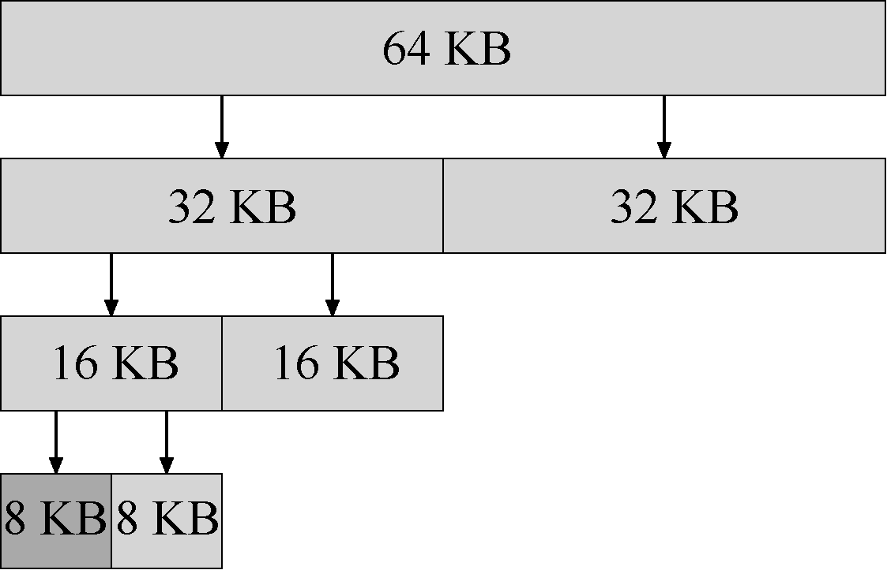

# 17.4 其他方式

除了上述基本策略外，人们还提出了许多技术和算法，来改进内存分配。这里我们列出一些来供你考虑（就是让你多一些思考，不只局限于最优匹配）。

## 分离空闲列表

一直以来有一种很有趣的方式叫作分离空闲列表（segregated list）。基本想法很简单：如果某个应用程序经常申请一种（或几种）大小的内存空间，那就用一个独立的列表，只管理这样大小的对象。其他大小的请求都交给更通用的内存分配程序。

这种方法的好处显而易见。通过拿出一部分内存专门满足某种大小的请求，碎片就不再是问题了。而且，由于没有复杂的列表查找过程，这种特定大小的内存分配和释放都很快。

就像所有好主意一样，这种方式也为系统引入了新的复杂性。例如，应该拿出多少内存来专门为某种大小的请求服务，而将剩余的用来满足一般请求？超级工程师Jeff Bonwick为Solaris 系统内核设计的厚块分配程序（slab allocator），很优雅地处理了这个问题[B94]。

具体来说，在内核启动时，它为可能频繁请求的内核对象创建一些对象缓存（object cache），如锁和文件系统inode 等。这些的对象缓存每个分离了特定大小的空闲列表，因此能够很快地响应内存请求和释放。如果某个缓存中的空闲空间快耗尽时，它就向通用内存分配程序申请一些内存厚块（slab）（总量是页大小和对象大小的公倍数）。相反，如果给定厚块中对象的引用计数变为0，通用的内存分配程序可以从专门的分配程序中回收这些空间，这通常发生在虚拟内存系统需要更多的空间的时候。

> **补充：了不起的工程师真的了不起**

> 像Jeff Bonwick 这样的工程师（Jeff Bonwick 不仅写了上面提到的厚块分配程序，还是令人惊叹的文件系统ZFS 的负责人），是硅谷的灵魂。在每一个伟大的产品或技术后面都有这样一个人（或一小群人），他们的天赋、能力和奉献精神远超众人。Facebook 的Mark Zuckerberg 曾经说过：“那些在自己的领域中超凡脱俗的人，比那些相当优秀的人强得不是一点点。”这就是为什么，会有人成立自己的公司，然后永远地改变了这个世界（想想Google、Apple 和Facebook）。努力工作，你也可能成为这种“以一当百”的人。做不到的话，就和这样的人一起工作，你会明白什么是“听君一席话，胜读十年书”。如果都做不到，那就太难过了。

厚块分配程序比大多数分离空闲列表做得更多，它将列表中的空闲对象保持在预初始化的状态。Bonwick 指出，数据结构的初始化和销毁的开销很大[B94]。通过将空闲对象保持在初始化状态，厚块分配程序避免了频繁的初始化和销毁，从而显著降低了开销。

## 伙伴系统

因为合并对分配程序很关键，所以人们设计了一些方法，让合并变得简单，一个好例子就是二分伙伴分配程序（binary buddy allocator）[K65]。

在这种系统中，空闲空间首先从概念上被看成大小为2N的大空间。当有一个内存分配请求时，空闲空间被递归地一分为二，直到刚好可以满足请求的大小（再一分为二就无法满足）。这时，请求的块被返回给用户。在下面的例子中，一个64KB 大小的空闲空间被切分，以便提供7KB 的块：

在这个例子中，最左边的8KB 块被分配给用户（如上图中深灰色部分所示）。请注意，这种分配策略只允许分配2 的整数次幂大小的空闲块，因此会有内部碎片（internal fragment）的麻烦。

伙伴系统的漂亮之处在于块被释放时。如果将这个8KB 的块归还给空闲列表，分配程序会检查“伙伴”8KB 是否空闲。如果是，就合二为一，变成16KB 的块。然后会检查这个16KB 块的伙伴是否空闲，如果是，就合并这两块。这个递归合并过程继续上溯，直到合并整个内存区域，或者某一个块的伙伴还没有被释放。

伙伴系统运转良好的原因，在于很容易确定某个块的伙伴。怎么找？仔细想想上面例子中的各个块的地址。如果你想得够仔细，就会发现每对互为伙伴的块只有一位不同，正是这一位决定了它们在整个伙伴树中的层次。现在你应该已经大致了解了二分伙伴分配程序的工作方式。更多的细节可以参考Wilson 的调查[W+95]。

## 其他想法

上面提到的众多方法都有一个重要的问题，缺乏可扩展性（scaling）。具体来说，就是查找列表可能很慢。因此，更先进的分配程序采用更复杂的数据结构来优化这个开销，牺牲简单性来换取性能。例子包括平衡二叉树、伸展树和偏序树[W+95]。

考虑到现代操作系统通常会有多核，同时会运行多线程的程序（本书之后关于并发的章节将会详细介绍），因此人们做了许多工作，提升分配程序在多核系统上的表现。两个很棒的例子参见Berger 等人的[B+00]和Evans 的[E06]，看看文章了解更多细节。

这只是人们为了优化内存分配程序，在长时间内提出的几千种想法中的两种。感兴趣的话可以深入阅读。或者阅读glibc 分配程序的工作原理[S15]，你会更了解现实的情形。
