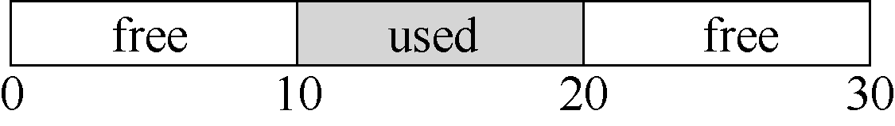

# 第 17 章 空闲空间管理

本章暂且将对虚拟内存的讨论放在一边，来讨论所有内存管理系统的一个基本方面，无论是malloc 库（管理进程中堆的页），还是操作系统本身（管理进程的地址空间）。具体来说，我们会讨论空闲空间管理（free-space management）的一些问题。

让问题更明确一点。管理空闲空间当然可以很容易，我们会在讨论分页概念时看到。如果需要管理的空间被划分为固定大小的单元，就很容易。在这种情况下，只需要维护这些大小固定的单元的列表，如果有请求，就返回列表中的第一项。

如果要管理的空闲空间由大小不同的单元构成，管理就变得困难（而且有趣）。这种情况出现在用户级的内存分配库（如malloc()和free()），或者操作系统用分段（segmentation）的方式实现虚拟内存。在这两种情况下，出现了外部碎片（external fragmentation）的问题：空闲空间被分割成不同大小的小块，成为碎片，后续的请求可能失败，因为没有一块足够大的连续空闲空间，即使这时总的空闲空间超出了请求的大小。

上面展示了该问题的一个例子。在这个例子中，全部可用空闲空间是20 字节，但被切成两个10 字节大小的碎片，导致一个15 字节的分配请求失败。所以本章需要解决的问题是：

> **关键问题：如何管理空闲空间**

> 要满足变长的分配请求，应该如何管理空闲空间？什么策略可以让碎片最小化？不同方法的时间和空间开销如何？
