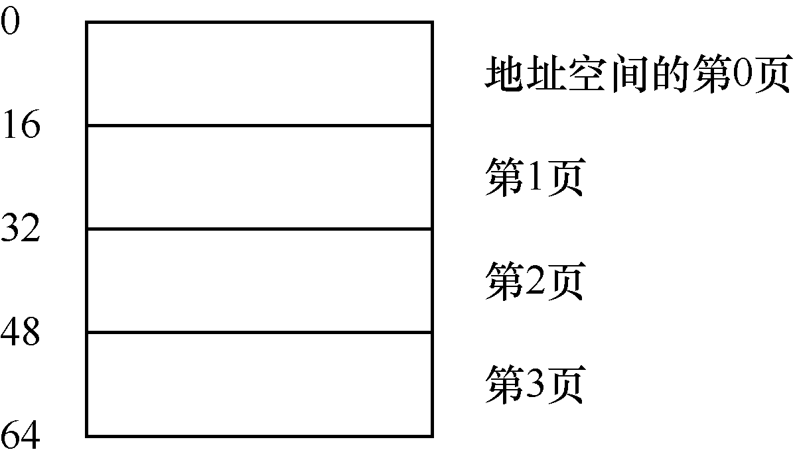
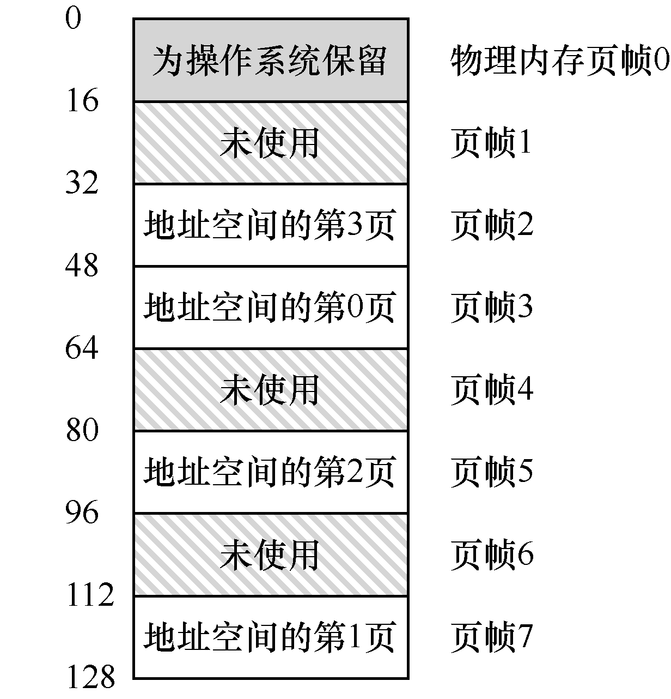
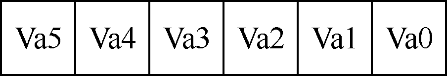
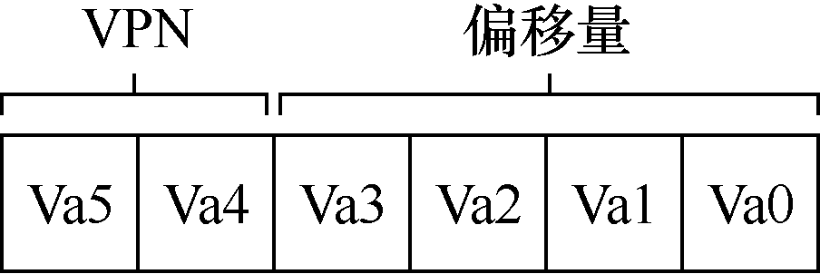
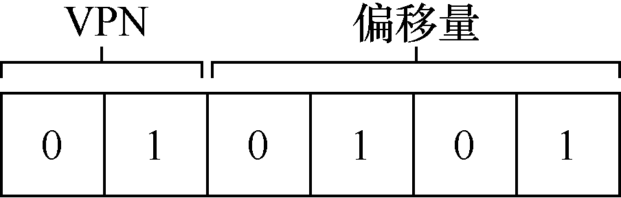
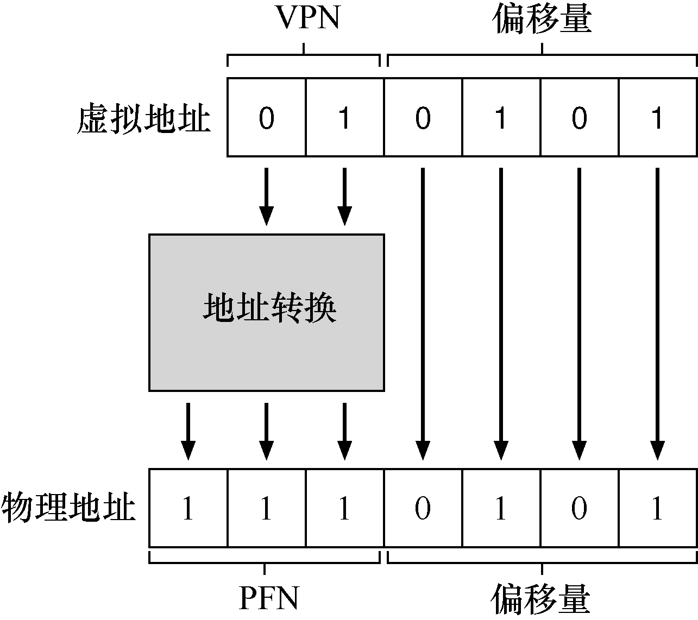

# 18.1 一个简单例子

为了让该方法看起来更清晰，我们用一个简单例子来说明。图 18.1 展示了一个只有 64 字节的小地址空间，有 4 个 16 字节的页（虚拟页 0、1、2、3）。真实的地址空间肯定大得多，通常 32 位有 4GB 的地址空间，甚至有 64 位[^address-space]。在本书中，我们常常用小例子，让大家更容易理解。

物理内存，如图 18.2 所示，也由一组固定大小的槽块组成。在这个例子中，有 8 个页帧（由 128 字节物理内存构成，也是极小的）。从图中可以看出，虚拟地址空间的页放在物理内存的不同位置。图中还显示，操作系统自己用了一些物理内存。

可以看到，与我们以前的方法相比，分页有许多优点。可能最大的改进就是灵活性：通过完善的分页方法，操作系统能够高效地提供地址空间的抽象，不管进程如何使用地址空间。例如，我们不会假定堆和栈的增长方向，以及它们如何使用。

另一个优点是分页提供的空闲空间管理的简单性。例如，如果操作系统希望将 64 字节的小地址空间放到 8 页的物理地址空间中，它只要找到 4 个空闲页。也许操作系统保存了一个所有空闲页的空闲列表（free list），只需要从这个列表中拿出 4 个空闲页。在这个例子里，操作系统将地址空间的虚拟页 0 放在物理页帧 3，虚拟页 1 放在物理页帧 7，虚拟页 2 放在物理页帧 5，虚拟页 3 放在物理页帧 2。页帧 1、4、6 目前是空闲的。





为了记录地址空间的每个虚拟页放在物理内存中的位置，操作系统通常为每个进程保存一个数据结构，称为页表（page table）。页表的主要作用是为地址空间的每个虚拟页面保存地址转换（address translation），从而让我们知道每个页在物理内存中的位置。对于我们的简单示例（见图 18.2），页表因此具有以下 4 个条目：（虚拟页 0→物理帧 3）、（VP 1→PF 7）、（VP 2→PF 5）和（VP 3→PF 2）。

重要的是要记住，这个页表是一个每进程的数据结构（我们讨论的大多数页表结构都是每进程的数据结构，我们将接触的一个例外是倒排页表，inverted page table）。如果在上面的示例中运行另一个进程，操作系统将不得不为它管理不同的页表，因为它的虚拟页显然映射到不同的物理页面（除了共享之外）。

现在，我们了解了足够的信息，可以完成一个地址转换的例子。设想拥有这个小地址空间（64 字节）的进程正在访问内存：

```asm
movl <virtual address>, %eax
```

具体来说，注意从地址 `<virtual address>` 到寄存器 `eax` 的数据显式加载（因此忽略之前肯定会发生的指令获取）。

为了转换（translate）该过程生成的虚拟地址，我们必须首先将它分成两个组件：虚拟页面号（virtual page number，VPN）和页内的偏移量（offset）。对于这个例子，因为进程的虚拟地址空间是 64 字节，我们的虚拟地址总共需要 6 位（2<sup>6</sup> = 64）。因此，虚拟地址可以表示如下：



在该图中，Va<sub>5</sub> 是虚拟地址的最高位，Va<sub>0</sub> 是最低位。因为我们知道页的大小（16 字节），所以可以进一步划分虚拟地址，如下所示：



页面大小为 16 字节，位于 64 字节的地址空间。因此我们需要能够选择 4 个页，地址的前 2 位就是做这件事的。因此，我们有一个 2 位的虚拟页号（VPN）。其余的位告诉我们，感兴趣该页的哪个字节，在这个例子中是 4 位，我们称之为偏移量。

当进程生成虚拟地址时，操作系统和硬件必须协作，将它转换为有意义的物理地址。例如，让我们假设上面的加载是虚拟地址 21：

```asm
movl 21, %eax
```

将“21”变成二进制形式，是“010101”，因此我们可以检查这个虚拟地址，看看它是如何分解成虚拟页号（VPN）和偏移量的：



因此，虚拟地址“21”在虚拟页“01”（或 1）的第 5 个（“0101”）字节处。通过虚拟页号，我们现在可以检索页表，找到虚拟页 1 所在的物理页面。在上面的页表中，物理帧号（PFN）（有时也称为物理页号，physical page number 或 PPN）是 7（二进制 111）。因此，我们可以通过用 PFN 替换 VPN 来转换此虚拟地址，然后将载入发送给物理内存（见图 18.3）。

请注意，偏移量保持不变（即未翻译），因为偏移量只是告诉我们页面中的哪个字节是我们想要的。我们的最终物理地址是 1110101（十进制 117），正是我们希望加载指令（见图 18.2）获取数据的地方。



有了这个基本概念，我们现在可以询问（希望也可以回答）关于分页的一些基本问题。例如，这些页表在哪里存储？页表的典型内容是什么，表有多大？分页是否会使系统变（得很）慢？这些问题和其他迷人的问题（至少部分）在下文中回答。请继续阅读！

[^address-space]: 64 位地址空间很难想象，它大得惊人。类比可能有助于理解：如果说 32 位地址空间有网球场那么大，则 64 位地址空间大约与欧洲的面积大小相当！
