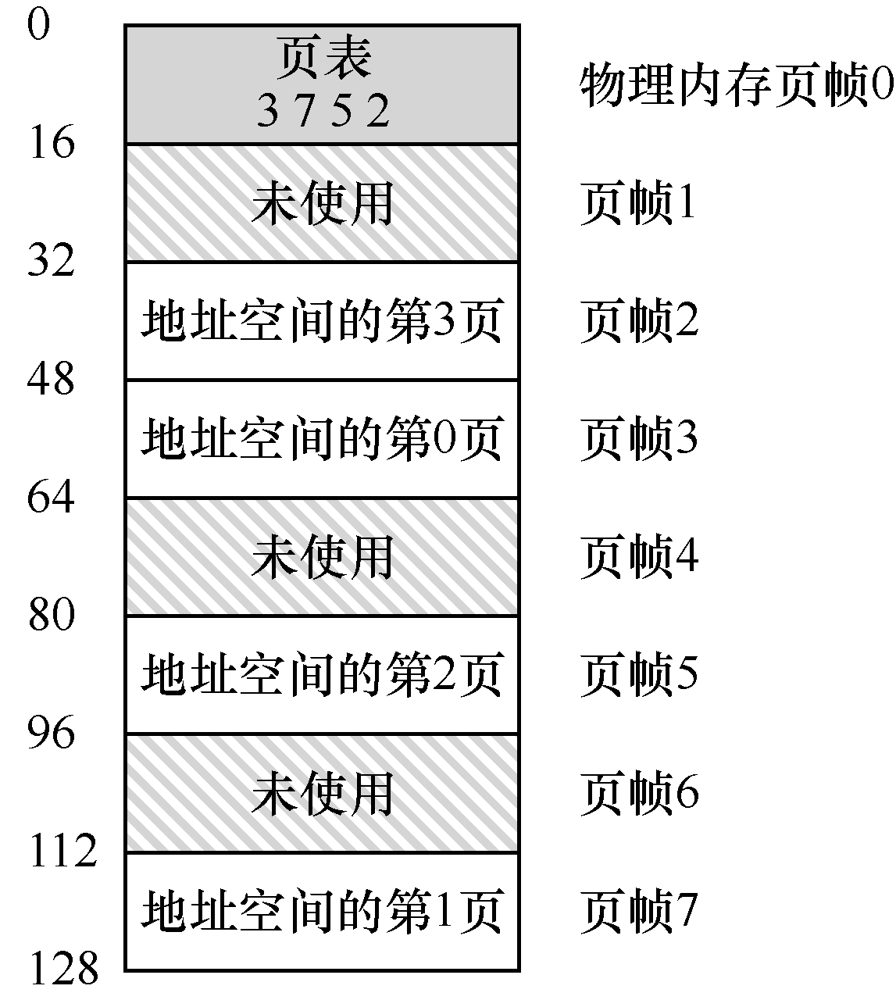

# 18.2 页表存在哪里

页表可以变得非常大，比我们之前讨论过的小段表或基址/界限对要大得多。例如，想象一个典型的 32 位地址空间，带有 4KB 的页。这个虚拟地址分成 20 位的 VPN 和 12 位的偏移量（回想一下，1KB 的页面大小需要 10 位，只需增加两位即可达到 4KB）。

一个 20 位的 VPN 意味着，操作系统必须为每个进程管理 220 个地址转换（大约一百万）。假设每个页表格条目（PTE）需要 4 个字节，来保存物理地址转换和任何其他有用的东西，每个页表就需要巨大的 4MB 内存！这非常大。现在想象一下有 100 个进程在运行：这意味着操作系统会需要 400MB 内存，只是为了所有这些地址转换！即使是现在，机器拥有千兆字节的内存，将它的一大块仅用于地址转换，这似乎有点疯狂，不是吗？我们甚至不敢想 64 位地址空间的页表有多大。那太可怕了，也许把你吓坏了。

由于页表如此之大，我们没有在 MMU 中利用任何特殊的片上硬件，来存储当前正在运行的进程的页表，而是将每个进程的页表存储在内存中。现在让我们假设页表存在于操作系统管理的物理内存中，稍后我们会看到，很多操作系统内存本身都可以虚拟化，因此页表可以存储在操作系统的虚拟内存中（甚至可以交换到磁盘上），但是现在这太令人困惑了，所以我们会忽略它。图 18.4 展示了操作系统内存中的页表，看到其中的一小组地址转换了吗？

