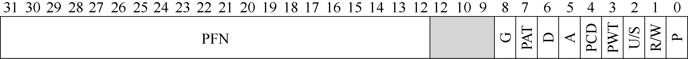

# 18.3 列表中究竟有什么

让我们来谈谈页表的组织。页表就是一种数据结构，用于将虚拟地址（或者实际上，是虚拟页号）映射到物理地址（物理帧号）。因此，任何数据结构都可以采用。最简单的形式称为线性页表（linear page table），就是一个数组。操作系统通过虚拟页号（VPN）检索该数组，并在该索引处查找页表项（PTE），以便找到期望的物理帧号（PFN）。现在，我们将假设采用这个简单的线性结构。在后面的章节中，我们将利用更高级的数据结构来帮助解决一些分页问题。

至于每个 PTE 的内容，我们在其中有许多不同的位，值得有所了解。有效位（valid bit）通常用于指示特定地址转换是否有效。例如，当一个程序开始运行时，它的代码和堆在其地址空间的一端，栈在另一端。所有未使用的中间空间都将被标记为无效（invalid），如果进程尝试访问这种内存，就会陷入操作系统，可能会导致该进程终止。因此，有效位对于支持稀疏地址空间至关重要。通过简单地将地址空间中所有未使用的页面标记为无效，我们不再需要为这些页面分配物理帧，从而节省大量内存。

我们还可能有保护位（protection bit），表明页是否可以读取、写入或执行。同样，以这些位不允许的方式访问页，会陷入操作系统。

还有其他一些重要的部分，但现在我们不会过多讨论。存在位（present bit）表示该页是在物理存储器还是在磁盘上（即它已被换出，swapped out）。当我们研究如何将部分地址空间交换（swap）到磁盘，从而支持大于物理内存的地址空间时，我们将进一步理解这一机制。交换允许操作系统将很少使用的页面移到磁盘，从而释放物理内存。脏位（dirty bit）也很常见，表明页面被带入内存后是否被修改过。

参考位（reference bit，也被称为访问位，accessed bit）有时用于追踪页是否被访问，也用于确定哪些页很受欢迎，因此应该保留在内存中。这些知识在页面替换（page replacement）时非常重要，我们将在随后的章节中详细研究这一主题。

图 18.5 显示了来自 x86 架构的示例页表项[I09]。它包含一个存在位（P），确定是否允许写入该页面的读/写位（R/W），确定用户模式进程是否可以访问该页面的用户/超级用户位（U/S），有几位（PWT、PCD、PAT 和 G）确定硬件缓存如何为这些页面工作，一个访问位（A）和一个脏位（D），最后是页帧号（PFN）本身。

阅读英特尔架构手册[I09]，以获取有关 x86 分页支持的更多详细信息。然而，要事先警告，阅读这些手册时，尽管非常有用（对于在操作系统中编写代码以使用这些页表的用户而言，这些手册当然是必需的），但起初可能很具挑战性。需要一点耐心和强烈的愿望。
