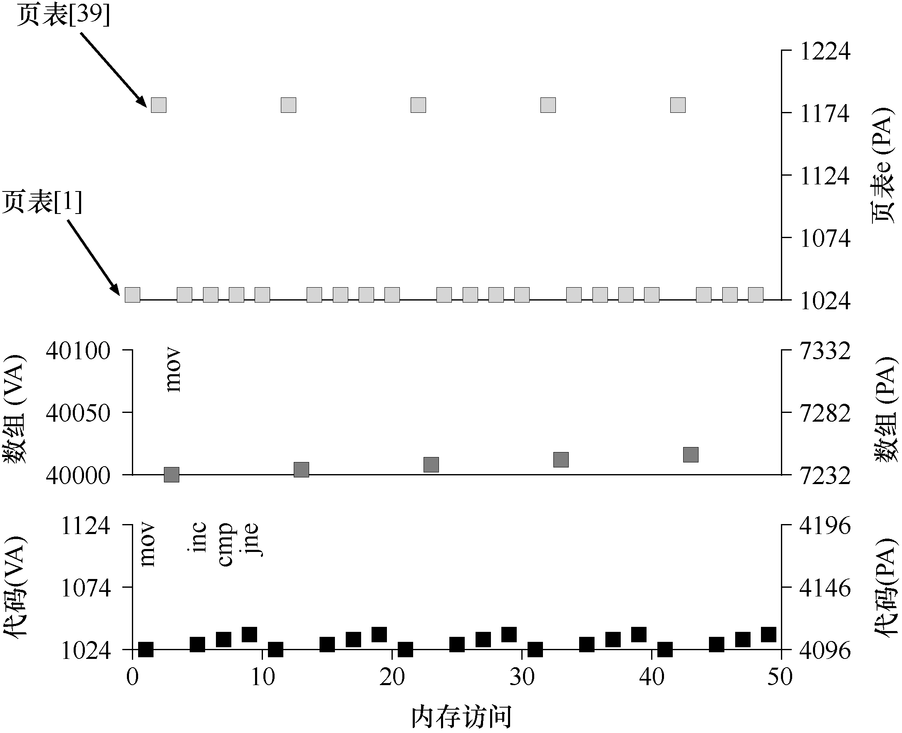

# 18.5 内存追踪

在结束之前，我们现在通过一个简单的内存访问示例，来演示使用分页时产生的所有内存访问。我们感兴趣的代码片段（用 C 写的，名为 `array.c`）是这样的：

```c
int array[1000];
...
for (i = 0; i < 1000; i++)
    array[i] = 0;
```

我们编译 `array.c` 并使用以下命令运行它：

```console
prompt> gcc -o array array.c -Wall -O
prompt> ./array
```

> **补充：数据结构——页表**
>
> 现代操作系统的内存管理子系统中最重要的数据结构之一就是页表（page table）。通常，页表存储虚拟—物理地址转换（virtual-to-physical address translation），从而让系统知道地址空间的每个页实际驻留在物理内存中的哪个位置。由于每个地址空间都需要这种转换，因此一般来说，系统中每个进程都有一个页表。页表的确切结构要么由硬件（旧系统）确定，要么由 OS（现代系统）更灵活地管理。

当然，为了真正理解这个代码片段（它只是初始化一个数组）进程怎样的内存访问，我们必须知道（或假设）一些东西。首先，我们必须反汇编结果二进制文件（在 Linux 上使用 `objdump` 或在 Mac 上使用 `otool`），查看使用什么汇编指令来初始化循环中的数组。以下是生成的汇编代码：

```asm
0x1024 movl $0x0,(%edi,%eax,4)
0x1028 incl %eax
0x102c cmpl $0x03e8,%eax
0x1030 jne  0x1024
```

如果懂一点 x86，代码实际上很容易理解[^instruction-size]。第一条指令将零值（显示为 `$0x0`）移动到数组位置的虚拟内存地址，这个地址是通过取 `%edi` 的内容并将其加上 `%eax` 乘以 4 来计算的。因此，`%edi` 保存数组的基址，而 `%eax` 保存数组索引（i）。我们乘以 4，因为数组是一个整型数组，每个元素的大小为 4 个字节。

第二条指令增加保存在 `%eax` 中的数组索引，第三条指令将该寄存器的内容与十六进制值 `0x03e8` 或十进制数 1000 进行比较。如果比较结果显示两个值不相等（这就是 `jne` 指令测试），第四条指令跳回到循环的顶部。

为了理解这个指令序列（在虚拟层和物理层）所访问的内存，我们必须假设虚拟内存中代码片段和数组的位置，以及页表的内容和位置。

对于这个例子，我们假设一个大小为 64KB 的虚拟地址空间（不切实际地小）。我们还假定页面大小为 1KB。

我们现在需要知道页表的内容，以及它在物理内存中的位置。假设有一个线性（基于数组）的页表，它位于物理地址 1KB（1024）。

至于其内容，我们只需要关心为这个例子映射的几个虚拟页面。首先，存在代码所在的虚拟页面。由于页大小为 1KB，虚拟地址 1024 驻留在虚拟地址空间的第二页（VPN = 1，因为 VPN = 0 是第一页）。假设这个虚拟页映射到物理帧 4（VPN 1→PFN 4）。[^address-note]

接下来是数组本身。它的大小是 4000 字节（1000 整数），我们假设它驻留在虚拟地址 40000 到 44000（不包括最后一个字节）。它的虚拟页的十进制范围是 VPN = 39……VPN = 42。因此，我们需要这些页的映射。针对这个例子，让我们假设以下虚拟到物理的映射：

```text
(VPN 39 → PFN 7), (VPN 40 → PFN 8), (VPN 41 → PFN 9), (VPN 42 → PFN 10)
```

我们现在准备好跟踪程序的内存引用了。当它运行时，每个取指将产生两个内存引用：一个访问页表以查找指令所在的物理框架，另一个访问指令本身将其提取到 CPU 进行处理。另外，在 `mov` 指令的形式中，有一个显式的内存引用，这会首先增加另一个页表访问（将数组虚拟地址转换为正确的物理地址），然后是数组访问本身。

图 18.7 展示了前 5 次循环迭代的整个过程。最下面的图显示了 y 轴上的指令内存引用（黑色虚拟地址和右边的实际物理地址）。中间的图以深灰色展示了数组访问（同样，虚拟在左侧，物理在右侧）；最后，最上面的图展示了浅灰色的页表内存访问（只有物理的，因为本例中的页表位于物理内存中）。整个追踪的 x 轴显示循环的前 5 个迭代中内存访问。每个循环有 10 次内存访问，其中包括 4 次取指令，一次显式更新内存，以及 5 次页表访问，为这 4 次获取和一次显式更新进行地址转换。



看看你是否可以理解在这个可视化中出现的模式。特别是，随着循环继续，超过前 5 次迭代，会发生什么变化？哪些新的内存位置将被访问？你能弄明白吗？

这只是最简单的例子（只有几行 C 代码），但你可能已经能够感觉到理解实际应用程序的实际内存行为的复杂性。别担心：它肯定会变得更糟，因为我们即将引入的机制只会使这个已经很复杂的机器更复杂。

[^instruction-size]: 我们在这里隐瞒了一点事实，假设每条指令的大小都是 4 字节，实际上，x86 指令是可变大小的。

[^address-note]: **编校注：** 原书汇编地址写作 `0x1024`，此处正文和图 18.7 则从十进制 1024 开始。`0x1024` 的十进制值为 4132，与 VPN = 1 的计算不一致；本节保留原书两处写法。阅读图 18.7 时，以图和正文的十进制地址为准。此注为整理时添加，详见[编校说明](../../编校说明.md)。
