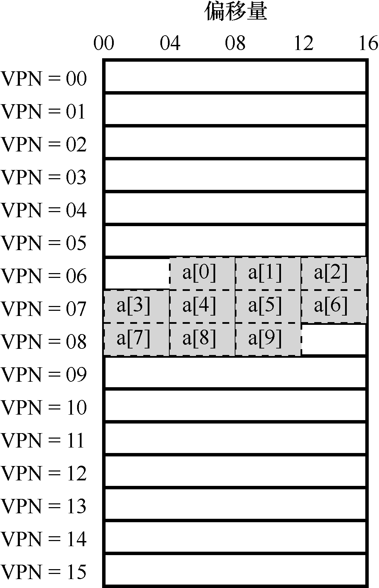

# 19.1 TLB 的基本算法

图19.1 展示了一个大体框架，说明硬件如何处理虚拟地址转换，假定使用简单的线性页表（linear page table，即页表是一个数组）和硬件管理的TLB（hardware-managed TLB，即硬件承担许多页表访问的责任，下面会有更多解释）。

```text
VPN = (VirtualAddress & VPN_MASK) >> SHIFT
(Success, TlbEntry) = TLB_Lookup(VPN)
if (Success == True)    // TLB Hit
    if (CanAccess(TlbEntry.ProtectBits) == True)
        Offset   = VirtualAddress & OFFSET_MASK
        PhysAddr = (TlbEntry.PFN << SHIFT) | Offset
        AccessMemory(PhysAddr)
    else
        RaiseException(PROTECTION_FAULT)
else    // TLB Miss
    PTEAddr = PTBR + (VPN * sizeof(PTE))
    PTE = AccessMemory(PTEAddr)
    if (PTE.Valid == False)
        RaiseException(SEGMENTATION_FAULT)
    else if (CanAccess(PTE.ProtectBits) == False)
        RaiseException(PROTECTION_FAULT)
    else
        TLB_Insert(VPN, PTE.PFN, PTE.ProtectBits)
        RetryInstruction()
```

*图19.1 TLB 控制流算法*

硬件算法的大体流程如下：首先从虚拟地址中提取页号（VPN）（见图19.1 第1 行），然后检查TLB 是否有该VPN 的转换映射（第2 行）。如果有，我们有了TLB 命中（TLB hit），这意味着TLB 有该页的转换映射。成功！接下来我们就可以从相关的TLB 项中取出页帧号（PFN），与原来虚拟地址中的偏移量组合形成期望的物理地址（PA），并访问内存（第5～7行），假定保护检查没有失败（第4 行）。

如果CPU 没有在TLB 中找到转换映射（TLB 未命中），我们有一些工作要做。在本例中，硬件访问页表来寻找转换映射（第11～12 行），并用该转换映射更新TLB（第18 行），假设该虚拟地址有效，而且我们有相关的访问权限（第13、15 行）。上述系列操作开销较大，主要是因为访问页表需要额外的内存引用（第12 行）。最后，当TLB 更新成功后，系统会重新尝试该指令，这时TLB 中有了这个转换映射，内存引用得到很快处理。

TLB 和其他缓存相似，前提是在一般情况下，转换映射会在缓存中（即命中）。如果是这样，只增加了很少的开销，因为TLB 处理器核心附近，设计的访问速度很快。如果TLB未命中，就会带来很大的分页开销。必须访问页表来查找转换映射，导致一次额外的内存引用（或者更多，如果页表更复杂）。如果这经常发生，程序的运行就会显著变慢。相对于大多数CPU 指令，内存访问开销很大，TLB 未命中导致更多内存访问。因此，我们希望尽可能避免TLB 未命中。


