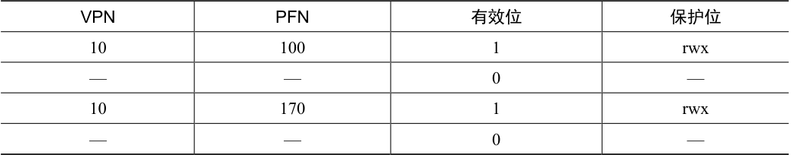
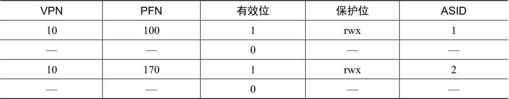
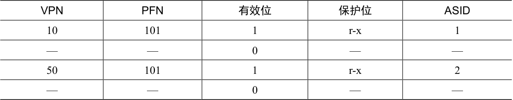

# 19.5 上下文切换时对TLB 的处理

有了TLB，在进程间切换时（因此有地址空间切换），会面临一些新问题。具体来说，TLB 中包含的虚拟到物理的地址映射只对当前进程有效，对其他进程是没有意义的。所以在发生进程切换时，硬件或操作系统（或二者）必须注意确保即将运行的进程不要误读了之前进程的地址映射。

为了更好地理解这种情况，我们来看一个例子。当一个进程（P1）正在运行时，假设TLB 缓存了对它有效的地址映射，即来自P1 的页表。对这个例子，假设P1 的10 号虚拟页映射到了100 号物理帧。

在这个例子中，假设还有一个进程（P2），操作系统不久后决定进行一次上下文切换，运行P2。这里假定P2 的10 号虚拟页映射到170 号物理帧。如果这两个进程的地址映射都在TLB 中，TLB 的内容如表19.1 所示。

表格文字

| VPN | PFN | 有效位 | 保护位 |
| --- | --- | --- | --- |
| 10 | 100 | 1 | rwx |
| — | — | 0 | — |
| 10 | 170 | 1 | rwx |
| — | — | 0 | — |

在上面的TLB 中，很明显有一个问题：VPN 10 被转换成了 PFN 100（P1）和PFN 170（P2），但硬件分不清哪个项属于哪个进程。所以我们还需要做一些工作，让TLB 正确而高效地支持跨多进程的虚拟化。因此，关键问题是：

> **关键问题：进程切换时如何管理TLB 的内容**

> 如果发生进程间上下文切换，上一个进程在TLB 中的地址映射对于即将运行的进程是无意义的。硬件或操作系统应该做些什么来解决这个问题呢？

这个问题有一些可能的解决方案。一种方法是在上下文切换时，简单地清空（flush）TLB，这样在新进程运行前TLB 就变成了空的。如果是软件管理TLB 的系统，可以在发生上下文切换时，通过一条显式（特权）指令来完成。如果是硬件管理TLB，则可以在页表基址寄存器内容发生变化时清空TLB（注意，在上下文切换时，操作系统必须改变页表基址寄存器（PTBR）的值）。不论哪种情况，清空操作都是把全部有效位（valid）置为0，本质上清空了TLB。

上下文切换的时候清空TLB，这是一个可行的解决方案，进程不会再读到错误的地址映射。但是，有一定开销：每次进程运行，当它访问数据和代码页时，都会触发TLB 未命中。如果操作系统频繁地切换进程，这种开销会很高。

为了减少这种开销，一些系统增加了硬件支持，实现跨上下文切换的TLB 共享。比如有的系统在TLB 中添加了一个地址空间标识符（Address Space Identifier，ASID）。可以把ASID 看作是进程标识符（Process Identifier，PID），但通常比PID 位数少（PID 一般32 位，ASID 一般是8 位）。

如果仍以上面的TLB 为例，加上 ASID，很清楚不同进程可以共享TLB 了：只要ASID字段来区分原来无法区分的地址映射。表19.2 展示了添加ASID 字段后的TLB。

表格文字

| VPN | PFN | 有效位 | 保护位 | ASID |
| --- | --- | --- | --- | --- |
| 10 | 100 | 1 | rwx | 1 |
| — | — | 0 | — | — |
| 10 | 170 | 1 | rwx | 2 |
| — | — | 0 | — | — |

因此，有了地址空间标识符，TLB 可以同时缓存不同进程的地址空间映射，没有任何冲突。当然，硬件也需要知道当前是哪个进程正在运行，以便进行地址转换，因此操作系统在上下文切换时，必须将某个特权寄存器设置为当前进程的ASID。

补充一下，你可能想到了另一种情况，TLB 中某两项非常相似。在表19.3 中，属于两个不同进程的两项，将两个不同的VPN 指向了相同的物理页。

表格文字

| VPN | PFN | 有效位 | 保护位 | ASID |
| --- | --- | --- | --- | --- |
| 10 | 101 | 1 | r-x | 1 |
| — | — | 0 | — | — |
| 50 | 101 | 1 | r-x | 2 |
| — | — | 0 | — | — |

如果两个进程共享同一物理页（例如代码段的页），就可能出现这种情况。在上面的例子中，进程P1 和进程P2 共享101 号物理页，但是P1 将自己的10 号虚拟页映射到该物理页，而P2 将自己的50 号虚拟页映射到该物理页。共享代码页（以二进制或共享库的方式）是有用的，因为它减少了物理页的使用，从而减少了内存开销。
