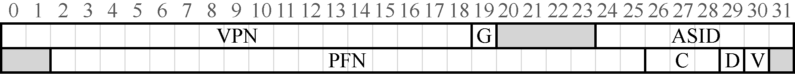

# 19.7 实际系统的TLB 表项

最后，我们简单看一下真实的TLB。这个例子来自MIPS R4000[H93]，它是一种现代的系统，采用软件管理TLB。图19.4 展示了稍微简化的MIPS TLB 项。

MIPS R4000 支持32 位的地址空间，页大小为4KB。所以在典型的虚拟地址中，预期会看到20 位的VPN 和12 位的偏移量。但是，你可以在TLB 中看到，只有19 位的VPN。事实上，用户地址只占地址空间的一半（剩下的留给内核），所以只需要19 位的 VPN。VPN转换成最大24 位的物理帧号（PFN），因此可以支持最多有64GB 物理内存（224个4KB 内存页）的系统。

MIPS TLB 还有一些有趣的标识位。比如全局位（Global，G），用来指示这个页是不是所有进程全局共享的。因此，如果全局位置为1，就会忽略ASID。我们也看到了8 位的ASID，操作系统用它来区分进程空间（像上面介绍的一样）。这里有一个问题：如果正在运行的进程数超过256（28）个怎么办？最后，我们看到3 个一致性位（Coherence，C），决定硬件如何缓存该页（其中一位超出了本书的范围）；脏位（dirty），表示该页是否被写入新数据（后面会介绍用法）；有效位（valid），告诉硬件该项的地址映射是否有效。还有没在图19.4 中展示的页掩码（page mask）字段，用来支持不同的页大小。后面会介绍，为什么更大的页可能有用。最后，64 位中有一些未使用（图19.4 中灰色部分）。

MIPS 的TLB 通常有32 项或64 项，大多数提供给用户进程使用，也有一小部分留给操作系统使用。操作系统可以设置一个被监听的寄存器，告诉硬件需要为自己预留多少TLB槽。这些保留的转换映射，被操作系统用于关键时候它要使用的代码和数据，在这些时候，TLB 未命中可能会导致问题（例如，在TLB 未命中处理程序中）。

由于MIPS 的TLB 是软件管理的，所以系统需要提供一些更新TLB 的指令。MIPS 提供了4 个这样的指令：TLBP，用来查找指定的转换映射是否在TLB 中；TLBR，用来将TLB中的内容读取到指定寄存器中；TLBWI，用来替换指定的TLB 项；TLBWR，用来随机替换一个TLB 项。操作系统可以用这些指令管理TLB 的内容。当然这些指令是特权指令，这很关键。如果用户程序可以任意修改TLB 的内容，你可以想象一下会发生什么可怕的事情。

> **提示：RAM 不总是RAM（Culler 定律）**

> 随机存取存储器（Random-Access Memory，RAM）暗示你访问RAM 的任意部分都一样快。虽然一般这样想RAM 没错，但因为TLB 这样的硬件/操作系统功能，访问某些内存页的开销较大，尤其是没有被TLB 缓存的页。因此，最好记住这个实现的窍门：RAM 不总是RAM。有时候随机访问地址空间，尤其是TLB 没有缓存的页，可能导致严重的性能损失。因为我的一位导师David Culler 过去常常指出TLB 是许多性能问题的源头，所以我们以他来命名这个定律：Culler 定律（Culler’s Law）。
