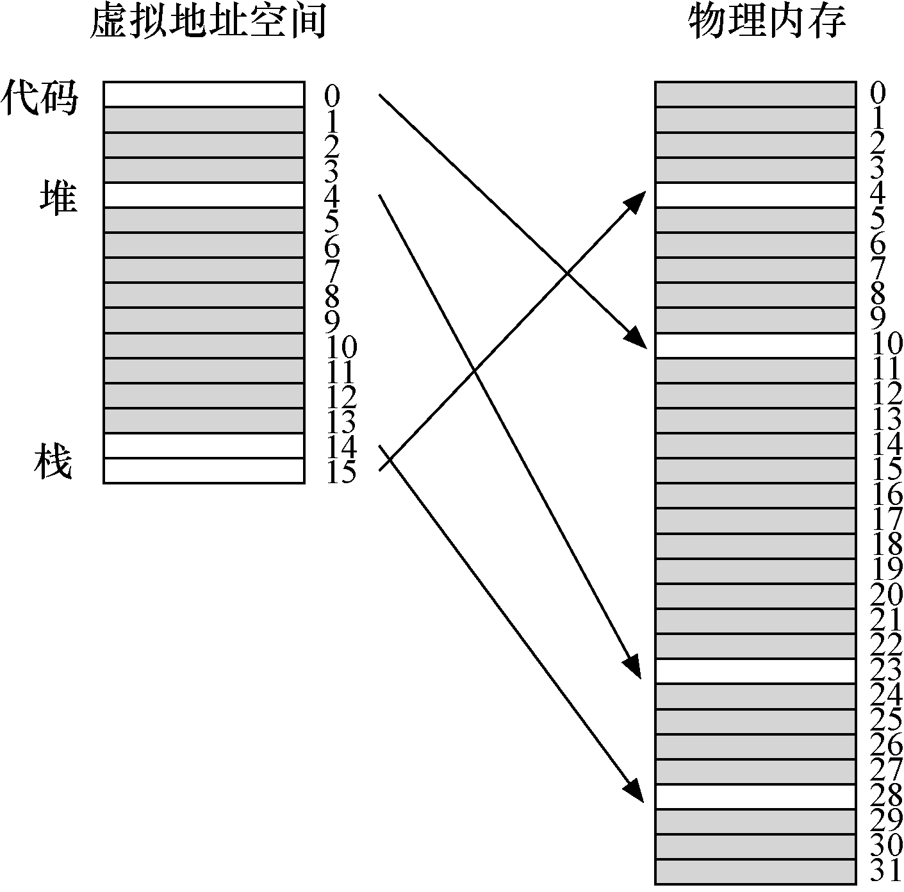
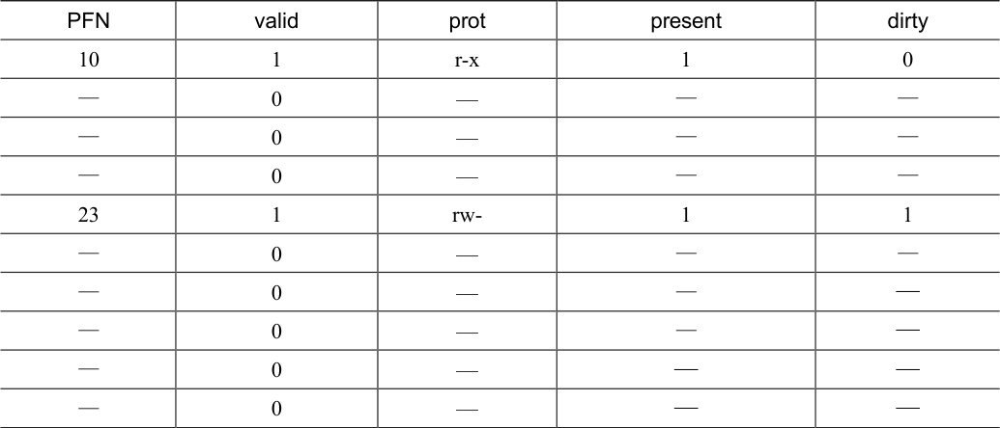
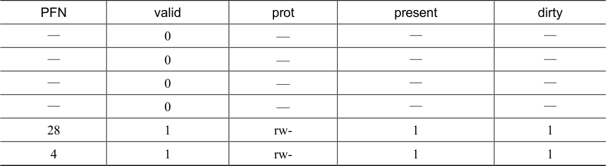
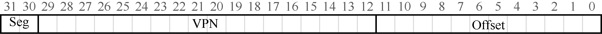

# 20.2 混合方法：分页和分段

在生活中，每当有两种合理但不同的方法时，你应该总是研究两者的结合，看看能否两全其美。我们称这种组合为杂合（hybrid）。例如，为什么只吃巧克力或简单的花生酱，而不是将两者结合起来，就像可爱的花生酱巧克力杯[M28]？

多年前，Multics 的创造者（特别是Jack Dennis）在构建Multics 虚拟内存系统时，偶然发现了这样的想法[M07]。具体来说，Dennis 想到



将分页和分段相结合，以减少页表的内存开销。更仔细地看看典型的线性页表，就可以理解为什么这可能有用。假设我们有一个地址空间，其中堆和栈的使用部分很小。例如，我们使用一个16KB 的小地址空间和1KB 的页（见图20.1）。该地址空间的页表如表20.1 所示。

这个例子假定单个代码页（VPN 0）映射到物理页10，单个堆页（VPN 4）映射到物理页23，以及地址空间另一端的两个栈页（VPN 14 和15）被分别映射到物理页28 和4。从图20.1 中可以看到，大部分页表都没有使用，充满了无效的（invalid）项。真是太浪费了！这是一个微小的16KB 地址空间。想象一下32 位地址空间的页表和所有潜在的浪费空间！真的，不要想象这样的事情，太可怕了。



<details markdown="1">
<summary>表格文字</summary>

| PFN | valid | prot | present | dirty |
| --- | --- | --- | --- | --- |
| 10 | 1 | r-x | 1 | 0 |
| — | 0 | — | — | — |
| — | 0 | — | — | — |
| — | 0 | — | — | — |
| 23 | 1 | rw- | 1 | 1 |
| — | 0 | — | — | — |
| — | 0 | — | — | — |
| — | 0 | — | — | — |
| — | 0 | — | — | — |
| — | 0 | — | — | — |

</details>

续表



<details markdown="1">
<summary>表格文字</summary>

| PFN | valid | prot | present | dirty |
| --- | --- | --- | --- | --- |
| — | 0 | — | — | — |
| — | 0 | — | — | — |
| — | 0 | — | — | — |
| — | 0 | — | — | — |
| 28 | 1 | rw- | 1 | 1 |
| 4 | 1 | rw- | 1 | 1 |

</details>

因此，我们的杂合方法不是为进程的整个地址空间提供单个页表，而是为每个逻辑分段提供一个。在这个例子中，我们可能有3 个页表，地址空间的代码、堆和栈部分各有一个。

现在，回忆在分段中，有一个基址（base）寄存器，告诉我们每个段在物理内存中的位置，还有一个界限（bound）或限制（limit）寄存器，告诉我们该段的大小。在杂合方案中，我们仍然在MMU 中拥有这些结构。在这里，我们使用基址不是指向段本身，而是保存该段的页表的物理地址。界限寄存器用于指示页表的结尾（即它有多少有效页）。

我们通过一个简单的例子来澄清。假设32 位虚拟地址空间包含4KB 页面，并且地址空间分为 4 个段。在这个例子中，我们只使用 3 个段：一个用于代码，另一个用于堆，还有一个用于栈。

要确定地址引用哪个段，我们会用地址空间的前两位。假设00 是未使用的段，01 是代码段，10 是堆段，11 是栈段。因此，虚拟地址如下所示：



在硬件中，假设有3 个基本/界限对，代码、堆和栈各一个。当进程正在运行时，每个段的基址寄存器都包含该段的线性页表的物理地址。因此，系统中的每个进程现在都有3 个与其关联的页表。在上下文切换时，必须更改这些寄存器，以反映新运行进程的页表的位置。

在TLB 未命中时（假设硬件管理的TLB，即硬件负责处理TLB 未命中），硬件使用分段位（SN）来确定要用哪个基址和界限对。然后硬件将其中的物理地址与VPN 结合起来，形成页表项（PTE）的地址：

```text
SN           = (VirtualAddress & SEG_MASK) >> SN_SHIFT
VPN          = (VirtualAddress & VPN_MASK) >> VPN_SHIFT
AddressOfPTE = Base[SN] + (VPN * sizeof(PTE))
```

这段代码应该看起来很熟悉，它与我们之前在线性页表中看到的几乎完全相同。当然，唯一的区别是使用3 个段基址寄存器中的一个，而不是单个页表基址寄存器。

杂合方案的关键区别在于，每个分段都有界限寄存器，每个界限寄存器保存了段中最大有效页的值。例如，如果代码段使用它的前3 个页（0、1 和2），则代码段页表将只有3个项分配给它，并且界限寄存器将被设置为3。内存访问超出段的末尾将产生一个异常，并可能导致进程终止。以这种方式，与线性页表相比，杂合方法实现了显著的内存节省。栈和堆之间未分配的页不再占用页表中的空间（仅将其标记为无效）。

> **提示：使用杂合**

> 当你有两个看似相反的好主意时，你应该总是看到你是否可以将它们组合成一个能够实现两全其美的杂合体（hybrid）。例如，杂交玉米物种已知比任何天然存在的物种更强壮。当然，并非所有的杂合都是好主意，请参阅Zeedonk（或Zonkey），它是斑马和驴的杂交。如果你不相信这样的生物存在，就查一下，你会大吃一惊。

但是，你可能会注意到，这种方法并非没有问题。首先，它仍然要求使用分段。正如我们讨论的那样，分段并不像我们需要的那样灵活，因为它假定地址空间有一定的使用模式。例如，如果有一个大而稀疏的堆，仍然可能导致大量的页表浪费。其次，这种杂合导致外部碎片再次出现。尽管大部分内存是以页面大小单位管理的，但页表现在可以是任意大小（是PTE 的倍数）。因此，在内存中为它们寻找自由空间更为复杂。出于这些原因，人们继续寻找更好的方式来实现更小的页表。
