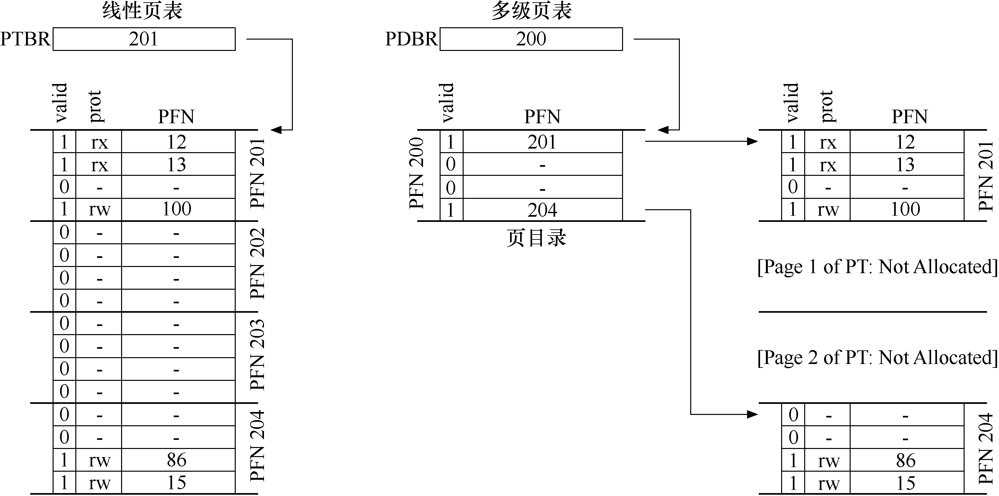
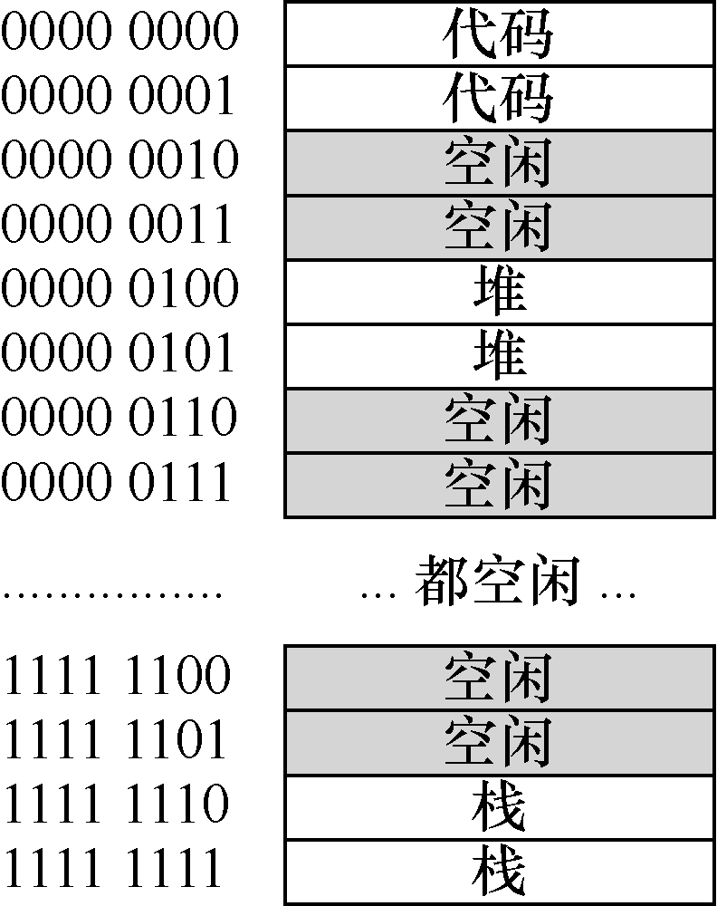
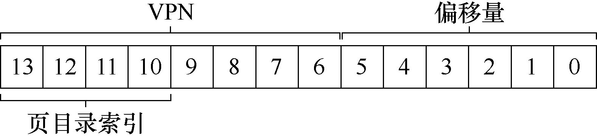
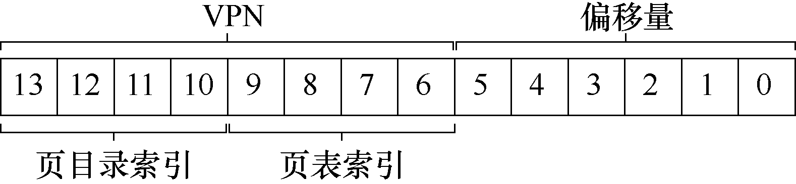
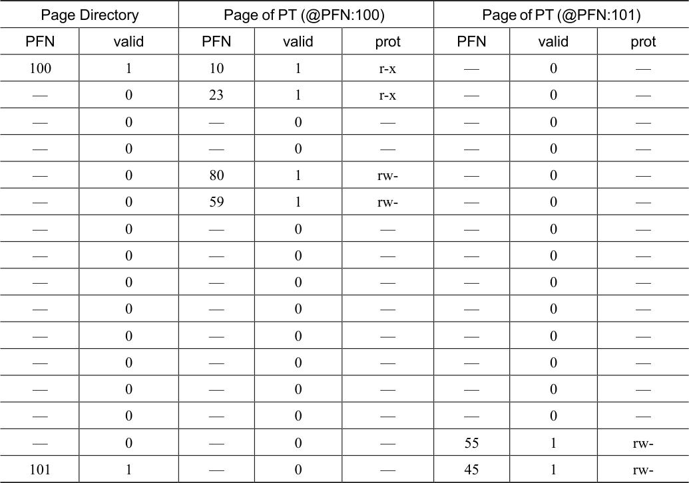
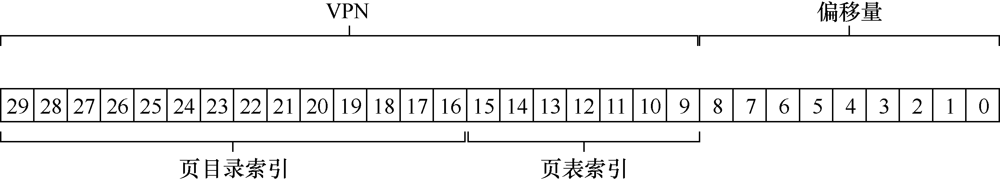
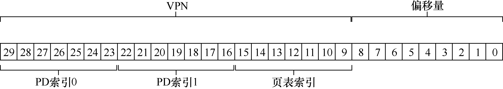

# 20.3 多级页表

另一种方法并不依赖于分段，但也试图解决相同的问题：如何去掉页表中的所有无效区域，而不是将它们全部保留在内存中？我们将这种方法称为多级页表（multi-level page table），因为它将线性页表变成了类似树的东西。这种方法非常有效，许多现代系统都用它（例如x86 [BOH10]）。我们现在详细描述这种方法。

多级页表的基本思想很简单。首先，将页表分成页大小的单元。然后，如果整页的页表项（PTE）无效，就完全不分配该页的页表。为了追踪页表的页是否有效（以及如果有效，它在内存中的位置），使用了名为页目录（page directory）的新结构。页目录因此可以告诉你页表的页在哪里，或者页表的整个页不包含有效页。

图20.2 展示了一个例子。图的左边是经典的线性页表。即使地址空间的大部分中间区域无效，我们仍然需要为这些区域分配页表空间（即页表的中间两页）。右侧是一个多级页表。页目录仅将页表的两页标记为有效（第一个和最后一个）；因此，页表的这两页就驻留在内存中。因此，你可以形象地看到多级页表的工作方式：它只是让线性页表的一部分消失（释放这些帧用于其他用途），并用页目录来记录页表的哪些页被分配。

在一个简单的两级页表中，页目录为每页页表包含了一项。它由多个页目录项（Page Directory Entries，PDE）组成。PDE（至少）拥有有效位（valid bit）和页帧号（page frame number，PFN），类似于PTE。但是，正如上面所暗示的，这个有效位的含义稍有不同：如果PDE 项是有效的，则意味着该项指向的页表（通过PFN）中至少有一页是有效的，即在该PDE 所指向的页中，至少一个PTE，其有效位被设置为1。如果PDE 项无效（即等于零），则PDE的其余部分没有定义。

与我们至今为止看到的方法相比，多级页表有一些明显的优势。首先，也许最明显的是，多级页表分配的页表空间，与你正在使用的地址空间内存量成比例。因此它通常很紧凑，并且支持稀疏的地址空间。



其次，如果仔细构建，页表的每个部分都可以整齐地放入一页中，从而更容易管理内存。操作系统可以在需要分配或增长页表时简单地获取下一个空闲页。将它与一个简单的（非分页）线性页表相比[^p176-1]，后者仅是按VPN 索引的PTE 数组。用这样的结构，整个线性页表必须连续驻留在物理内存中。对于一个大的页表（比如4MB），找到如此大量的、未使用的连续空闲物理内存，可能是一个相当大的挑战。有了多级结构，我们增加了一个间接层（level of indirection），使用了页目录，它指向页表的各个部分。这种间接方式，让我们能够将页表页放在物理内存的任何地方。

> **提示：理解时空折中**

> 在构建数据结构时，应始终考虑时间和空间的折中（time-space trade-off）。通常，如果你希望更快地访问特定的数据结构，就必须为该结构付出空间的代价。

应该指出，多级页表是有成本的。在TLB 未命中时，需要从内存加载两次，才能从页表中获取正确的地址转换信息（一次用于页目录，另一次用于PTE 本身），而用线性页表只需要一次加载。因此，多级表是一个时间—空间折中（time-space trade-off）的小例子。我们想要更小的表（并得到了），但不是没代价。尽管在常见情况下（TLB 命中），性能显然是相同的，但TLB 未命中时，则会因较小的表而导致较高的成本。

另一个明显的缺点是复杂性。无论是硬件还是操作系统来处理页表查找（在TLB 未命中时），这样做无疑都比简单的线性页表查找更复杂。通常我们愿意增加复杂性以提高性能或降低管理费用。在多级表的情况下，为了节省宝贵的内存，我们使页表查找更加复杂。

## 详细的多级示例

为了更好地理解多级页表背后的想法，我们来看一个例子。设想一个大小为16KB 的小地址空间，其中包含64 个字节的页。因此，我们有一个14 位的虚拟地址空间，VPN 有8位，偏移量有6 位。即使只有一小部分地址空间正在使用，线性页表也会有2<sup>8</sup>（256）个项。图20.3 展示了这种地址空间的一个例子。

> **提示：对复杂性表示怀疑**

> 系统设计者应该谨慎对待让系统增加复杂性。好的系统构建者所做的就是：实现最小复杂性的系统，来完成手上的任务。例如，如果磁盘空间非常大，则不应该设计一个尽可能少使用字节的文件系统。同样，如果处理器速度很快，建议在操作系统中编写一个干净、易于理解的模块，而不是CPU 优化的、手写汇编的代码。注意过早优化的代码或其他形式的不必要的复杂性。这些方法会让系统难以理解、维护和调试。正如Antoine de Saint-Exupery 的名言：“完美非无可增，乃不可减。”他没有写的是：“谈论完美易，真正实现难。

在这个例子中，虚拟页0 和1 用于代码，虚拟页4 和5 用



于堆，虚拟页254 和255 用于栈。地址空间的其余页未被使用。

要为这个地址空间构建一个两级页表，我们从完整的线性页表开始，将它分解成页大小的单元。回想一下我们的完整页表（在这个例子中）有256 个项；假设每个PTE 的大小是4个字节。因此，我们的页大小为1KB（256×4 字节）。鉴于我们有64 字节的页，1KB 页表可以分为16 个64 字节的页，每个页可以容纳16 个PTE。

我们现在需要了解：如何获取VPN，并用它来首先索引

和64 字节的页到页目录中，然后再索引到页表的页中。请记住，每个都是一组项。因此，我们需要弄清楚，如何为每个VPN 构建索引。

我们首先索引到页目录。这个例子中的页表很小：256 个项，分布在16 个页上。页目录需要为页表的每页提供一个项。因此，它有16 个项。结果，我们需要4 位VPN 来索引目录。我们使用VPN 的前4 位，如下所示：



一旦从VPN 中提取了页目录索引（简称PDIndex），我们就可以通过简单的计算来找到页目录项（PDE）的地址：PDEAddr = PageDirBase +（PDIndex×sizeof（PDE））。这就得到了页目录，现在我们来看它，在地址转换上取得进一步进展。

如果页目录项标记为无效，则我们知道访问无效，从而引发异常。但是，如果PDE 有效，我们还有更多工作要做。具体来说，我们现在必须从页目录项指向的页表的页中获取页表项（PTE）。要找到这个PTE，我们必须使用VPN 的剩余位索引到页表的部分：



这个页表索引（Page-Table Index，PTIndex）可以用来索引页表本身，给出PTE 的地址：

```text
PTEAddr = (PDE.PFN << SHIFT) + (PTIndex * sizeof(PTE))
```

请注意，从页目录项获得的页帧号（PFN）必须左移到位，然后再与页表索引组合，才能形成PTE 的地址。

为了确定这一切是否合理，我们现在代入一个包含一些实际值的多级页表，并转换一个虚拟地址。让我们从这个例子的页目录开始（见表20.2 的左侧）。

在该表中，可以看到每个页目录项（PDE）都描述了有关地址空间页表的一些内容。在这个例子中，地址空间里有两个有效区域（在开始和结束处），以及一些无效的映射。

在物理页100（页表的第0 页的物理帧号）中，我们有1 页，包含16 个页表项，记录了地址空间中的前16 个VPN。请参见表20.2（中间部分）了解这部分页表的内容。



<details markdown="1">
<summary>表格文字</summary>

| Page Directory |  | Page of PT (@PFN:100) |  |  | Page of PT (@PFN:101) |  |  |
| --- | --- | --- | --- | --- | --- | --- | --- |
| PFN | valid | PFN | valid | prot | PFN | valid | prot |
| 100 | 1 | 10 | 1 | r-x | — | 0 | — |
| — | 0 | 23 | 1 | r-x | — | 0 | — |
| — | 0 | — | 0 | — | — | 0 | — |
| — | 0 | — | 0 | — | — | 0 | — |
| — | 0 | 80 | 1 | rw- | — | 0 | — |
| — | 0 | 59 | 1 | rw- | — | 0 | — |
| — | 0 | — | 0 | — | — | 0 | — |
| — | 0 | — | 0 | — | — | 0 | — |
| — | 0 | — | 0 | — | — | 0 | — |
| — | 0 | — | 0 | — | — | 0 | — |
| — | 0 | — | 0 | — | — | 0 | — |
| — | 0 | — | 0 | — | — | 0 | — |
| — | 0 | — | 0 | — | — | 0 | — |
| — | 0 | — | 0 | — | — | 0 | — |
| — | 0 | — | 0 | — | 55 | 1 | rw- |
| 101 | 1 | — | 0 | — | 45 | 1 | rw- |

</details>

页表的这一页包含前16 个VPN 的映射。在我们的例子中，VPN 0 和1 是有效的（代码段），4 和5（堆）也是。因此，该表有每个页的映射信息。其余项标记为无效。

页表的另一个有效页在PFN 101 中。该页包含地址空间的最后16 个VPN 的映射。具体见表20.2（右侧）。

在这个例子中，VPN 254 和255（栈）包含有效的映射。希望从这个例子中可以看出，多级索引结构可以节省多少空间。在这个例子中，我们不是为一个线性页表分配完整的16页，而是分配3 页：一个用于页目录，两个用于页表的具有有效映射的块。大型（32 位或64 位）地址空间的节省显然要大得多。

最后，让我们用这些信息来进行地址转换。这里是一个地址，指向VPN 254 的第0 个字节：0x3F80，或二进制的11 1111 1000 0000。

回想一下，我们将使用VPN 的前4 位来索引页目录。因此，1111 会从上面的页目录中选择最后一个（第15 个，如果你从第0 个开始）。这就指向了位于地址101 的页表的有效页。然后，我们使用VPN 的下4 位（1110）来索引页表的那一页并找到所需的PTE。1110 是页面中的倒数第二（第14 个）条，并告诉我们虚拟地址空间的页254 映射到物理页55。通过连接PFN = 55（或十六进制0x37）和offset = 000000，可以形成我们想要的物理地址，并向内存系统发出请求：PhysAddr =（PTE.PFN &lt;&lt; SHIFT）+ offset = 00 1101 1100 0000 = 0x0DC0。

你现在应该知道如何构建两级页表，利用指向页表页的页目录。但遗憾的是，我们的工作还没有完成。我们现在要讨论，有时两个页级别是不够的！

## 超过两级

在至今为止的例子中，我们假定多级页表只有两个级别：一个页目录和几页页表。在某些情况下，更深的树是可能的（并且确实需要）。

让我们举一个简单的例子，用它来说明为什么更深层次的多级页表可能有用。在这个例子中，假设我们有一个30 位的虚拟地址空间和一个小的（512 字节）页。因此我们的虚拟地址有一个21 位的虚拟页号和一个9 位偏移量。

请记住我们构建多级页表的目标：使页表的每一部分都能放入一个页。到目前为止，我们只考虑了页表本身。但是，如果页目录太大，该怎么办？

要确定多级表中需要多少级别才能使页表的所有部分都能放入一页，首先要确定多少页表项可以放入一页。鉴于页大小为512 字节，并且假设PTE 大小为4 字节，你应该看到，可以在单个页上放入128 个PTE。当我们索引页表时，我们可以得出结论，我们需要VPN的最低有效位7 位（log<sub>2</sub>128）作为索引：



在上面你还可能注意到，多少位留给了（大）页目录：14。如果我们的页目录有2<sup>14</sup>个项，那么它不是一个页，而是128 个，因此我们让多级页表的每一个部分放入一页目标失败了。

为了解决这个问题，我们为树再加一层，将页目录本身拆成多个页，然后在其上添加另一个页目录，指向页目录的页。我们可以按如下方式分割虚拟地址：



现在，当索引上层页目录时，我们使用虚拟地址的最高几位（图中的PD 索引0）。该索引用于从顶级页目录中获取页目录项。如果有效，则通过组合来自顶级PDE 的物理帧号和VPN 的下一部分（PD 索引1）来查阅页目录的第二级。最后，如果有效，则可以通过使用与第二级PDE 的地址组合的页表索引来形成PTE 地址。这会有很多工作。所有这些只是为了在多级页表中查找某些东西。

## 地址转换过程：记住TLB

为了总结使用两级页表的地址转换的整个过程，我们再次以算法形式展示控制流（见图20.4）。该图显示了每个内存引用在硬件中发生的情况（假设硬件管理的TLB）。

从图中可以看到，在任何复杂的多级页表访问发生之前，硬件首先检查TLB。在命中时，物理地址直接形成，而不像之前一样访问页表。只有在TLB 未命中时，硬件才需要执行完整的多级查找。在这条路径上，可以看到传统的两级页表的成本：两次额外的内存访问来查找有效的转换映射。

```text
VPN = (VirtualAddress & VPN_MASK) >> SHIFT
(Success, TlbEntry) = TLB_Lookup(VPN)
if (Success == True)    // TLB Hit
    if (CanAccess(TlbEntry.ProtectBits) == True)
        Offset   = VirtualAddress & OFFSET_MASK
        PhysAddr = (TlbEntry.PFN << SHIFT) | Offset
        Register = AccessMemory(PhysAddr)
    else
        RaiseException(PROTECTION_FAULT)
else                  // TLB Miss
    // first, get page directory entry
    PDIndex = (VPN & PD_MASK) >> PD_SHIFT
    PDEAddr = PDBR + (PDIndex * sizeof(PDE))
    PDE     =  AccessMemory(PDEAddr)
    if (PDE.Valid == False)
        RaiseException(SEGMENTATION_FAULT)
    else
        // PDE is valid: now fetch PTE from page table
        PTIndex = (VPN & PT_MASK) >> PT_SHIFT
        PTEAddr = (PDE.PFN << SHIFT) + (PTIndex * sizeof(PTE))
        PTE     =  AccessMemory(PTEAddr)
        if (PTE.Valid == False)
            RaiseException(SEGMENTATION_FAULT)
        else if (CanAccess(PTE.ProtectBits) == False)
            RaiseException(PROTECTION_FAULT)
        else
            TLB_Insert(VPN, PTE.PFN, PTE.ProtectBits)
            RetryInstruction()
```

*图20.4 多级页表控制流*

[^p176-1]: 我们在这里做了一些假设，所有的页表全部驻留在物理内存中（即它们没有交换到磁盘）。我们很快就会放松这个假设。
