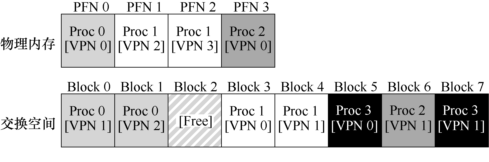

# 21.1 交换空间

我们要做的第一件事情就是，在硬盘上开辟一部分空间用于物理页的移入和移出。在操作系统中，一般这样的空间称为交换空间（swap space），因为我们将内存中的页交换到其中，并在需要的时候又交换回去。因此，我们会假设操作系统能够以页大小为单元读取或者写入交换空间。为了达到这个目的，操作系统需要记住给定页的硬盘地址（disk address）。

交换空间的大小是非常重要的，它决定了系统在某一时刻能够使用的最大内存页数。简单起见，现在假设它非常大。

在小例子中（见图21.1），你可以看到一个4 页的物理内存和一个8 页的交换空间。在这个例子中，3 个进程（进程0、进程1 和进程2）主动共享物理内存。但3 个中的每一个，都只有一部分有效页在内存中，剩下的在硬盘的交换空间中。第4 个进程（进程3）的所有页都被交换到硬盘上，因此很清楚它目前没有运行。有一块交换空间是空闲的。即使通过这个小例子，你应该也能看出，使用交换空间如何让系统假装内存比实际物理内存更大。

我们需要注意，交换空间不是唯一的硬盘交换目的地。例如，假设运行一个二进制程序（如ls，或者你自己编译的main 程序）。这个二进制程序的代码页最开始是在硬盘上，但程序运行的时候，它们被加载到内存中（要么在程序开始运行时全部加载，要么在现代操作系统中，按需要一页一页加载）。但是，如果系统需要在物理内存中腾出空间以满足其他需求，则可以安全地重新使用这些代码页的内存空间，因为稍后它又可以重新从硬盘上的二进制文件加载。

