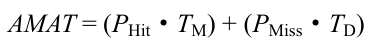

# 22.1 缓存管理

在深入研究策略之前，先详细描述一下我们要解决的问题。由于内存只包含系统中所有页的子集，因此可以将其视为系统中虚拟内存页的缓存（cache）。因此，在为这个缓存选择替换策略时，我们的目标是让缓存未命中（cache miss）最少，即使得从磁盘获取页的次数最少。或者，可以将目标看成让缓存命中（cache hit）最多，即在内存中找到待访问页的次数最多。

知道了缓存命中和未命中的次数，就可以计算程序的平均内存访问时间（Average Memory Access Time，AMAT，计算机架构师衡量硬件缓存的指标 [HP06]）。具体来说，给定这些值，可以按照如下公式计算AMAT：

其中TM 表示访问内存的成本，TD 表示访问磁盘的成本，PHit 表示在缓存中找到数据的概率（命中），PMiss表示在缓存中找不到数据的概率（未命中）。PHit和PMiss从0.0 变化到1.0，并且PMiss + PHit = 1.0。

例如，假设有一个机器有小型地址空间：4KB，每页256 字节。因此，虚拟地址由两部分组成：一个4 位VPN（最高有效位）和一个8 位偏移量（最低有效位）。因此，本例中的一个进程可以访问总共24=16 个虚拟页。在这个例子中，该进程将产生以下内存引用（即虚拟地址）0x000，0x100，0x200，0x300，0x400，0x500，0x600，0x700，0x800，0x900。这些虚拟地址指向地址空间中前10 页的每一页的第一个字节（页号是每个虚拟地址的第一个十六进制数字）。

让我们进一步假设，除了虚拟页3 之外，所有页都已经在内存中。因此，我们的内存引用序列将遇到以下行为：命中，命中，命中，未命中，命中，命中，命中，命中，命中。我们可以计算命中率（hit rate，在内存中找到引用的百分比）：90%（PHit = 0.9），因为10个引用中有9 个在内存中。未命中率（miss rate）显然是10%（PMiss = 0.1）。

要计算AMAT，需要知道访问内存的成本和访问磁盘的成本。假设访问内存（TM）的成本约为100ns，并且访问磁盘（TD）的成本大约为10ms，则我们有以下AMAT：0.9×100ns+ 0.1×10ms，即90ns + 1ms或1.0009ms，或约1ms。如果我们的命中率是99.9%（PMiss = 0.001），结果是完全不同的：AMAT 是10.1μs，大约快100 倍。当命中率接近100%时，AMAT 接近100ns。

遗憾的是，正如你在这个例子中看到的，在现代系统中，磁盘访问的成本非常高，即使很小概率的未命中也会拉低正在运行的程序的总体AMAT。显然，我们必须尽可能地避免缓存未命中，避免程序以磁盘的速度运行。要做到这一点，有一种方法就是仔细开发一个聪明的策略，像我们现在所做的一样。
