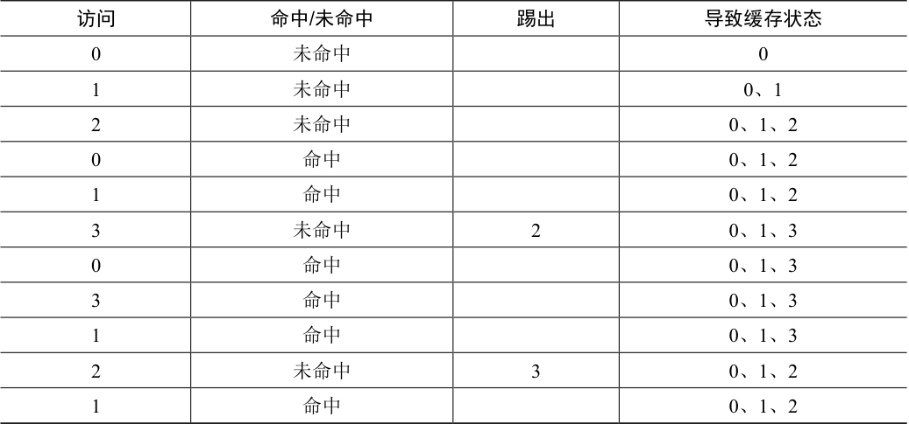

# 22.2 最优替换策略

为了更好地理解一个特定的替换策略是如何工作的，将它与最好的替换策略进行比较是很好的方法。事实证明，这样一个最优（optimal）策略是Belady 多年前开发的[B66]（原来这个策略叫作MIN）。最优替换策略能达到总体未命中数量最少。Belady 展示了一个简单的方法（但遗憾的是，很难实现！），即替换内存中在最远将来才会被访问到的页，可以达到缓存未命中率最低。

> **提示：与最优策略对比非常有用**

> 虽然最优策略非常不切实际，但作为仿真或其他研究的比较者还是非常有用的。比如，单说你喜欢的新算法有80%的命中率是没有意义的，但加上最优算法只有82%的命中率（因此你的新方法非常接近最优），就会使得结果很有意义，并给出了它的上下文。因此，在你进行的任何研究中，知道最优策略可以方便进行对比，知道你的策略有多大的改进空间，也用于决定当策略已经非常接近最优策略时，停止做无谓的优化[AD03]。

希望最优策略背后的想法你能理解。这样想：如果你不得不踢出一些页，为什么不踢出在最远将来才会访问的页呢？这样做基本上是说，缓存中所有其他页都比这个页重要。道理很简单：在引用最远将来会访问的页之前，你肯定会引用其他页。

我们追踪一个简单的例子，来理解最优策略的决定。假设一个程序按照以下顺序访问虚拟页：0，1，2，0，1，3，0，3，1，2，1。表22.1 展示了最优的策略，这里假设缓存可以存3 个页。

在表22.1 中，可以看到以下操作。不要惊讶，前3 个访问是未命中，因为缓存开始是空的。这种未命中有时也称作冷启动未命中（cold-start miss，或强制未命中，compulsory miss）。然后我们再次引用页0 和1，它们都在缓存中。最后，我们又有一个缓存未命中（页3），但这时缓存已满，必须进行替换！这引出了一个问题：我们应该替换哪个页？使用最优策略，我们检查当前缓存中每个页（0、1 和2）未来访问情况，可以看到页0 马上被访问，页1 稍后被访问，页2 在最远的将来被访问。因此，最优策略的选择很简单：踢出页面2，结果是缓存中的页面是0、1 和3。接下来的3 个引用是命中的，然后又访问到被我们之前踢出的页2，那么又有一个未命中。这里，最优策略再次检查缓存页（0、1 和3）中每个页面的未来被访问情况，并且看到只要不踢出页1（即将被访问）就可以。这个例子显示了页3 被踢出，虽然踢出0 也是可以的。最后，我们命中页1，追踪完成。

表格文字

| 访问 | 命中/未命中 | 踢出 | 导致缓存状态 |
| --- | --- | --- | --- |
| 0 | 未命中 |  | 0 |
| 1 | 未命中 |  | 0、1 |
| 2 | 未命中 |  | 0、1、2 |
| 0 | 命中 |  | 0、1、2 |
| 1 | 命中 |  | 0、1、2 |
| 3 | 未命中 | 2 | 0、1、3 |
| 0 | 命中 |  | 0、1、3 |
| 3 | 命中 |  | 0、1、3 |
| 1 | 命中 |  | 0、1、3 |
| 2 | 未命中 | 3 | 0、1、2 |
| 1 | 命中 |  | 0、1、2 |

> **补充：缓存未命中的类型**

> 在计算机体系结构世界中，架构师有时会将未命中分为3 类：强制性、容量和冲突未命中，有时称为3C [H87]。发生强制性（compulsory miss）未命中（或冷启动未命中，cold-start miss [EF78]）是因为缓存开始是空的，而这是对项目的第一次引用。与此不同，由于缓存的空间不足而不得不踢出一个项目以将新项目引入缓存，就发生了容量未命中（capacity miss）。第三种类型的未命中（冲突未命中，conflict miss）出现在硬件中，因为硬件缓存中对项的放置位置有限制，这是由于所谓的集合关联性（set-associativity）。它不会出现在操作系统页面缓存中，因为这样的缓存总是完全关联的（fully-associative），即对页面可以放置的内存位置没有限制。详情请见H＆P [HP06]。

我们同时计算缓存命中率：有 6 次命中和 5 次未命中，那么缓存命中率 Hits / (Hits + Misses) 是 6 / (6 + 5)，或 54.5%。也可以计算命中率中除去强制未命中（即忽略页的第一次未命中），那么命中率为 81.8%。

遗憾的是，正如我们之前在开发调度策略时所看到的那样，未来的访问是无法知道的，你无法为通用操作系统实现最优策略[^p193-1]。因此，在开发一个真正的、可实现的策略时，我们将聚焦于寻找其他决定把哪个页面踢出的方法。因此，最优策略只能作为比较，知道我们的策略有多接近“完美”。

[^p193-1]: 如果你可以，请告诉我们，我们可以一起发我，或者，像“发现”冷聚变的科学家一样，被众人所讽刺和嘲笑[FP89]。
