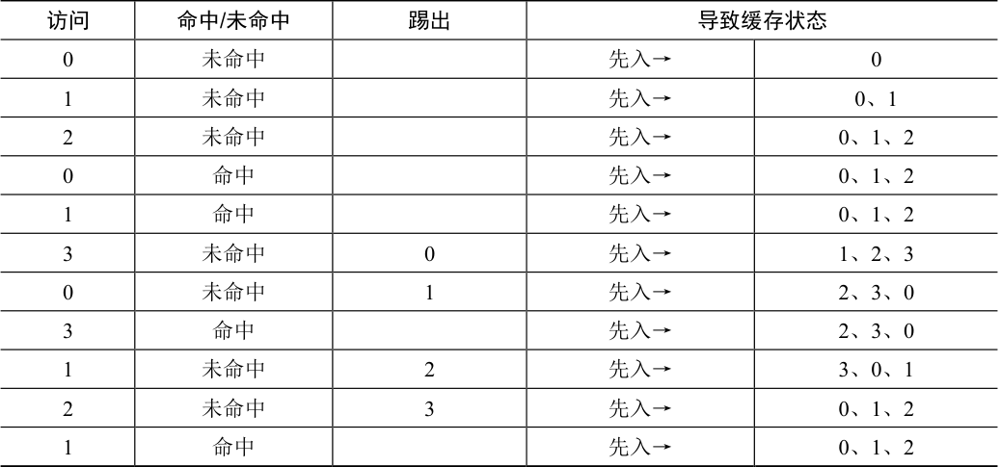

# 22.3 简单策略：FIFO

许多早期的系统避免了尝试达到最优的复杂性，采用了非常简单的替换策略。例如，一些系统使用FIFO（先入先出）替换策略。页在进入系统时，简单地放入一个队列。当发生替换时，队列尾部的页（“先入”页）被踢出。FIFO 有一个很大的优势：实现相当简单。

让我们来看看FIFO 策略如何执行这过程（见表22.2）。我们再次开始追踪3 个页面0、1和2。首先是强制性未命中，然后命中页0 和1。接下来，引用页3，缓存未命中。使用FIFO策略决定替换哪个页面是很容易的：选择第一个进入的页，这里是页0（表中的缓存状态列是按照先进先出顺序，最左侧是第一个进来的页），遗憾的是，我们的下一个访问还是页0，导致另一次未命中和替换（替换页1）。然后我们命中页3，但是未命中页1 和2，最后命中页3。

表格文字

| 访问 | 命中/未命中 | 踢出 | 导致缓存状态 |  |
| --- | --- | --- | --- | --- |
| 0 | 未命中 |  | 先入→ | 0 |
| 1 | 未命中 |  | 先入→ | 0、1 |
| 2 | 未命中 |  | 先入→ | 0、1、2 |
| 0 | 命中 |  | 先入→ | 0、1、2 |
| 1 | 命中 |  | 先入→ | 0、1、2 |
| 3 | 未命中 | 0 | 先入→ | 1、2、3 |
| 0 | 未命中 | 1 | 先入→ | 2、3、0 |
| 3 | 命中 |  | 先入→ | 2、3、0 |
| 1 | 未命中 | 2 | 先入→ | 3、0、1 |
| 2 | 未命中 | 3 | 先入→ | 0、1、2 |
| 1 | 命中 |  | 先入→ | 0、1、2 |

对比FIFO 和最优策略，FIFO 明显不如最优策略，FIFO 命中率只有36.4%（不包括强制性未命中为57.1%）。先进先出（FIFO）根本无法确定页的重要性：即使页0 已被多次访问，FIFO 仍然会将其踢出，因为它是第一个进入内存的。

> **补充：Belady 的异常**

> Belady（最优策略发明者）及其同事发现了一个有意思的引用序列[BNS69]。内存引用顺序是：1，2，3，4，1，2，5，1，2，3，4，5。他们正在研究的替换策略是FIFO。有趣的问题：当缓存大小从3 变成4 时，缓存命中率如何变化？

> 一般来说，当缓存变大时，缓存命中率是会提高的（变好）。但在这个例子，采用FIFO，命中率反而下降了！你可以自己计算一下缓存命中和未命中次数。这种奇怪的现象被称为Belady 的异常（Belady’s Anomaly）。

> 其他一些策略，比如LRU，不会遇到这个问题。可以猜猜为什么？事实证明，LRU 具有所谓的栈特性（stack property）[M+70]。对于具有这个性质的算法，大小为N + 1 的缓存自然包括大小为N 的缓存的内容。因此，当增加缓存大小时，缓存命中率至少保证不变，有可能提高。先进先出（FIFO）和随机（Random）等显然没有栈特性，因此容易出现异常行为。
